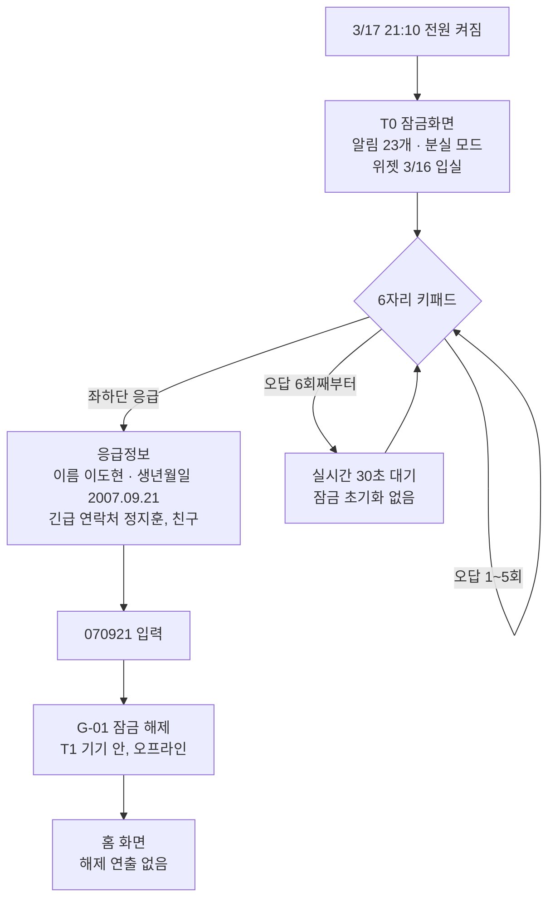
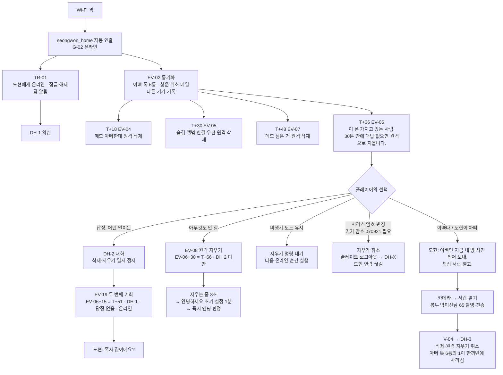
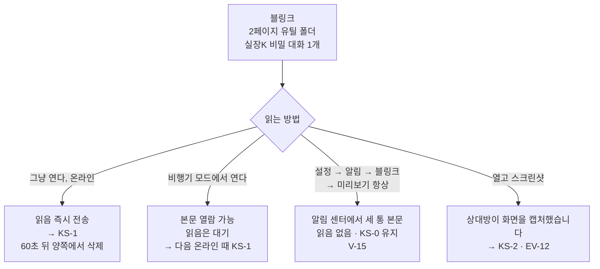
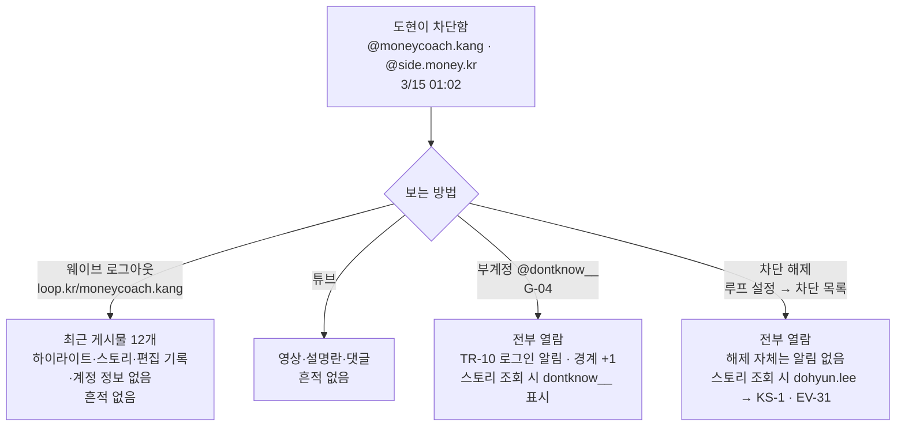
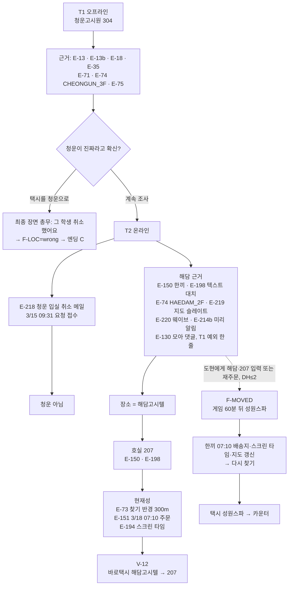
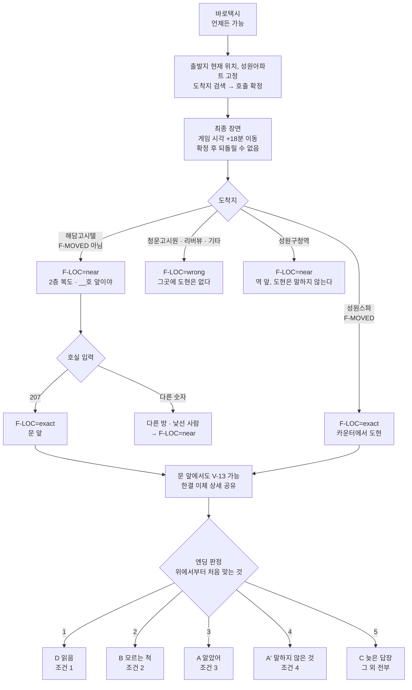
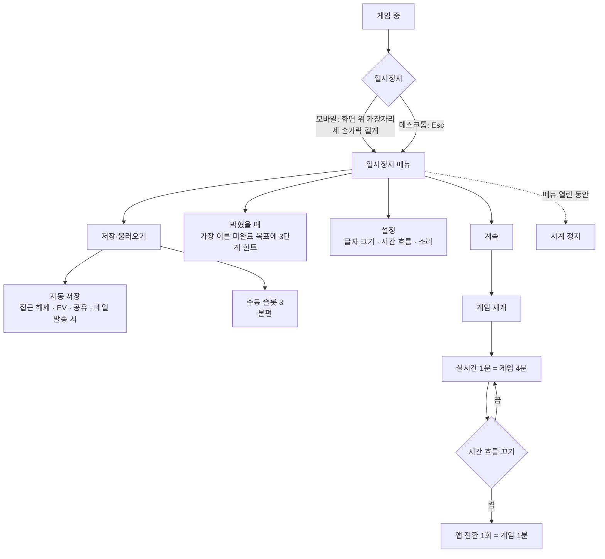

# USER FLOWS — DONTKNOW

> **역할:** 잠금 해제·메모 암호·"30분" 위기·블링크 열람·차단 계정 열람·위치 추적·최종 행동·일시정지/저장의 분기와 조건을 도식으로 고정한다.
> **단일 출처:** 흐름의 숫자·조건. 잠금·게이트는 [`PROGRESSION_AND_ENDINGS.md`](PROGRESSION_AND_ENDINGS.md), 위기 해법은 [`BUSINESS_RULES.md`](BUSINESS_RULES.md), 블링크·차단 열람은 [[FEATURE_SPECIFICATION](FEATURE_SPECIFICATION.md)](FEATURE_SPECIFICATION.md) 5절·[[SNS_SPECIFICATION](../03-features/SNS_SPECIFICATION.md)](../03-features/SNS_SPECIFICATION.md) 4절, 위치는 [`LOCATIONS.md`](LOCATIONS.md)·[[LOCATIONS](LOCATIONS.md)](LOCATIONS.md), 엔딩은 [`PROGRESSION_AND_ENDINGS.md`](PROGRESSION_AND_ENDINGS.md) 6.4가 단일 출처다.
> **참조:** [`USER_JOURNEYS.md`](USER_JOURNEYS.md), [`ACTION_PROOF.md`](ACTION_PROOF.md), [`EVIDENCE_LEDGER.md`](EVIDENCE_LEDGER.md), [`PLAYTIME_BUDGET.md`](PLAYTIME_BUDGET.md).

## 1. 잠금 해제 — 응급정보 → 070921

- 응급정보에는 **아빠가 없다**. 긴급 연락처는 지훈이다. 배경화면은 아버지가 있는 가족사진(E-30)이다. 설명하지 않는다.
- 잠금 해제 기록은 남지만, 아직 오프라인이라 아무도 모른다.

## 2. 메모 암호 — 680403 두 경로

```mermaid
flowchart TD
    A[T1 · 메모 앱] --> B[잠긴 메모 2개<br/>비번 · 아빠한테]
    B --> C[암호 힌트: 아빠]
    C --> D1[경로 A<br/>연락처 → 아빠 카드<br/>생일 1968년 4월 3일]
    C --> D2[경로 B<br/>캘린더 → 4/3<br/>아빠 생일 58번째]
    D1 --> E[680403 입력]
    D2 --> E
    E --> F[G-06 잠긴 메모 열림]
    F --> G[아빠한테<br/>3/13 23:50 미발송 편지]
    F --> H[비번<br/>누리: 엄마+내 생일 끝자리<br/>루프 부: 메일로]
    B -->|오답 5회| I[힌트 재표시<br/>잠기지 않음]
    I --> B
```

- 680403은 **메모 암호**다. 기기 비밀번호 070921과 별개다.
- 두 출처(연락처 E-210 / 생일 캘린더 E-211) 중 하나만 봐도 열린다(P4).
- 비번 메모의 규칙은 은행 110221(V-03)과 부계정(G-04)의 근거다.

## 3. 첫 온라인과 "30분" 위기 — 해법 다섯

- **게임 30분 = 실시간 7분 30초(×4).** 화면에 타이머는 없다. 수신 시각과 상태바 시계로 계산한다.
- 오프라인이면 EV-04/05/07/08은 도현 쪽에서 정해진 시각에 일어나고, 다음 온라인 순간 몰아서 적용된다.
- 원격 지우기는 사실상 이른 엔딩이다. 경고(EV-06)는 반드시 오고, 해법이 다섯 가지다.
- "왜 방 사진인가": 폰을 주운 사람이나 실장은 도현의 방에 있을 수 없다. 서랍 속 봉투는 도현과 그 방에 있는 사람만 안다.

## 4. 블링크를 읽는 네 방법

- 미열람 3통: 3/14 18:40 "오늘 8시 사무실. 안 오면 니 아빠 회사로 간다" / 3/14 21:30 "녹음했다고? 폰 내놔" / 3/16 21:00 "수요일 정오까지 돈 안 가져오면 니 아빠 회사 간다. 한빛물류 맞지?"
- 과거 대화(1/9~3/10)는 없다. 도현의 3/10 캡처 1장만 사진첩에 있다(E-36).
- 실장에게 답장하거나 위치 관련 낱말·단서를 보내면 위치 유출(F-LEAK) 위험이 있다.

## 5. 차단된 실장을 보는 네 방법

- 편집 기록(E-103)과 하이라이트(E-102)는 부계정이나 차단 해제로만 보인다. 둘 다 필수는 아니다(P4: E-101·E-120으로 대체).
- 실장의 게임 중 스토리(E-223, 23:30)를 dohyun.lee로 보는 것은 "죽은 폰이 살아났다"고 실장에게 알리는 일이다.

## 6. 위치 추적 — 청운 미끼 → 해담 207

- **오프라인 출처는 모두 2월의 계획(청운)을 가리킨다.** 진짜 위치의 근거는 T2(온라인)에만 있다.
- 찾기 반경 300m 안에 청운·해담·성원스파가 모두 들어간다. 반경만으로는 셋 중 어디인지 모른다.
- 해담 이름의 T1 예외는 모아 2월 댓글 한 줄(E-130)뿐이다. 그것만으로는 장소를 특정할 수 없다.
- 청운 취소 메일은 온라인 후 받은편지함 맨 위(새 메일)로 온다. 오프라인 플레이어에게는 의도된 결과다.

## 7. 최종 행동 — 바로택시 → 207 입력 → 엔딩 판정 순서

**판정 조건([PROGRESSION_AND_ENDINGS](PROGRESSION_AND_ENDINGS.md) 6.4, 위에서부터 처음 맞는 것):**
1. **D 읽음:** `F-WIPE-SLATE` **또는** (`F-LEAK` ∧ ¬(`F-GO` ∧ `F-LOC=exact`)) **또는** (`F-WIPED` ∧ `F-REC=lost` ∧ `F-LOC ≠ exact`).
2. **B 모르는 척:** `F-MAIL=deleted` ∧ ¬(`F-REC-SENT` ∨ `F-NAME-SENT`).
3. **A 알았어:** `F-GO` ∧ `F-LOC=exact` ∧ **위협 해소** ∧ `F-CONFESS`.
4. **A′ 말하지 않은 것:** `F-GO` ∧ `F-LOC=exact` ∧ **위협 해소** ∧ ¬`F-CONFESS`.
5. **C 늦은 답장:** 그 외 전부.

- **위협 해소** = F-REC-SENT ∨ F-NAME-SENT ∨ F-PLATE-SENT ∨ F-REC=synced.
- 엔딩 판정은 택시 호출 직후뿐 아니라 **원격 지우기(EV-08)**, **3/18 09:00 예약 메일 발송(EV-21)**, **플레이어가 슬레이트를 지움(F-WIPE-SLATE)** 에서도 일어난다.
- 청운·리버뷰로 가면 도현이 없다. 성원구청역은 near다. F-MOVED면 해담 대신 성원스파의 "카운터"가 호실 입력을 대신한다.
- 문 앞에서 도현은 묻는다: "그 사람… 경찰이 알아?" 경찰에 증거·이름·번호판이 이미 갔거나 녹음이 살아서 슬레이트에도 올라왔다는 걸 도현이 알면 문이 열린다. 아니면 "아빠 먼저 가. 9시에 나 혼자 갈게" → C.
- 문이 열린 뒤 갈림: 빚을 말했으면 A, 말하지 않았으면 A′.

## 8. 일시정지와 저장

- 시계는 일시정지 메뉴와 시네마틱에서만 정지한다. 탭이 백그라운드면 `visibilitychange`로 정지한다.
- "막혔을 때"는 10개 목표 중 가장 이른 미완료 목표에 ① 방향 ② 앱 ③ 위치를 준다. 화면에 목표 목록을 상시 표시하지 않는다.
- 수동 슬롯 3은 본편 포함이다. MVP는 자동 저장만.

## 확인 사항

- **Q-OPEN-20:** "위치 추적" 흐름에서 F-MOVED의 성원스파 이동은 DH≤2에서 해담·207·성원구청로 31을 입력하거나 EV-27(재주문)이 일어날 때다. 두 조건의 우선순위·동시 발생 시 처리는 [PROGRESSION_AND_ENDINGS](PROGRESSION_AND_ENDINGS.md) 4.1에 명시되지 않았다. 구현 시 이벤트 순서를 확정해야 한다.
- **Q-OPEN-21:** 일시정지 메뉴의 "설정(소리)"은 MVP에서 소리 자체가 제외되어 있다. MVP에서는 항목을 숨기거나 비활성으로 둔다. P0에서 확정한다.
- **Q-OPEN-22:** 엔딩 판정 도식의 논리식은 [PROGRESSION_AND_ENDINGS](PROGRESSION_AND_ENDINGS.md) 6.4를 그대로 옮겼다. 연산자 우선순위(∧·∨·¬)는 문서 표기를 따랐으며, 구현 시 명시적 괄호로 고정한다.
