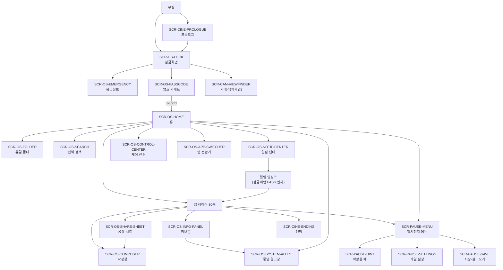
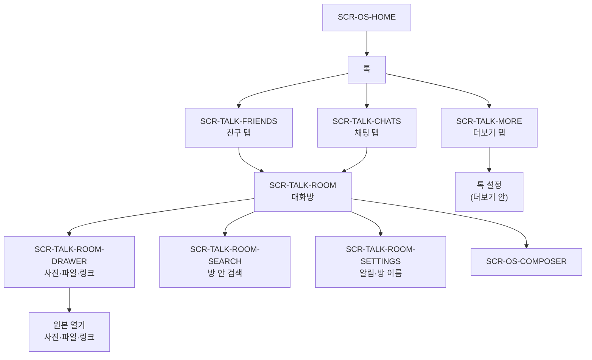
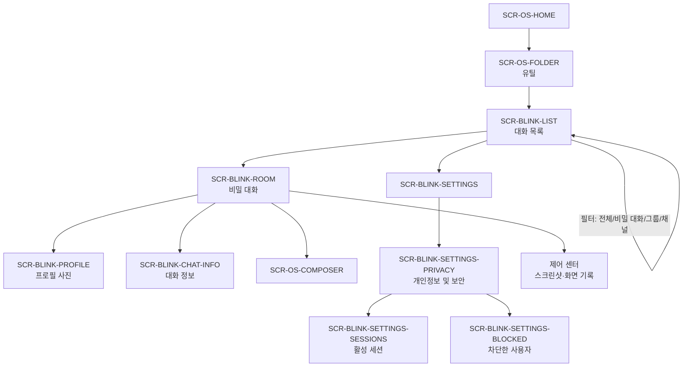
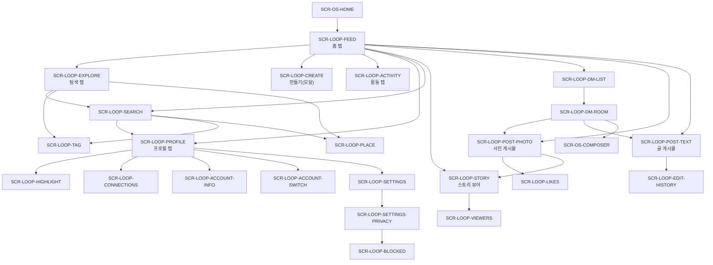
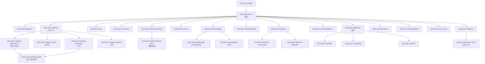

# NAVIGATION_ARCHITECTURE — 내비게이션 구조와 화면 목록

> **역할:** LUMA OS의 셸 레이어와 앱 레이어가 어떻게 겹치고 이동하는지 정의하고, **화면 `SCR-` 목록의 단일 출처**가 된다. 03-features 문서가 제안한 모든 `SCR-`를 모아 중복·충돌·명명 불일치를 정리하고 최종 확정한다.
> **단일 출처:** 이 문서 = 화면 ID(`SCR-`), 표시 방식(push/modal/sheet/overlay/tab-root), 부모 화면, 진입 경로, 상세 레이아웃 우선순위(P0/P1), 셸·앱 레이어 규칙, 뒤로 가기 규칙, 앱 상태 보존, 딥링크 규칙. 레이아웃 수치는 [SCREEN_SPECIFICATIONS.md](./SCREEN_SPECIFICATIONS.md), 컴포넌트는 [COMPONENT_SPECIFICATIONS.md](./COMPONENT_SPECIFICATIONS.md), 마이크로 인터랙션은 [INTERACTION_SPECIFICATIONS.md](./INTERACTION_SPECIFICATIONS.md)가 단일 출처다.
> **참조:** [DESIGN_TOKENS.md](./DESIGN_TOKENS.md) · [DESIGN_SYSTEM.md](./DESIGN_SYSTEM.md) · [UI_UX_GUIDELINES.md](./UI_UX_GUIDELINES.md) · [RESPONSIVE_DESIGN.md](./RESPONSIVE_DESIGN.md) · [ACCESSIBILITY.md](./ACCESSIBILITY.md) · [ICONOGRAPHY_AND_IMAGERY.md](./ICONOGRAPHY_AND_IMAGERY.md) · [BUSINESS_RULES.md](../01-product/BUSINESS_RULES.md) · [TRACES_AND_REACTIONS.md](../01-product/TRACES_AND_REACTIONS.md) · 03-features 문서 전체.
> **근거:** 공통 지시서 3.3(ID 규칙)·3.4(앱 레퍼런스 결정), `../03-features/*`의 ⑥ 화면 목록. 충돌 시 이 문서의 `SCR-` 확정이 03-features의 "제안"보다 우선한다. 03-features 파일은 수정하지 않고, 정정 내역을 4절에 모아 총괄이 반영한다.

## 0. 범위와 용어

| 항목 | 정의 |
|---|---|
| **셸 레이어** | LUMA OS 자체. 잠금화면, 홈, 알림 센터, 제어 센터, 전역 검색, 앱 전환기, 공유 시트, 정보(i), 작성창, 시스템 경고창, 일시정지 메뉴, 시네마틱. |
| **앱 레이어** | 앱 30종. 앱마다 **탭 바 또는 단일 스택** 하나를 갖고, 그 위에 푸시·모달·시트를 쌓는다. |
| **push** | 오른쪽에서 밀려 들어오는 스택 화면. 이전 화면을 유지한다. |
| **modal** | 아래에서 전체 화면으로 올라와 현재 맥락을 덮는 작업 화면. 취소/완료가 명확하다. |
| **sheet** | 아래에서 올라오는 높이 단계형 카드. 현재 화면을 유지하고 배경을 `op-scrim` 0.48로 어둡게 한다. |
| **overlay** | 셸이 앱을 덮는 전체 화면 또는 시스템 층. 배경 상호작용을 막는다. |
| **tab-root** | 앱의 하단 탭이 직접 여는 최상위 화면. 탭마다 스크롤·스택을 기억한다. |
| **P0** | 상세 레이아웃을 SCREEN_SPECIFICATIONS에서 최고 밀도로 먼저 확정하는 화면. |
| **P1** | P0 다음에 상세화하는 화면. 구조·ID·부모·진입 경로는 이 문서에서 확정한다. |

- 화면 ID는 `SCR-<영역>-<이름>`이다. 영역 코드는 공통 지시서 3.3을 따른다(OS, PAUSE, PHONE, MSG, TALK, LOOP, BLINK, MAIL, PHOTO, CAM, MAP, FIND, CONT, CAL, NOTE, REM, VOICE, CLOCK, WTHR, HEALTH, WALLET, BANK, TAXI, FILE, WAVE, TUBE, MOA, HANKKI, MARKET, PORTAL, CALC, SET, CINE).
- 앱 루트를 홈에서 여는 것은 **push**로 표기한다(스택 루트). 단, 하단 탭이 직접 여는 화면은 **tab-root**다.
- `overlay`는 z-index 층으로 구분한다. 같은 overlay라도 z가 다르면 아래 표기(Z)를 함께 적는다.
- 한 화면의 제목(`h1`)은 하나다. 두 제목이 필요하면 상세 화면으로 푸시한다([DESIGN_SYSTEM.md](./DESIGN_SYSTEM.md) 3.2).

## 1. 내비게이션 모델

### 1.1 두 레이어

| 레이어 | 구성 | 화면 | z-index | 재질 | 뒤로 가기 |
|---|---|---|---|---|---|
| **기기 크롬** | 상태바, 홈 인디케이터 | (화면 아님) | `--lm-z-nav` 10 | `material-thin` | — |
| **셸 루트** | 잠금화면, 홈, 전역 검색 | `SCR-OS-LOCK`, `SCR-OS-HOME`, `SCR-OS-SEARCH` | `--lm-z-app` 0 | 불투명 `bg` | 잠금: 없음 / 홈: 없음 / 검색: 홈 |
| **셸 모달** | 암호 키패드, 응급정보 | `SCR-OS-PASSCODE`, `SCR-OS-EMERGENCY` | `--lm-z-sheet` 70 | `bg-elevated` 또는 `material-thick` | 닫기 = 이전 셸 화면 |
| **홈 내부 오버레이** | 유틸 폴더 | `SCR-OS-FOLDER` | `--lm-z-app` 0(홈 콘텐츠 위, 내비 없음) | `material-regular` | 닫기 = 홈 |
| **앱 레이어** | 앱 30종의 탭·스택 | 앱별 루트·상세 | 콘텐츠 0 / 내비 10 / 탭 20 | `bg` | 앱 스택 뒤로 → 앱 루트에서 홈 |
| **알림 배너·토스트** | 배너, 토스트 | (화면 아님) | `--lm-z-banner` 60 | `material-regular` | 위로 밀어 닫기 |
| **시트 층** | 공유, 정보(i), 액션 시트, 서랍, 필터 | `SCR-OS-SHARE-SHEET`, `SCR-OS-INFO-PANEL`, 앱별 sheet | `--lm-z-sheet` 70 | `material-thick` | 바깥 탭·아래로 끌기·뒤로 |
| **센터 층** | 알림 센터, 제어 센터, 앱 전환기 | `SCR-OS-NOTIF-CENTER`, `SCR-OS-CONTROL-CENTER`, `SCR-OS-APP-SWITCHER` | `--lm-z-center` 80 | `material-thick` | 아래로 끌기·바깥 탭·뒤로 |
| **경고층** | 시스템 경고창 | `SCR-OS-SYSTEM-ALERT` | `--lm-z-alert` 90 | `bg-elevated` + `elev-3`(라이트) | 취소·Esc만 |
| **게임 층** | 일시정지 메뉴 | `SCR-PAUSE-MENU` | `--lm-z-pause` 100 | `material-thick` | 계속·Esc |
| **시네마틱** | 프롤로그·엔딩 | `SCR-CINE-PROLOGUE`, `SCR-CINE-ENDING` | `--lm-z-pause` 100 | 불투명 `bg` | 첫 재생에는 없음 |

- z 순서는 [DESIGN_TOKENS.md](./DESIGN_TOKENS.md) 7절 그대로다. 새 층을 만들지 않는다.
- **한 번에 하나의 모달·시트.** 모달 위에 모달을 쌓지 않고, 시트 위에 시트를 쌓지 않는다. 필요하면 기존 것을 닫고 연다([UI_UX_GUIDELINES.md](./UI_UX_GUIDELINES.md) 1.2).
- 센터 층은 앱 레이어와 앱 위의 시트를 모두 덮는다. 경고창은 센터 위에 뜬다. 일시정지 메뉴는 모든 것 위에 뜨며, 열려 있는 동안 아래 층의 입력을 받지 않는다.
- 알림 배너는 앱 내비·탭 위에 뜨지만 시트·센터·경고창·일시정지 아래에 있다. 시트가 열려 있으면 배너 대신 알림 센터에만 쌓는다.
- 시네마틱은 셸 상태바와 홈 인디케이터를 숨긴다. 일시정지 메뉴만 예외로 열 수 있다([SYSTEM_SHELL_SPECIFICATION.md](../03-features/SYSTEM_SHELL_SPECIFICATION.md) 4.11).

### 1.2 앱 레이어 유형

| 유형 | 앱 | 최상위 | 하위 깊이 | 비고 |
|---|---|---|---|---|
| **하단 탭 5** | 루프 | 홈 / 탐색 / 만들기(+) / 활동 / 프로필 | 3 | 만들기는 탭이 아니라 모달. DM은 홈 우상단. |
| **하단 탭 3** | 톡 | 친구 / 채팅 / 더보기 | 3 | 대화방은 푸시. |
| **하단 탭 2** | 전화 | 최근 기록 / 키패드 | 2 | 연락처는 별도 앱. |
| **단일 스택 + 상단 세그먼트** | 블링크, 사진, 지갑, 웨이브, 튜브, 모아 | 루트 1개 | 3 | 블링크 필터·사진 앨범 전환·지갑 교통/결제·웨이브 탭/기록·튜브 홈/기록·모아 게시판. |
| **단일 스택 + 인라인 폴더** | 메일 | 받은편지함 | 3 | 폴더는 목록 상단 접이식 구역. 계정 전환은 시트. |
| **단일 스택** | 설정, 지도, 바로택시, 날씨, 누리은행, 한끼, 이웃마켓, 캘린더, 메모, 미리 알림, 시계, 건강, 계산기, 한서 포털, 음성 메모, 파일, 연락처, 메시지 | 루트 1개 | 3 | 설정은 검색 + 그룹 목록. |
| **전체 화면 도구** | 카메라, 사진 뷰어 | 뷰파인더/뷰어 | 2 | 카메라는 잠금화면에서도 열린다. |
| **셸 전용** | 없음 | — | — | 앱 아이콘이 없는 OS 기능은 셸 레이어에 둔다. |

- 앱의 **깊이 3단계 이하**를 지킨다. 앱 루트(1) → 중간 목록(2) → 상세(3). 4단계가 필요하면 구조를 다시 짠다. 예외는 설정의 "루트 → 일반 → 근처 공유"처럼 그룹 화면을 세는 3단계이며, 4단계가 되면 시트로 푼다.
- 하단 탭이 없는 앱은 탭 바 대신 큰 제목과 뒤로 버튼을 쓴다.
- 앱 안에서 다른 앱으로 이동하는 것은 **공유 시트** 또는 **딥링크**뿐이다. 앱 스택을 가로질러 푸시하지 않는다.

### 1.3 뒤로 가기 규칙

| 입력 | 동작 | 임계·조건 |
|---|---|---|
| **왼쪽 가장자리 밀기** | 앱 스택 뒤로 1단계. 앱 루트에서는 홈. | 시작 가장자리 **20px** 이내. 가로 이동이 세로 이동보다 크고, 화면 폭의 **35%** 이상 또는 왼쪽 속도 500px/s 이상이면 실행. 미달이면 240ms `ease-standard`로 복귀. |
| **내비 바 뒤로 버튼** | 같은 뒤로 1단계. | 항상 존재. 터치 44×44. |
| **브라우저·하드웨어 뒤로** | 앱 스택 뒤로와 동일하게 매핑한다. 앱 루트에서는 홈으로 가고, 브라우저 기록을 앱 밖으로 넘기지 않는다. | 웹 게임에서 페이지 이탈을 만들지 않는다. |
| **홈 인디케이터 위로** | 앱 레이어를 닫고 홈. | 위로 밀어 멈추면 앱 전환기. |
| **Esc** | 최상위 오버레이를 닫는다. 오버레이가 없으면 앱 스택 뒤로, 앱 루트면 홈. 일시정지 메뉴가 열려 있으면 일시정지 메뉴를 닫는다. | [ACCESSIBILITY.md](./ACCESSIBILITY.md) 5.1과 일치. |
| **시트·모달 뒤로** | 최상위 시트·모달을 닫는다. 작성 중 내용이 있으면 "작성 중인 내용이 있습니다" 확인을 1회 띄운다. 빈 작성창은 확인 없이 닫는다. | [UI_UX_GUIDELINES.md](./UI_UX_GUIDELINES.md) 1.2-9. |
| **경고창 뒤로·Esc** | 취소와 같다. 바깥 탭으로 닫히지 않는다. | [UI_UX_GUIDELINES.md](./UI_UX_GUIDELINES.md) 4.1. |
| **잠금화면 뒤로** | 아무 일도 하지 않는다. 암호 키패드·응급정보가 열려 있으면 그것만 닫는다. | T0에서 홈으로 나갈 수 없다. |
| **시네마틱 뒤로** | 첫 재생에는 무시. 다시 보기에서는 이전 컷. | 건너뛰기는 다시 보기에서만. |

- 뒤로 가기는 **스크롤 위치·선택·필터를 복원**한다. 목록으로 돌아오면 이전 위치로 돌아간다.
- 같은 탭을 다시 누르면 그 탭의 스크롤을 맨 위로 올린다. 두 번째 재탭은 아무 일도 하지 않는다.
- 시트는 위쪽 그랩 영역과 바깥 scrim 탭으로도 닫는다. 중앙 경고창은 원격 지우기·암호 변경 확인 두 곳만 쓰고, 그 외 확인이 필요한 파괴적 동작은 확인 시트 1회를 쓴다.
- 햄버거 메뉴·드롭다운을 쓰지 않는다. 최상위는 탭, 하위는 목록, 맥락 동작은 시트다.

### 1.4 앱 상태 보존

| 상태 | 보존 범위 | 복원 시점 |
|---|---|---|
| **화면 스택** | 앱별로 마지막 화면까지의 스택. 탭마다 독립 스택을 유지한다. | 앱 재진입·앱 전환기 카드 탭·딥링크 복귀. |
| **스크롤 위치** | 화면별 세로 스크롤. 목록 필터·정렬·검색어도 함께 유지한다. | 뒤로 가기, 앱 재진입. |
| **탭 선택** | 앱별 마지막 탭. | 앱 재진입. |
| **작성 중 초안** | 작성창·메일·메모·게시물 작성의 입력값·첨부·수신자. 앱을 닫아도 사라지지 않는다. | 해당 작성 화면 재진입. |
| **미디어 위치** | 음성 메모·튜브의 재생 위치. 앱을 떠나면 재생은 일시정지하고 위치만 유지한다. | 재생 화면 재진입. |
| **필터·세그먼트** | 블링크 필터, 루프 홈 세그먼트, 사진 앨범, 지갑 교통/결제, 웨이브 라이브러리 탭. | 앱 재진입. |
| **앱 전환기 썸네일** | 최근 순서의 열린 앱 카드. 썸네일은 마지막 화면 스냅샷. | 앱 전환기 열기. |
| **민감 화면** | 블링크 카드·잠금 상태 카드의 썸네일은 흐리고 앱 이름만 표시한다. | 앱 전환기 열기. |

- 앱을 닫아도 계정 로그아웃·이벤트 중단은 없다. 알림은 계속 도착한다([SYSTEM_SHELL_SPECIFICATION.md](../03-features/SYSTEM_SHELL_SPECIFICATION.md) 4.7).
- "모두 닫기"는 없다.
- 실시간 사건이 보고 있는 목록을 바꿀 때는 해당 행만 갱신하고 스크롤 위치를 유지한다.
- 게임 저장(localStorage)에는 **마지막 화면과 스택**을 저장하지 않는다. 저장·불러오기는 시각·플래그·알림·열람 기록만 복원하고, 불러온 뒤에는 홈에서 시작한다(화면 상태는 세션 메모리).

### 1.5 딥링크

딥링크는 "어디서 왔든 정확한 화면과 항목으로 간다"는 규칙이다. 모든 딥링크는 **잠금·게이트·온라인 조건을 우회하지 않는다.**

| 소스 | 목적 화면(`SCR-`) | 항목 파라미터 | 잠금·조건 처리 |
|---|---|---|---|
| 알림: 톡 새 메시지 | `SCR-TALK-ROOM` | `roomId`, `messageId` | 잠금이면 `SCR-OS-PASSCODE` 먼저. 오프라인이면 캐시된 방. 읽음은 방을 연 뒤에만 전송. |
| 알림: 메시지(시러스) | `SCR-MSG-ROOM` | `threadId`, `messageId` | 잠금이면 키패드 먼저. 오프라인이면 캐시. |
| 알림: 블링크 | `SCR-BLINK-ROOM` | `conversationId`, `messageId` | 잠금이면 키패드 먼저. **G-05 전에는 앱을 열지 않고 홈으로 간다**(숨겨진 앱 게이트를 우회하지 않는다). G-05 후에는 방을 열고 읽음·60초 타이머를 시작한다(미리보기로 읽은 경우와 구분). |
| 알림: 루프 DM | `SCR-LOOP-DM-ROOM` | `threadId`, `messageId` | 잠금이면 키패드 먼저. 오프라인이면 캐시. |
| 알림: 루프 활동 | `SCR-LOOP-ACTIVITY` | `activityId` | 잠금이면 키패드 먼저. 오프라인이면 캐시. |
| 알림: 메일 | `SCR-MAIL-DETAIL` | `mailId` | 잠금이면 키패드 먼저. 오프라인이면 캐시된 메일만. 원본이 삭제됐으면 알림 기록만 남고 화면은 목록의 삭제 상태로 간다. |
| 알림: 은행 | `SCR-BANK-LOGIN` → 성공 후 `SCR-BANK-TRANSACTIONS` | `txId` | 온라인 + `G-03` 필요. 잠금이면 키패드. 은행 잠금이면 간편비밀번호. |
| 알림: 보안(시러스) | `SCR-SET-CIRRUS-SECURITY` 또는 `SCR-SET-CIRRUS-SYNC` | `rowKey` | 알림 종류에 따라 보안/동기화 화면. 읽기 전용. |
| 알림: 시스템(분실 정지 등) | `SCR-MSG-LIST` | `threadId` | 캐시된 시스템 문자. |
| 검색 결과: 연락처 | `SCR-CONT-DETAIL` | `contactId` | 로컬. 항상 열린다. |
| 검색 결과: 톡 메시지 | `SCR-TALK-ROOM` | `roomId`, `messageId` | 해당 메시지로 스크롤하고 1회 하이라이트. 잠금이면 키패드 먼저. |
| 검색 결과: 메시지 | `SCR-MSG-ROOM` | `threadId`, `messageId` | 같음. |
| 검색 결과: 메일 | `SCR-MAIL-DETAIL` | `mailId` | 캐시·온라인 구분. |
| 검색 결과: 메모 | `SCR-NOTE-EDIT` | `noteId` | 메모 암호(680403)가 걸린 메모면 `SCR-NOTE-LOCKED` 시트 먼저. |
| 검색 결과: 미리 알림 | `SCR-REM-LIST` | `listId`, `itemId` | 해당 항목으로 스크롤. |
| 검색 결과: 캘린더 | `SCR-CAL-EVENT` | `eventId` | 일정 시트. 배경은 `SCR-CAL-DAY`. |
| 검색 결과: 파일 | `SCR-FILE-DETAIL` | `fileId` | 로컬. |
| 검색 결과: 사진 위치명 | `SCR-PHOTO-VIEWER` 또는 `SCR-PHOTO-MAP` | `photoId` | 위치 핀에서 뷰어. |
| 검색 결과: 지도 저장·최근 | `SCR-MAP-PLACE` | `placeId` | 저장·최근 검색. |
| 검색 결과: 웨이브 기록 | `SCR-WAVE-BROWSER` | `url` | 온라인 필요. 오프라인이면 기록만. |
| 검색 결과: 설정 항목 | 해당 `SCR-SET-*` | `rowKey` | 검색 결과의 경로를 그대로 연다. 값 출처 배지 유지. |
| 검색 결과: 은행 거래 메모 | `SCR-BANK-TRANSACTION-DETAIL` | `txId` | `G-03` 이전에는 결과에 나오지 않는다. |
| 검색 결과: 루프 캐시·온라인 | `SCR-LOOP-POST-PHOTO` / `SCR-LOOP-POST-TEXT` / `SCR-LOOP-PROFILE` | `postId`, `accountId` | 온라인 필요 항목은 오프라인에서 캐시만. |
| 공유 시트의 "원본 열기" | 원본 화면(게시물·메일·사진·파일·거래·메모·녹음 구간) | `itemId` | 원본이 삭제·만료됐으면 인라인 "원본을 열 수 없습니다." |
| DM의 공유 게시물 | `SCR-LOOP-POST-PHOTO` / `SCR-LOOP-POST-TEXT` | `postId` | 온라인 필요. 오프라인이면 캐시. |
| 스토리 만료 | `SCR-LOOP-STORY`의 만료 상태 | `storyId` | "이 스토리는 만료되었습니다." 다른 스토리로 자동 이동하지 않는다. |
| 앱 전환기 카드 | 앱의 마지막 화면 | `appId` | 잠금 상태면 키패드. |
| 홈 아이콘·배지 | 앱 루트 | `appId` | 앱 루트. 배지는 열면 사라진다. |
| LUMA 제안 | 동기화된 앱의 루트 | `appId` | 항목을 바로 열지 않는다. "무엇이 새로 들어왔는지"만 알려 준다([BUSINESS_RULES.md](../01-product/BUSINESS_RULES.md) BR-24). |

- **알림 기록은 원본이 지워져도 남는다**([BUSINESS_RULES.md](../01-product/BUSINESS_RULES.md) BR-30). 알림을 탭했을 때 원본이 없으면 콘텐츠를 되살리지 않고, 해당 앱의 삭제 상태·목록 위치로 간다.
- 잠금 상태에서 알림을 탭하면 **항상 `SCR-OS-PASSCODE`가 먼저**다. 알림 내용을 키패드 뒤에 미리 노출하지 않는다.
- 딥링크는 새 스택을 만들지 않고 기존 앱 스택 위에 목표 화면을 **푸시**한다. 앱이 닫혀 있으면 앱 루트를 연 뒤 목표 화면을 푸시한다. 같은 화면이 이미 스택에 있으면 그 화면으로 돌아가 항목만 갱신한다.
- 딥링크로 연 화면도 뒤로 가면 원래 앱 루트로 돌아간다. 홈으로 튕기지 않는다.
- 오프라인에서 온라인 전용 목적지로 가면 목적지 대신 인라인 안내("온라인이 필요합니다.")를 가진 화면을 연다. 빈 화면으로 보내지 않는다.
- 숨겨진 앱(블링크)은 `G-05` 전에 어떤 알림·검색·공유 딥링크로도 열리지 않는다. 잠금 해제 후 홈으로 가고, 앱 이름이 알림 기록에 남을 뿐이다. 앱 발견은 유틸 폴더에서 플레이어가 한다.
- 잠긴 금고(은행 `G-03`, 부계정 `G-04`, 메모 `G-06`, 사진 원본 `G-07`)도 딥링크로 우회하지 않는다. 해당 인증·열쇠 화면을 먼저 통과한다.

### 1.6 전역 예외

| 상황 | 규칙 |
|---|---|
| **잠금(T0)** | 홈·알림 센터·제어 센터·전역 검색·앱 전환기를 열 수 없다. 응급정보·카메라(찍기만)·키패드만. 알림 탭은 키패드 먼저. |
| **원격 지우기 진행** | 8초 진행 화면은 별도 `SCR-`가 아니라 `SCR-OS-LOCK`의 시스템 상태다. 입력을 받지 않고 일시정지 메뉴만 열 수 있다. 완료 후 초기 설정 화면에서 멈춘다. |
| **시스템 경고창** | 원격 지우기·암호 변경 확인 두 곳만. 중앙 경고창이며 바깥 탭으로 닫히지 않는다. |
| **일시정지** | 게임 시계와 NPC 이벤트를 멈춘다. 모든 화면 위에서 열 수 있다. 시네마틱·원격 지우기 중에도 열 수 있다. |
| **시네마틱** | 셸 크롬을 숨긴다. 첫 재생에는 건너뛰기가 없다. 일시정지 메뉴는 열 수 있다. |
| **앱 오류** | 오류가 앱을 잠그지 않는다. 다른 화면으로 이동할 수 있고, 오류는 문제 컴포넌트 아래에 인라인으로 1회 표시한다. |

## 2. 내비게이션 지도

### 2.1 셸 전체

- 알림 배너·토스트는 화면이 아니므로 지도에 넣지 않는다. 배너 탭은 `NOTIF → DEEP`과 같은 경로다.
- `SCR-OS-SYSTEM-ALERT`는 앱·홈 어디서든 열릴 수 있지만 실제 사용처는 원격 지우기·암호 변경 두 곳이다.

### 2.2 톡

- 대화방은 공용 작성창을 쓴다. 작성창은 앱 스택 밖의 셸 모달이다.
- 방 안 검색 결과를 탭하면 `SCR-TALK-ROOM`의 해당 메시지로 돌아가 스크롤한다.

### 2.3 블링크

- 그룹·채널 필터는 빈 상태다. 장식 대화를 넣지 않는다.
- 비밀 대화 상단의 "이 기기에만 저장 · 읽고 60초 뒤 삭제" 배너는 화면 고정 요소다(`CMP-SECRET-CHAT-BANNER`).

### 2.4 루프

- 홈 상단 세그먼트 `팔로잉 / 추천`은 화면이 아니라 `SCR-LOOP-FEED`의 상태다.
- 만들기(+)는 탭 루트가 아니라 모달 `SCR-LOOP-CREATE`다.
- 글 게시물만 리포스트·인용을 갖고, 사진 게시물만 두 번 탭 좋아요·DM 공유를 갖는다.
- `SCR-LOOP-POST-PHOTO`와 `SCR-LOOP-POST-TEXT`는 같은 스레드 모델을 쓰되 레이아웃이 다르다(4절 ID 정정).

### 2.5 설정

- 설정 깊이는 루트(1) → 그룹(2) → 세부(3)다. `SCR-SET-GENERAL`은 03-features에 빠져 있던 그룹 화면이며, 이 문서에서 추가한다(4절).
- `SCR-SET-NOTIFICATION-APP`, `SCR-SET-DISPLAY-TEXT`는 전체 화면이 아니라 시트다. 깊이를 늘리지 않는다.
- 검색 결과는 해당 `SCR-SET-*`로 직접 이동한다. 결과 행에 경로를 함께 표시한다.

### 2.6 나머지 앱

| 앱 | 레이어 유형 | 루트 | 핵심 화면 | 최대 깊이 | 비고 |
|---|---|---|---|---|---|
| 전화 | 탭 2 | `SCR-PHONE-RECENTS` / `SCR-PHONE-KEYPAD` | `SCR-PHONE-CALL-DETAIL` | 2 | 발신은 "서비스 없음" 시트. 통화 기록은 로컬. |
| 메시지 | 단일 스택 | `SCR-MSG-LIST` | `SCR-MSG-ROOM` | 2 | 시스템 문자와 시러스 대화를 한 목록에 유형 라벨로 구분. |
| 연락처 | 단일 스택 | `SCR-CONT-LIST` | `SCR-CONT-DETAIL` | 2 | 수정·삭제·추가 없음. |
| 메일 | 단일 스택 + 인라인 폴더 | `SCR-MAIL-INBOX` | `SCR-MAIL-DETAIL`, `SCR-MAIL-COMPOSE`, `SCR-MAIL-SCHEDULE`, `SCR-MAIL-SCHEDULE-EDIT`, `SCR-MAIL-ACCOUNTS`, `SCR-MAIL-SEARCH` | 3 | 예약 메일은 "나중에 보내기" 폴더에서만. |
| 찾기 | 단일 스택 | `SCR-FIND-DEVICES` | `SCR-FIND-DEVICE`, `SCR-FIND-ACTIONS` | 3 | 온라인 필요. |
| 사진 | 단일 스택 + 상단 전환 | `SCR-PHOTO-LIBRARY` | `SCR-PHOTO-ALBUM`, `SCR-PHOTO-VIEWER`, `SCR-PHOTO-INFO`, `SCR-PHOTO-EDIT`, `SCR-PHOTO-BURST`, `SCR-PHOTO-MAP` | 3 | 숨김 앨범은 기기 암호. |
| 카메라 | 전체 화면 도구 | `SCR-CAM-VIEWFINDER` | `SCR-CAM-REVIEW` | 2 | 잠금화면에서 찍기만. |
| 음성 메모 | 단일 스택 | `SCR-VOICE-LIST` | `SCR-VOICE-PLAYER`, `SCR-VOICE-TRANSCRIPT` | 3 | 전사는 설정에서 켠 뒤. |
| 파일 | 단일 스택 | `SCR-FILE-BROWSE` | `SCR-FILE-DETAIL` | 2 | 출처 필터는 화면 상태. |
| 지도 | 단일 스택 | `SCR-MAP-EXPLORE` | `SCR-MAP-SEARCH`, `SCR-MAP-PLACE`, `SCR-MAP-ROUTE`, `SCR-MAP-SAVED` | 3 | 사진 레이어는 홈 상태. |
| 바로택시 | 단일 스택 | `SCR-TAXI-HOME` | `SCR-TAXI-HISTORY`, `SCR-TAXI-CALL`, `SCR-TAXI-CONFIRM`, `SCR-TAXI-LOST` | 3 | 호출 확정 후 앱이 최종 장면으로 대체된다. |
| 날씨 | 단일 스택 | `SCR-WTHR-HOME` | `SCR-WTHR-CITIES` | 2 | 다른 기기 지역은 온라인 후. |
| 지갑 | 단일 스택 + 상단 전환 | `SCR-WALLET-HOME` | `SCR-WALLET-TRANSIT`, `SCR-WALLET-PAYMENTS`, `SCR-WALLET-PAYMENT-DETAIL` | 3 | 교통/결제 분리. |
| 누리은행 | 단일 스택 | `SCR-BANK-LOGIN` | `SCR-BANK-HOME`, `SCR-BANK-TRANSACTIONS`, `SCR-BANK-TRANSACTION-DETAIL` | 4 | 예외적으로 로그인→홈→거래내역→상세 4단계. 인증 화면은 스택 깊이에 세지 않는다. |
| 한끼 | 단일 스택 | `SCR-HANKKI-HOME` | `SCR-HANKKI-ORDERS`, `SCR-HANKKI-ORDER-DETAIL`, `SCR-HANKKI-REORDER` | 3 | 재주문 시트는 확인만. |
| 이웃마켓 | 단일 스택 | `SCR-MARKET-FEED` | `SCR-MARKET-POST`, `SCR-MARKET-CHAT` | 3 | 열람만. |
| 캘린더 | 단일 스택 + 상단 전환 | `SCR-CAL-MONTH` | `SCR-CAL-DAY`, `SCR-CAL-EVENT`, `SCR-CAL-CALENDARS` | 3 | 월/일 전환은 화면 상태가 아니라 push. |
| 메모 | 단일 스택 | `SCR-NOTE-LIST` | `SCR-NOTE-EDIT`, `SCR-NOTE-LOCKED` | 2 | 잠긴 메모는 시트. |
| 미리 알림 | 단일 스택 | `SCR-REM-LISTS` | `SCR-REM-LIST` | 2 | 실시간 체크는 행 갱신. |
| 시계 | 단일 스택 | `SCR-CLOCK-ALARMS` | `SCR-CLOCK-ALARM-DETAIL` | 2 | 알람 울림 연출 없음. |
| 건강 | 단일 스택 | `SCR-HEALTH-TODAY` | `SCR-HEALTH-ACTIVITY`, `SCR-HEALTH-HEART` | 3 | 열람만. |
| 계산기 | 전체 화면 도구 | `SCR-CALC-CALCULATOR` | `SCR-CALC-HISTORY` | 1 | 기록은 시트. |
| 웨이브 | 단일 스택 + 라이브러리 시트 | `SCR-WAVE-BROWSER` | `SCR-WAVE-LIBRARY` | 2 | 로그아웃 열람은 브라우저 상태. |
| 튜브 | 단일 스택 + 상단 전환 | `SCR-TUBE-HOME` | `SCR-TUBE-SEARCH`, `SCR-TUBE-CHANNEL`, `SCR-TUBE-WATCH`, `SCR-TUBE-HISTORY` | 3 | 자동 재생 없음. |
| 모아 | 단일 스택 | `SCR-MOA-HOME` | `SCR-MOA-BOARD`, `SCR-MOA-POST`, `SCR-MOA-MY-POSTS`, `SCR-MOA-MY-COMMENTS`, `SCR-MOA-MSG-LIST`, `SCR-MOA-MSG-ROOM`, `SCR-MOA-ACCOUNT` | 3 | 글쓰기 버튼 없음. |
| 한서 포털 | 단일 스택 | `SCR-PORTAL-HOME` | `SCR-PORTAL-ATTENDANCE`, `SCR-PORTAL-LEAVE` | 2 | 온라인 필요. |
| 폴더 | 셸 오버레이 | `SCR-OS-FOLDER` | — | 1 | 계산기·블링크만. |

- 누리은행은 예외적으로 깊이 4(로그인 → 계좌 홈 → 거래내역 → 거래 상세)다. 인증 화면은 **탐색 깊이에 포함하지 않는다**는 규칙으로 3단계 제한과 충돌하지 않게 한다. 인증 후에는 계좌 홈(1) → 거래내역(2) → 상세(3)다.
- 모든 앱 루트는 홈에서 열린다. 유일한 예외는 블링크(유틸 폴더)와 카메라(잠금화면·홈)다.

## 3. 화면 인벤토리

- **정의 문서** 열은 03-features의 제안 문서다. 링크 약어는 아래와 같다.
- **P0 = 34개, P1 = 144개, 합계 178개.** 4절에서 추가·분할한 화면을 포함한 수다.
- `부모`가 `—`인 화면은 앱 루트 또는 셸 루트다. 표시 방식이 `tab-root`면 하단 탭이 직접 연다.

약어: [SHELL](../03-features/SYSTEM_SHELL_SPECIFICATION.md) · [MSG](../03-features/MESSAGING_SPECIFICATION.md) · [BLINK](../03-features/SECURE_MESSAGING_SPECIFICATION.md) · [SNS](../03-features/SNS_SPECIFICATION.md) · [AVC](../03-features/VIDEO_AND_COMMUNITY_SPECIFICATION.md) · [MAIL](../03-features/MAIL_AND_CLOUD_SPECIFICATION.md) · [MAP](../03-features/MAPS_AND_MOBILITY_SPECIFICATION.md) · [MEDIA](../03-features/MEDIA_SPECIFICATION.md) · [PDA](../03-features/PERSONAL_DATA_APPS_SPECIFICATION.md) · [FIN](../03-features/COMMERCE_AND_FINANCE_SPECIFICATION.md) · [SET](../03-features/SETTINGS_SPECIFICATION.md)

[SHELL]: ../03-features/SYSTEM_SHELL_SPECIFICATION.md
[MSG]: ../03-features/MESSAGING_SPECIFICATION.md
[BLINK]: ../03-features/SECURE_MESSAGING_SPECIFICATION.md
[SNS]: ../03-features/SNS_SPECIFICATION.md
[AVC]: ../03-features/VIDEO_AND_COMMUNITY_SPECIFICATION.md
[MAIL]: ../03-features/MAIL_AND_CLOUD_SPECIFICATION.md
[MAP]: ../03-features/MAPS_AND_MOBILITY_SPECIFICATION.md
[MEDIA]: ../03-features/MEDIA_SPECIFICATION.md
[PDA]: ../03-features/PERSONAL_DATA_APPS_SPECIFICATION.md
[FIN]: ../03-features/COMMERCE_AND_FINANCE_SPECIFICATION.md
[SET]: ../03-features/SETTINGS_SPECIFICATION.md

### 3.1 셸·일시정지·시네마틱 (19)

| SCR ID | 화면 이름 | 앱 | 표시 방식 | 부모 화면 | 진입 경로 | 정의 문서 | 우선순위 |
|---|---|---|---|---|---|---|---|
| SCR-OS-LOCK | 잠금화면 | OS | push | — | 부팅 / 잠금 | [SHELL] | P0 |
| SCR-OS-PASSCODE | 암호 키패드 | OS | modal | SCR-OS-LOCK | 잠금화면 탭·알림 탭 | [SHELL] | P0 |
| SCR-OS-EMERGENCY | 응급정보 | OS | modal | SCR-OS-LOCK | 잠금화면 좌하단 "응급" | [SHELL] | P0 |
| SCR-OS-HOME | 홈 | OS | push | — | 잠금 해제 / 홈 인디케이터 | [SHELL] | P0 |
| SCR-OS-FOLDER | 유틸 폴더 | OS | overlay | SCR-OS-HOME | 홈 2페이지 → 유틸 | [SHELL] | P1 |
| SCR-OS-SEARCH | 전역 검색 | OS | push | SCR-OS-HOME | 홈 위로 끌기 / 상태바 두 번 탭 | [SHELL] | P0 |
| SCR-OS-NOTIF-CENTER | 알림 센터 | OS | overlay(Z80) | — | 홈 아래로 끌기 / 잠금 해제 후 알림 | [SHELL] | P0 |
| SCR-OS-CONTROL-CENTER | 제어 센터 | OS | overlay(Z80) | — | 홈 오른쪽 위에서 끌기 | [SHELL] | P0 |
| SCR-OS-APP-SWITCHER | 앱 전환기 | OS | overlay(Z80) | — | 홈 인디케이터 위로 멈춤 | [SHELL] | P1 |
| SCR-OS-SHARE-SHEET | 공유 시트 | OS | sheet | — | 항목 길게 누르기 → 공유 | [SHELL] | P0 |
| SCR-OS-INFO-PANEL | 정보(i) | OS | sheet | — | 항목 길게 누르기 → 정보 | [SHELL] | P0 |
| SCR-OS-COMPOSER | 작성창(공용) | OS | modal | — | 공유 시트 → 메시지·톡·DM·메일 / 새 메시지 | [SHELL] | P0 |
| SCR-OS-SYSTEM-ALERT | 중앙 경고창 | OS | overlay(Z90) | — | 원격 지우기·암호 변경 확인 | [SHELL] | P1 |
| SCR-PAUSE-MENU | 일시정지 메뉴 | PAUSE | overlay(Z100) | — | 세 손가락 길게 / 상태바 시각 길게 / Esc | [SHELL] | P0 |
| SCR-PAUSE-HINT | 막혔을 때 | PAUSE | sheet | SCR-PAUSE-MENU | 일시정지 메뉴 → 막혔을 때 | [SHELL] | P1 |
| SCR-PAUSE-SETTINGS | 게임 설정 | PAUSE | modal | SCR-PAUSE-MENU | 일시정지 메뉴 → 설정 | [SHELL] | P1 |
| SCR-PAUSE-SAVE | 저장·불러오기 | PAUSE | modal | SCR-PAUSE-MENU | 일시정지 메뉴 → 저장·불러오기 | [SHELL] | P1 |
| SCR-CINE-PROLOGUE | 프롤로그 시네마틱 | CINE | overlay(Z100) | — | 새 게임 시작 | [SHELL] | P1 |
| SCR-CINE-ENDING | 엔딩 시네마틱 | CINE | overlay(Z100) | — | 엔딩 판정 | [SHELL] | P1 |

### 3.2 통신 (22)

| SCR ID | 화면 이름 | 앱 | 표시 방식 | 부모 화면 | 진입 경로 | 정의 문서 | 우선순위 |
|---|---|---|---|---|---|---|---|
| SCR-PHONE-RECENTS | 최근 기록 | PHONE | tab-root | — | 홈 독 → 전화 | [MSG] | P1 |
| SCR-PHONE-KEYPAD | 키패드 | PHONE | tab-root | — | 전화 하단 탭 | [MSG] | P1 |
| SCR-PHONE-CALL-DETAIL | 통화 상세 | PHONE | push | SCR-PHONE-RECENTS | 최근 기록 → 항목 | [MSG] | P1 |
| SCR-MSG-LIST | 메시지 대화 목록 | MSG | push | — | 홈 독 → 메시지 | [MSG] | P1 |
| SCR-MSG-ROOM | 메시지 대화 | MSG | push | SCR-MSG-LIST | 목록 → 대화 | [MSG] | P1 |
| SCR-TALK-FRIENDS | 친구 탭 | TALK | tab-root | — | 홈 → 톡 | [MSG] | P0 |
| SCR-TALK-CHATS | 채팅 목록 | TALK | tab-root | — | 톡 하단 탭 | [MSG] | P0 |
| SCR-TALK-MORE | 더보기 | TALK | tab-root | — | 톡 하단 탭 | [MSG] | P1 |
| SCR-TALK-ROOM | 대화방 | TALK | push | SCR-TALK-CHATS / SCR-TALK-FRIENDS | 채팅 목록·친구 → 대화 | [MSG] | P0 |
| SCR-TALK-ROOM-DRAWER | 대화방 서랍 | TALK | sheet | SCR-TALK-ROOM | 대화방 상단 서랍 | [MSG] | P0 |
| SCR-TALK-ROOM-SEARCH | 방 안 검색 | TALK | push | SCR-TALK-ROOM | 대화방 상단 검색 | [MSG] | P1 |
| SCR-TALK-ROOM-SETTINGS | 대화방 설정 | TALK | push | SCR-TALK-ROOM | 대화방 상단 설정 | [MSG] | P1 |
| SCR-CONT-LIST | 연락처 목록 | CONT | push | — | 홈 → 연락처 | [MSG] | P1 |
| SCR-CONT-DETAIL | 연락처 상세 | CONT | push | SCR-CONT-LIST | 목록 → 카드 | [MSG] | P1 |
| SCR-BLINK-LIST | 블링크 대화 목록 | BLINK | push | — | 유틸 폴더 → 블링크 | [BLINK] | P0 |
| SCR-BLINK-ROOM | 비밀 대화 | BLINK | push | SCR-BLINK-LIST | 목록 → 실장K | [BLINK] | P0 |
| SCR-BLINK-PROFILE | 프로필 사진 | BLINK | sheet | SCR-BLINK-ROOM | 대화 상단 프로필 | [BLINK] | P1 |
| SCR-BLINK-CHAT-INFO | 대화 정보 | BLINK | sheet | SCR-BLINK-ROOM | 대화 상단 정보(i) | [BLINK] | P1 |
| SCR-BLINK-SETTINGS | 블링크 설정 | BLINK | push | SCR-BLINK-LIST | 목록 상단 설정 | [BLINK] | P1 |
| SCR-BLINK-SETTINGS-PRIVACY | 개인정보 및 보안 | BLINK | push | SCR-BLINK-SETTINGS | 설정 → 개인정보 및 보안 | [BLINK] | P0 |
| SCR-BLINK-SETTINGS-SESSIONS | 활성 세션 | BLINK | push | SCR-BLINK-SETTINGS-PRIVACY | 개인정보 및 보안 → 활성 세션 | [BLINK] | P0 |
| SCR-BLINK-SETTINGS-BLOCKED | 차단한 사용자 | BLINK | push | SCR-BLINK-SETTINGS-PRIVACY | 개인정보 및 보안 → 차단한 사용자 | [BLINK] | P1 |

### 3.3 SNS — 루프 (23)

| SCR ID | 화면 이름 | 앱 | 표시 방식 | 부모 화면 | 진입 경로 | 정의 문서 | 우선순위 |
|---|---|---|---|---|---|---|---|
| SCR-LOOP-FEED | 홈 피드 | LOOP | tab-root | — | 홈 → 루프 | [SNS] | P0 |
| SCR-LOOP-EXPLORE | 탐색 | LOOP | tab-root | — | 루프 하단 탭 | [SNS] | P0 |
| SCR-LOOP-SEARCH | 검색 | LOOP | push | SCR-LOOP-EXPLORE | 탐색 상단 검색 | [SNS] | P1 |
| SCR-LOOP-CREATE | 만들기 | LOOP | modal | SCR-LOOP-FEED | 하단 탭 + | [SNS] | P1 |
| SCR-LOOP-ACTIVITY | 활동 | LOOP | tab-root | — | 루프 하단 탭 | [SNS] | P1 |
| SCR-LOOP-PROFILE | 프로필 | LOOP | tab-root | — | 루프 하단 탭 / 계정 이름 | [SNS] | P0 |
| SCR-LOOP-POST-PHOTO | 사진 게시물 상세 | LOOP | push | SCR-LOOP-FEED / SCR-LOOP-PROFILE / SCR-LOOP-SEARCH / SCR-LOOP-PLACE / SCR-LOOP-TAG | 피드·그리드·검색 → 사진 게시물 | [SNS] | P0 |
| SCR-LOOP-POST-TEXT | 글 게시물 상세 | LOOP | push | SCR-LOOP-FEED / SCR-LOOP-PROFILE / SCR-LOOP-SEARCH / SCR-LOOP-ACTIVITY | 피드·프로필·검색 → 글 게시물 | [SNS] | P0 |
| SCR-LOOP-STORY | 스토리 뷰어 | LOOP | modal | SCR-LOOP-FEED / SCR-LOOP-PROFILE / SCR-LOOP-HIGHLIGHT | 스토리 트레이 | [SNS] | P0 |
| SCR-LOOP-HIGHLIGHT | 하이라이트 | LOOP | push | SCR-LOOP-PROFILE | 프로필 하이라이트 | [SNS] | P1 |
| SCR-LOOP-VIEWERS | 조회자 목록 | LOOP | sheet | SCR-LOOP-STORY / SCR-LOOP-HIGHLIGHT | 내 스토리·하이라이트 → 조회자 | [SNS] | P1 |
| SCR-LOOP-LIKES | 좋아요 목록 | LOOP | sheet | SCR-LOOP-POST-PHOTO / SCR-LOOP-POST-TEXT | 게시물 → 좋아요 수 | [SNS] | P1 |
| SCR-LOOP-PLACE | 장소 페이지 | LOOP | push | SCR-LOOP-POST-PHOTO / SCR-LOOP-SEARCH / SCR-LOOP-EXPLORE | 위치 태그 / 검색 | [SNS] | P1 |
| SCR-LOOP-TAG | 태그 페이지 | LOOP | push | SCR-LOOP-POST-PHOTO / SCR-LOOP-POST-TEXT / SCR-LOOP-SEARCH | 해시태그 | [SNS] | P1 |
| SCR-LOOP-ACCOUNT-INFO | 계정 정보 | LOOP | sheet | SCR-LOOP-PROFILE | 프로필 ⋯ | [SNS] | P0 |
| SCR-LOOP-EDIT-HISTORY | 편집 기록 | LOOP | sheet | SCR-LOOP-POST-PHOTO / SCR-LOOP-POST-TEXT | 게시물 "편집됨" | [SNS] | P1 |
| SCR-LOOP-DM-LIST | DM 목록 | LOOP | push | SCR-LOOP-FEED | 홈 우상단 | [SNS] | P0 |
| SCR-LOOP-DM-ROOM | DM 대화 | LOOP | push | SCR-LOOP-DM-LIST | DM 목록 / 공유 | [SNS] | P0 |
| SCR-LOOP-SETTINGS | 루프 설정 | LOOP | push | SCR-LOOP-PROFILE | 프로필 ⋯ / 설정 | [SNS] | P1 |
| SCR-LOOP-SETTINGS-PRIVACY | 루프 개인정보 | LOOP | push | SCR-LOOP-SETTINGS | 설정 → 개인정보 | [SNS] | P1 |
| SCR-LOOP-BLOCKED | 차단 목록 | LOOP | push | SCR-LOOP-SETTINGS-PRIVACY | 개인정보 → 차단 목록 | [SNS] | P1 |
| SCR-LOOP-ACCOUNT-SWITCH | 계정 전환 | LOOP | modal | SCR-LOOP-PROFILE | 프로필 상단 계정 이름 | [SNS] | P1 |
| SCR-LOOP-CONNECTIONS | 팔로워·팔로잉 | LOOP | push | SCR-LOOP-PROFILE | 프로필 팔로워 수 | [SNS] | P1 |

### 3.4 메일·찾기 (10)

| SCR ID | 화면 이름 | 앱 | 표시 방식 | 부모 화면 | 진입 경로 | 정의 문서 | 우선순위 |
|---|---|---|---|---|---|---|---|
| SCR-MAIL-INBOX | 메일함 목록 | MAIL | push | — | 홈 → 메일 / 폴더 선택 | [MAIL] | P1 |
| SCR-MAIL-DETAIL | 메일 본문 | MAIL | push | SCR-MAIL-INBOX | 메일함 목록 → 메일 행 | [MAIL] | P1 |
| SCR-MAIL-COMPOSE | 새 메일 작성 | MAIL | modal | SCR-MAIL-INBOX / SCR-MAIL-DETAIL | 작성 버튼 / 답장·전달 | [MAIL] | P1 |
| SCR-MAIL-SCHEDULE | 예약 메일 상세 | MAIL | push | SCR-MAIL-INBOX | 나중에 보내기 → 메일 행 | [MAIL] | P1 |
| SCR-MAIL-SCHEDULE-EDIT | 예약 메일 수정 | MAIL | modal | SCR-MAIL-SCHEDULE | 예약 메일 상세 → 수정 | [MAIL] | P1 |
| SCR-MAIL-ACCOUNTS | 계정 전환 | MAIL | sheet | SCR-MAIL-INBOX | 목록 상단 계정 이름 | [MAIL] | P1 |
| SCR-MAIL-SEARCH | 메일 검색 | MAIL | push | SCR-MAIL-INBOX | 목록 상단 검색 | [MAIL] | P1 |
| SCR-FIND-DEVICES | 기기 목록 | FIND | push | — | 홈 → 찾기 | [MAIL] | P1 |
| SCR-FIND-DEVICE | 기기 위치·상세 | FIND | push | SCR-FIND-DEVICES | 기기 목록 → 기기 행 | [MAIL] | P1 |
| SCR-FIND-ACTIONS | 기기 동작 확인 | FIND | sheet | SCR-FIND-DEVICE | 기기 상세 → 동작 버튼 | [MAIL] | P1 |

### 3.5 미디어 (14)

| SCR ID | 화면 이름 | 앱 | 표시 방식 | 부모 화면 | 진입 경로 | 정의 문서 | 우선순위 |
|---|---|---|---|---|---|---|---|
| SCR-PHOTO-LIBRARY | 사진 보관함 | PHOTO | push | — | 홈 → 사진 | [MEDIA] | P1 |
| SCR-PHOTO-ALBUM | 앨범 상세 | PHOTO | push | SCR-PHOTO-LIBRARY | 보관함 → 앨범 행 | [MEDIA] | P1 |
| SCR-PHOTO-VIEWER | 사진 뷰어 | PHOTO | push | SCR-PHOTO-LIBRARY / SCR-PHOTO-ALBUM | 그리드 → 사진 | [MEDIA] | P1 |
| SCR-PHOTO-INFO | 사진 정보 | PHOTO | sheet | SCR-PHOTO-VIEWER / SCR-PHOTO-LIBRARY | 길게 누르기 → 정보 | [MEDIA] | P1 |
| SCR-PHOTO-EDIT | 편집·원본 복귀 | PHOTO | modal | SCR-PHOTO-VIEWER | 뷰어 → 편집 | [MEDIA] | P1 |
| SCR-PHOTO-BURST | 버스트 프레임 | PHOTO | push | SCR-PHOTO-VIEWER | 뷰어 → 버스트 펼치기 | [MEDIA] | P1 |
| SCR-PHOTO-MAP | 지도에서 보기 | PHOTO | push | SCR-PHOTO-LIBRARY | 보관함 → 지도 | [MEDIA] | P1 |
| SCR-CAM-VIEWFINDER | 카메라 뷰파인더 | CAM | push | — | 잠금화면·홈 → 카메라 | [MEDIA] | P1 |
| SCR-CAM-REVIEW | 촬영 미리보기 | CAM | modal | SCR-CAM-VIEWFINDER | 뷰파인더 → 촬영 | [MEDIA] | P1 |
| SCR-VOICE-LIST | 음성 메모 목록 | VOICE | push | — | 홈 → 음성 메모 | [MEDIA] | P1 |
| SCR-VOICE-PLAYER | 음성 메모 재생 | VOICE | push | SCR-VOICE-LIST | 목록 → 녹음 | [MEDIA] | P1 |
| SCR-VOICE-TRANSCRIPT | 전사·검색 | VOICE | push | SCR-VOICE-PLAYER | 재생 → 전사 / 설정에서 전사 켬 | [MEDIA] | P1 |
| SCR-FILE-BROWSE | 파일 목록 | FILE | push | — | 홈 → 파일 | [MEDIA] | P1 |
| SCR-FILE-DETAIL | 파일 미리보기·정보 | FILE | push | SCR-FILE-BROWSE | 목록 → 파일 | [MEDIA] | P1 |

### 3.6 지도·이동·날씨·지갑 (16)

| SCR ID | 화면 이름 | 앱 | 표시 방식 | 부모 화면 | 진입 경로 | 정의 문서 | 우선순위 |
|---|---|---|---|---|---|---|---|
| SCR-MAP-EXPLORE | 지도 홈 | MAP | push | — | 홈 → 지도 | [MAP] | P1 |
| SCR-MAP-SEARCH | 장소 검색·최근 검색 | MAP | push | SCR-MAP-EXPLORE | 지도 홈 검색창 | [MAP] | P1 |
| SCR-MAP-PLACE | 장소 상세 | MAP | push | SCR-MAP-EXPLORE / SCR-MAP-SEARCH | 검색 결과·지도 핀 | [MAP] | P1 |
| SCR-MAP-ROUTE | 경로 | MAP | push | SCR-MAP-PLACE | 장소 상세 → 길찾기 | [MAP] | P1 |
| SCR-MAP-SAVED | 저장 장소 | MAP | push | SCR-MAP-EXPLORE | 지도 홈 → 저장 | [MAP] | P1 |
| SCR-TAXI-HOME | 택시 홈 | TAXI | push | — | 홈 → 바로택시 | [MAP] | P1 |
| SCR-TAXI-HISTORY | 이용 내역 | TAXI | push | SCR-TAXI-HOME | 택시 홈 → 이용 내역 | [MAP] | P1 |
| SCR-TAXI-CALL | 도착지 검색·호출 | TAXI | push | SCR-TAXI-HOME | 택시 홈 → 목적지 입력 | [MAP] | P1 |
| SCR-TAXI-CONFIRM | 호출 확인 | TAXI | sheet | SCR-TAXI-CALL | 도착지 선택 → 호출 | [MAP] | P1 |
| SCR-TAXI-LOST | 분실물 문의 | TAXI | push | SCR-TAXI-HISTORY | 이용 내역 상세 → 분실물 문의 | [MAP] | P1 |
| SCR-WTHR-HOME | 날씨 홈 | WTHR | push | — | 홈 → 날씨 | [MAP] | P1 |
| SCR-WTHR-CITIES | 저장 지역 관리 | WTHR | push | SCR-WTHR-HOME | 날씨 홈 → 지역 목록 | [MAP] | P1 |
| SCR-WALLET-HOME | 지갑 홈 | WALLET | push | — | 홈 → 지갑 | [MAP] | P1 |
| SCR-WALLET-TRANSIT | 교통카드 상세 | WALLET | push | SCR-WALLET-HOME | 지갑 홈 → 교통 | [MAP] | P1 |
| SCR-WALLET-PAYMENTS | 결제 탭 | WALLET | push | SCR-WALLET-HOME | 지갑 홈 → 결제 | [FIN] | P1 |
| SCR-WALLET-PAYMENT-DETAIL | 결제 상세 | WALLET | push | SCR-WALLET-PAYMENTS | 결제 탭 → 결제 행 | [FIN] | P1 |

### 3.7 금융·커머스 (11)

| SCR ID | 화면 이름 | 앱 | 표시 방식 | 부모 화면 | 진입 경로 | 정의 문서 | 우선순위 |
|---|---|---|---|---|---|---|---|
| SCR-BANK-LOGIN | 간편비밀번호 | BANK | push | — | 홈 → 누리은행 | [FIN] | P1 |
| SCR-BANK-HOME | 계좌·잔액 | BANK | push | SCR-BANK-LOGIN | 로그인 성공 | [FIN] | P1 |
| SCR-BANK-TRANSACTIONS | 거래내역 | BANK | push | SCR-BANK-HOME | 계좌 홈 → 거래내역 | [FIN] | P1 |
| SCR-BANK-TRANSACTION-DETAIL | 거래 상세 | BANK | push | SCR-BANK-TRANSACTIONS | 거래내역 → 거래 행 | [FIN] | P1 |
| SCR-HANKKI-HOME | 한끼 홈 | HANKKI | push | — | 홈 → 한끼 | [FIN] | P1 |
| SCR-HANKKI-ORDERS | 주문 내역 | HANKKI | push | SCR-HANKKI-HOME | 한끼 홈 → 주문 내역 | [FIN] | P1 |
| SCR-HANKKI-ORDER-DETAIL | 주문 상세 | HANKKI | push | SCR-HANKKI-ORDERS | 주문 내역 → 주문 | [FIN] | P1 |
| SCR-HANKKI-REORDER | 재주문 확인 | HANKKI | sheet | SCR-HANKKI-ORDER-DETAIL | 주문 상세 → 재주문 | [FIN] | P1 |
| SCR-MARKET-FEED | 판매 글 목록 | MARKET | push | — | 홈 → 이웃마켓 | [FIN] | P1 |
| SCR-MARKET-POST | 판매 글 상세 | MARKET | push | SCR-MARKET-FEED | 피드 → 글 | [FIN] | P1 |
| SCR-MARKET-CHAT | 직거래 채팅 | MARKET | push | SCR-MARKET-POST | 글 상세 → 채팅 | [FIN] | P1 |

### 3.8 개인 데이터 (16)

| SCR ID | 화면 이름 | 앱 | 표시 방식 | 부모 화면 | 진입 경로 | 정의 문서 | 우선순위 |
|---|---|---|---|---|---|---|---|
| SCR-CAL-MONTH | 월 보기 | CAL | push | — | 홈 → 캘린더 | [PDA] | P1 |
| SCR-CAL-DAY | 일 보기 | CAL | push | SCR-CAL-MONTH | 월 보기 → 날짜 | [PDA] | P1 |
| SCR-CAL-EVENT | 일정 상세 | CAL | sheet | SCR-CAL-DAY | 일 보기 → 일정 | [PDA] | P1 |
| SCR-CAL-CALENDARS | 캘린더 목록 | CAL | sheet | SCR-CAL-MONTH | 월 보기 → 캘린더 | [PDA] | P1 |
| SCR-NOTE-LIST | 메모 목록 | NOTE | push | — | 홈 → 메모 | [PDA] | P1 |
| SCR-NOTE-EDIT | 메모 작성·열람 | NOTE | push | SCR-NOTE-LIST | 목록 → 메모 / 새 메모 | [PDA] | P1 |
| SCR-NOTE-LOCKED | 메모 암호 입력 | NOTE | sheet | SCR-NOTE-LIST | 목록 → 잠긴 메모 | [PDA] | P1 |
| SCR-REM-LISTS | 목록 목록 | REM | push | — | 홈 → 미리 알림 | [PDA] | P1 |
| SCR-REM-LIST | 항목 목록 | REM | push | SCR-REM-LISTS | 목록 목록 → "3/18" | [PDA] | P1 |
| SCR-CLOCK-ALARMS | 알람 목록 | CLOCK | push | — | 홈 → 시계 | [PDA] | P1 |
| SCR-CLOCK-ALARM-DETAIL | 알람 상세 | CLOCK | push | SCR-CLOCK-ALARMS | 알람 목록 → 알람 | [PDA] | P1 |
| SCR-HEALTH-TODAY | 오늘 요약 | HEALTH | push | — | 홈 → 건강 | [PDA] | P1 |
| SCR-HEALTH-ACTIVITY | 걸음 상세 | HEALTH | push | SCR-HEALTH-TODAY | 오늘 요약 → 걸음 | [PDA] | P1 |
| SCR-HEALTH-HEART | 심박 상세 | HEALTH | push | SCR-HEALTH-TODAY | 오늘 요약 → 심박 | [PDA] | P1 |
| SCR-CALC-CALCULATOR | 계산기 | CALC | push | — | 홈 → 유틸 → 계산기 | [PDA] | P1 |
| SCR-CALC-HISTORY | 계산 기록 | CALC | sheet | SCR-CALC-CALCULATOR | 계산기 → 위로 쓸기 | [PDA] | P1 |

### 3.9 영상·커뮤니티·웹 (18)

| SCR ID | 화면 이름 | 앱 | 표시 방식 | 부모 화면 | 진입 경로 | 정의 문서 | 우선순위 |
|---|---|---|---|---|---|---|---|
| SCR-TUBE-HOME | 튜브 홈 | TUBE | push | — | 홈 → 튜브 | [AVC] | P1 |
| SCR-TUBE-SEARCH | 튜브 검색 | TUBE | push | SCR-TUBE-HOME | 홈 상단 검색 | [AVC] | P1 |
| SCR-TUBE-CHANNEL | 채널 | TUBE | push | SCR-TUBE-WATCH / SCR-TUBE-SEARCH | 영상 → 채널 / 검색 결과 | [AVC] | P1 |
| SCR-TUBE-WATCH | 시청 | TUBE | push | SCR-TUBE-HOME / SCR-TUBE-CHANNEL / SCR-TUBE-SEARCH | 영상 | [AVC] | P1 |
| SCR-TUBE-HISTORY | 시청 기록 | TUBE | push | SCR-TUBE-HOME | 홈 → 기록 | [AVC] | P1 |
| SCR-MOA-HOME | 모아 홈 | MOA | push | — | 홈 → 모아 | [AVC] | P1 |
| SCR-MOA-BOARD | 게시판 | MOA | push | SCR-MOA-HOME | 홈 → 게시판 | [AVC] | P1 |
| SCR-MOA-POST | 모아 글 | MOA | push | SCR-MOA-BOARD / SCR-MOA-MY-POSTS | 게시판 → 글 | [AVC] | P1 |
| SCR-MOA-MY-POSTS | 내가 쓴 글 | MOA | push | SCR-MOA-HOME | 홈 → 내가 쓴 글 | [AVC] | P1 |
| SCR-MOA-MY-COMMENTS | 내가 쓴 댓글 | MOA | push | SCR-MOA-HOME | 홈 → 내가 쓴 댓글 | [AVC] | P1 |
| SCR-MOA-MSG-LIST | 쪽지함 | MOA | push | SCR-MOA-HOME | 홈 → 쪽지함 | [AVC] | P1 |
| SCR-MOA-MSG-ROOM | 쪽지 대화 | MOA | push | SCR-MOA-MSG-LIST | 쪽지함 → 대화 | [AVC] | P1 |
| SCR-MOA-ACCOUNT | 내 계정 | MOA | sheet | SCR-MOA-HOME | 홈 상단 프로필 | [AVC] | P1 |
| SCR-WAVE-BROWSER | 웨이브 브라우저 | WAVE | push | — | 홈 → 웨이브 | [PDA] | P1 |
| SCR-WAVE-LIBRARY | 기록·탭·북마크·다운로드 | WAVE | sheet | SCR-WAVE-BROWSER | 브라우저 → 탭/기록 | [PDA] | P1 |
| SCR-PORTAL-HOME | 한서 포털 홈 | PORTAL | push | — | 홈 → 한서 포털 | [PDA] | P1 |
| SCR-PORTAL-ATTENDANCE | 출결 | PORTAL | push | SCR-PORTAL-HOME | 포털 홈 → 출결 | [PDA] | P1 |
| SCR-PORTAL-LEAVE | 학사 신청 상세 | PORTAL | push | SCR-PORTAL-HOME | 포털 홈 → 학사 신청 | [PDA] | P1 |

### 3.10 설정 (29)

| SCR ID | 화면 이름 | 앱 | 표시 방식 | 부모 화면 | 진입 경로 | 정의 문서 | 우선순위 |
|---|---|---|---|---|---|---|---|
| SCR-SET-ROOT | 설정 루트 | SET | push | — | 홈 → 설정 | [SET] | P0 |
| SCR-SET-SEARCH | 설정 검색 | SET | push | SCR-SET-ROOT | 설정 루트 상단 검색 | [SET] | P1 |
| SCR-SET-CIRRUS | 시러스 ID | SET | push | SCR-SET-ROOT | 루트 → 시러스 ID | [SET] | P0 |
| SCR-SET-CIRRUS-DEVICES | 기기 | SET | push | SCR-SET-CIRRUS | 시러스 ID → 기기 | [SET] | P1 |
| SCR-SET-CIRRUS-SYNC | 동기화 | SET | push | SCR-SET-CIRRUS | 시러스 ID → 동기화 | [SET] | P0 |
| SCR-SET-CIRRUS-SECURITY | 암호 및 보안 | SET | push | SCR-SET-CIRRUS | 시러스 ID → 암호 및 보안 | [SET] | P0 |
| SCR-SET-CIRRUS-FAMILY | 가족 | SET | push | SCR-SET-CIRRUS | 시러스 ID → 가족 | [SET] | P1 |
| SCR-SET-WIFI | Wi-Fi | SET | push | SCR-SET-ROOT | 루트 → Wi-Fi | [SET] | P0 |
| SCR-SET-HOTSPOT | 개인용 핫스팟 | SET | push | SCR-SET-ROOT | 루트 → 개인용 핫스팟 | [SET] | P1 |
| SCR-SET-NOTIFICATIONS | 알림 | SET | push | SCR-SET-ROOT | 루트 → 알림 | [SET] | P0 |
| SCR-SET-NOTIFICATION-APP | 앱별 알림 | SET | sheet | SCR-SET-NOTIFICATIONS | 알림 → 앱 | [SET] | P1 |
| SCR-SET-FOCUS | 집중 모드 | SET | push | SCR-SET-ROOT | 루트 → 집중 모드 | [SET] | P1 |
| SCR-SET-KEYBOARD | 키보드 | SET | push | SCR-SET-ROOT | 루트 → 키보드 | [SET] | P1 |
| SCR-SET-KEYBOARD-CLIPBOARD | 클립보드 기록 | SET | push | SCR-SET-KEYBOARD | 키보드 → 클립보드 기록 | [SET] | P1 |
| SCR-SET-KEYBOARD-TEXT | 텍스트 대치 | SET | push | SCR-SET-KEYBOARD | 키보드 → 텍스트 대치 | [SET] | P1 |
| SCR-SET-SCREENTIME | 스크린 타임 | SET | push | SCR-SET-ROOT | 루트 → 스크린 타임 | [SET] | P1 |
| SCR-SET-PRIVACY | 개인정보 보호 | SET | push | SCR-SET-ROOT | 루트 → 개인정보 보호 | [SET] | P1 |
| SCR-SET-PRIVACY-LOCATION | 위치 서비스·중요 위치 | SET | push | SCR-SET-PRIVACY | 개인정보 보호 → 위치 서비스 | [SET] | P1 |
| SCR-SET-PRIVACY-REPORT | 앱 개인정보 보고서 | SET | push | SCR-SET-PRIVACY | 개인정보 보호 → 앱 개인정보 보고서 | [SET] | P1 |
| SCR-SET-ACCESSIBILITY | 손쉬운 사용 | SET | push | SCR-SET-ROOT | 루트 → 손쉬운 사용 | [SET] | P1 |
| SCR-SET-GENERAL | 일반 | SET | push | SCR-SET-ROOT | 루트 → 일반 | [SET] | P1 |
| SCR-SET-NEARBY | 근처 공유 | SET | push | SCR-SET-GENERAL | 일반 → 근처 공유 | [SET] | P1 |
| SCR-SET-STORAGE | 저장 공간 | SET | push | SCR-SET-GENERAL | 일반 → 저장 공간 | [SET] | P1 |
| SCR-SET-BATTERY | 배터리 | SET | push | SCR-SET-ROOT | 루트 → 배터리 | [SET] | P1 |
| SCR-SET-PASSWORDS | 암호 | SET | push | SCR-SET-ROOT | 루트 → 암호 | [SET] | P1 |
| SCR-SET-CELLULAR | 셀룰러 | SET | push | SCR-SET-ROOT | 루트 → 셀룰러 | [SET] | P1 |
| SCR-SET-ABOUT | 정보 | SET | push | SCR-SET-GENERAL | 일반 → 정보 | [SET] | P1 |
| SCR-SET-DISPLAY | 디스플레이·배경화면·소리 | SET | push | SCR-SET-ROOT | 루트 → 디스플레이 | [SET] | P1 |
| SCR-SET-DISPLAY-TEXT | 글자 크기 | SET | sheet | SCR-SET-DISPLAY | 디스플레이 → 글자 크기 | [SET] | P1 |

### 3.11 합계

| 구분 | P0 | P1 | 합계 |
|---|---|---|---|
| 셸·일시정지·시네마틱 | 11 | 8 | 19 |
| 통신 | 8 | 14 | 22 |
| SNS | 9 | 14 | 23 |
| 메일·찾기 | 0 | 10 | 10 |
| 미디어 | 0 | 14 | 14 |
| 지도·이동·날씨·지갑 | 0 | 16 | 16 |
| 금융·커머스 | 0 | 11 | 11 |
| 개인 데이터 | 0 | 16 | 16 |
| 영상·커뮤니티·웹 | 0 | 18 | 18 |
| 설정 | 6 | 23 | 29 |
| **합계** | **34** | **144** | **178** |

- P0 셸 10개는 `OS-LOCK`, `OS-PASSCODE`, `OS-EMERGENCY`, `OS-HOME`, `OS-SEARCH`, `OS-NOTIF-CENTER`, `OS-CONTROL-CENTER`, `OS-SHARE-SHEET`, `OS-INFO-PANEL`, `OS-COMPOSER`다. 여기에 `PAUSE-MENU` 1개를 더해 셸·일시정지 그룹 P0가 11개다. `OS-PASSCODE`는 "잠금화면" 흐름의 필수 하위 화면이라 P0에 포함했다.
- `SCR-OS-SYSTEM-ALERT`, `SCR-OS-APP-SWITCHER`, `SCR-OS-FOLDER`는 P1이다. 시스템 경고창은 컴포넌트 `CMP-ALERT`의 상세가 SCREEN_SPECIFICATIONS에서 P0급으로 다뤄질 수 있으나, 화면 인벤토리 우선순위는 P1로 둔다.

## 4. ID 정정 및 충돌 정리

### 4.1 ID 정정 목록

| 옛 ID | 새 ID | 문서 | 이유 |
|---|---|---|---|
| `SCR-LOOP-POST` | `SCR-LOOP-POST-PHOTO` | [SNS](../03-features/SNS_SPECIFICATION.md) 6·9절 | 사진 게시물과 글 게시물은 캐러셀·위치/사람 태그·두 번 탭·리포스트/인용·공유 대상이 달라 레이아웃을 따로 상세화해야 한다. P0 목록의 "게시물 상세(사진)/게시물 상세(글)" 요구를 반영한다. |
| `SCR-LOOP-POST` | `SCR-LOOP-POST-TEXT` | [SNS](../03-features/SNS_SPECIFICATION.md) 6·9절 | 같은 이유. 통일 스레드 모델은 공유하되 화면 레이아웃과 액션 바 구성이 다르다. |

- 03-features의 `SCR-LOOP-POST`를 쓰는 모든 진입 경로(피드·그리드·검색·장소·태그·프로필·활동·DM 공유)는 게시물 `kind`에 따라 위 두 ID로 분기한다.
- `SCR-LOOP-POST`라는 ID는 최종 인벤토리에서 쓰지 않는다.

### 4.2 추가 ID

| 새 ID | 화면 이름 | 문서 | 이유 |
|---|---|---|---|
| `SCR-BLINK-SETTINGS-SESSIONS` | 활성 세션 | [BLINK](../03-features/SECURE_MESSAGING_SPECIFICATION.md) 5.6·9.3 | "활성 세션이 이 기기 1대뿐"이라는 사실이 "한 기기에만 로그인"의 시각적 증거다. 03-features는 개인정보 및 보안 화면의 한 절로만 두었으나, P0 요구와 정보 위계상 독립 화면으로 확정한다. |
| `SCR-SET-GENERAL` | 일반 | [SET](../03-features/SETTINGS_SPECIFICATION.md) 4.1·8.0 | 03-features의 메뉴 지도는 "루트 → 일반 → 근처 공유/저장 공간/정보" 3단계를 전제하지만 중간 화면 ID가 없었다. 누락된 그룹 화면을 추가한다. |

### 4.3 표시 방식 정정

| SCR ID | 03-features 제안 | 확정 | 이유 |
|---|---|---|---|
| `SCR-OS-NOTIF-CENTER` | sheet | overlay(Z80) | 셸 센터 층. `--lm-z-center` 80, `material-thick`. |
| `SCR-OS-CONTROL-CENTER` | sheet | overlay(Z80) | 같음. |
| `SCR-OS-APP-SWITCHER` | modal | overlay(Z80) | 셸 센터 층. 카드 탭·위로 밀기. |
| `SCR-OS-FOLDER` | modal | overlay | 홈 위에 겹치는 폴더 그리드. 전체 화면 모달이 아니다. |
| `SCR-OS-SYSTEM-ALERT` | modal | overlay(Z90) | 중앙 경고창은 `--lm-z-alert` 90. |
| `SCR-PAUSE-MENU` | modal | overlay(Z100) | 게임 층. `--lm-z-pause` 100. |
| `SCR-CINE-PROLOGUE` | push | overlay(Z100) | 셸 크롬을 숨기는 전체 화면 재생기. |
| `SCR-CINE-ENDING` | push | overlay(Z100) | 같음. |

- `SCR-OS-PASSCODE`, `SCR-OS-EMERGENCY`는 03-features의 modal을 유지한다. 잠금화면 위에 뜨는 작업 화면이다.
- `SCR-OS-COMPOSER`는 modal을 유지한다. 앱 위에 전체 화면으로 올라오는 작성 작업이다.

### 4.4 중복·명명 충돌

| 항목 | 정리 |
|---|---|
| `SCR-SET-CIRRUS-SYNC` 중복 언급 | [SET](../03-features/SETTINGS_SPECIFICATION.md)가 화면 ID의 소유자다. [MAIL](../03-features/MAIL_AND_CLOUD_SPECIFICATION.md)는 데이터·효과만 정의하고 ID를 중복 제안하지 않는다. 최종 ID는 하나다. |
| `SCR-OS-COMPOSER` 반복 | [SHELL](../03-features/SYSTEM_SHELL_SPECIFICATION.md) 6·9절의 두 표와 [MSG](../03-features/MESSAGING_SPECIFICATION.md) 3.6의 참조가 같은 화면을 가리킨다. 단일 화면으로 확정한다. |
| `SCR-OS-INFO-PANEL`과 앱별 정보 시트 | `SCR-OS-INFO-PANEL`은 공용 정보(i) 시트다. `SCR-PHOTO-INFO`, `SCR-BLINK-CHAT-INFO`, `SCR-LOOP-ACCOUNT-INFO`, `SCR-LOOP-EDIT-HISTORY`는 각 앱의 특수 정보 화면이며 공용 패널의 변형이 아니다. 서로 대체하지 않는다. |
| `SCR-BLINK-PROFILE`과 `SCR-BLINK-CHAT-INFO` | 프로필 사진 시트와 대화 정보 시트를 분리한다. 프로필은 사진·이름, 대화 정보는 저장 위치·삭제 시점·읽음 시각이다. |
| `SCR-LOOP-PROFILE`의 진입 | 하단 탭과 계정 이름 둘 다 같은 화면으로 간다. "내 프로필"과 "남의 프로필"은 같은 `SCR-LOOP-PROFILE`에 `accountId` 파라미터로 구분한다. |
| 폴더 진입 | 블링크와 계산기는 `SCR-OS-FOLDER` 안의 앱 아이콘으로만 진입한다. 별도 "유틸" 앱 화면을 만들지 않는다. |
| 설정 "일반" 누락 | 4.2에서 `SCR-SET-GENERAL` 추가. `SCR-SET-NEARBY`, `SCR-SET-STORAGE`, `SCR-SET-ABOUT`의 부모를 이 화면으로 확정한다. |
| 블링크 활성 세션 누락 | 4.2에서 `SCR-BLINK-SETTINGS-SESSIONS` 추가. 개인정보 및 보안 화면의 하위 push다. |

### 4.5 화면 깊이 검사

| 앱 | 루트 → 최대 상세 | 단계 | 판정 |
|---|---|---|---|
| 톡 | 채팅 목록 → 대화방 → 방 설정 | 3 | 통과 |
| 블링크 | 목록 → 설정 → 개인정보 → 활성 세션 | 4 | **예외**: 설정 계열은 "앱 루트 → 설정 → 개인정보 및 보안 → 활성 세션"으로 4단계가 된다. 활성 세션은 개인정보 및 보안 화면 안의 섹션으로 접을 수 있으나 P0 독립 화면 요구로 4단계를 허용한다. 같은 예외를 `SCR-BLINK-SETTINGS-BLOCKED`에도 적용한다. |
| 루프 | 프로필 → 설정 → 개인정보 → 차단 목록 | 4 | **예외**: 루프 설정 계열도 4단계다. 설정 화면은 앱의 콘텐츠 스택이 아니라 "앱 설정 스택"으로 세며, 콘텐츠 깊이 3단계 제한과 분리한다. |
| 설정 | 루트 → 일반 → 근처 공유 | 3 | 통과 |
| 사진 | 보관함 → 앨범 → 뷰어 → 정보 | 4 | **예외**: 뷰어·정보는 모달/시트이므로 push 깊이에 세지 않는다. push는 보관함 → 앨범 → 뷰어 3단계. |
| 누리은행 | 로그인 → 홈 → 거래내역 → 상세 | 4 | **예외**: 인증 화면은 탐색 깊이에 세지 않는다. 인증 후 3단계. |
| 메일 | 목록 → 상세 → (답장 작성) | 3 | 통과. 작성은 모달. |
| 지도 | 홈 → 장소 → 경로 | 3 | 통과 |
| 바로택시 | 홈 → 호출 → 확인 | 3 | 통과. 확인은 시트. |

- **설정 스택 예외 규칙:** 앱의 "설정" 하위 트리는 콘텐츠 탐색 스택과 별도로 센다. 사용자가 설정 깊이를 4단계까지 내려가도 콘텐츠 탐색이 3단계를 넘지 않으면 통과로 본다. 단, 설정 검색은 언제나 해당 행으로 직접 이동해 깊이를 우회한다.

## 5. 확인 사항

- **Q-OPEN-201:** `SCR-OS-PASSCODE` 등 P0/P1 경계 화면은 P1 유지 + 상세만 P0 밀도로 둔다(34개 P0 집계 불변). (해결 — Q-OPEN-022 결정)
- **Q-OPEN-202:** `SCR-BLINK-SETTINGS-SESSIONS`와 `SCR-SET-GENERAL`을 추가했다. 03-features 파일에는 이 ID가 없으므로 총괄이 원본 문서의 화면 목록에 반영해야 한다.
- **Q-OPEN-203:** 블링크 설정 계열과 루프 설정 계열의 깊이가 4단계가 된다. "설정 스택 예외"로 처리했으나, UI_UX_GUIDELINES 1.2-1의 "깊이 3단계 이하"와 문자적으로 충돌한다. 설정 하위 트리를 예외로 둘지 확정이 필요하다.
- **Q-OPEN-204:** `SCR-OS-FOLDER`를 overlay로 바꿨다. 03-features의 modal 표기와 다르다. 폴더는 홈 위에 겹치는 그리드이며 배경 홈이 보여야 하므로 overlay가 맞다고 판단했다.
- **Q-OPEN-205:** 앱 루트를 인증 화면(누리은행 로그인)과 함께 셀 때 깊이 계산이 문서마다 달라질 수 있다. 이 문서는 "인증 화면은 탐색 깊이에 세지 않는다"로 정했다. SCREEN_SPECIFICATIONS 작성자와 합의가 필요하다.
