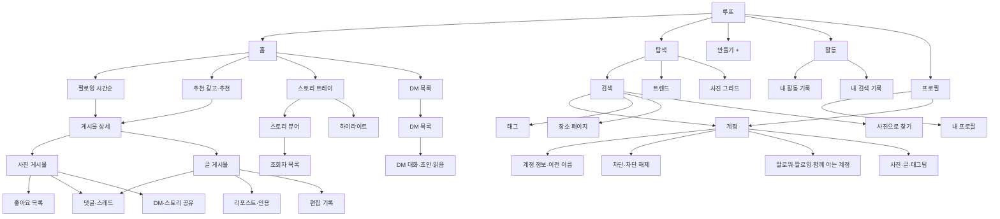

# SNS_SPECIFICATION — 루프

> **역할:** 메인 SNS 루프의 기능·데이터·상태·상호작용을 구현 가능한 수준으로 정의한다. 루프는 시각 중심 SNS와 공개 확산 SNS를 결합한 가상 플랫폼이다. 계정은 사람이 아니고, 이름을 바꾼 계정·부계정·사칭 계정·차단이 수사의 중심이다.
> **단일 출처:** 이 문서 = 루프의 앱 기능·화면 데이터·상태·게시물 유형 배정. 계정 ID(A-)·인물은 [CHARACTERS.md](../01-product/CHARACTERS.md), 단서 E-는 [EVIDENCE_LEDGER.md](../01-product/EVIDENCE_LEDGER.md), 행동 증명 V-는 [ACTION_PROOF.md](../01-product/ACTION_PROOF.md), 사건 EV-·NPC 상태·플래그는 [PROGRESSION_AND_ENDINGS.md](../01-product/PROGRESSION_AND_ENDINGS.md), 흔적 TR-은 [TRACES_AND_REACTIONS.md](../01-product/TRACES_AND_REACTIONS.md), 장소 L-은 [LOCATIONS.md](../01-product/LOCATIONS.md), 플레이타임은 [PLAYTIME_BUDGET.md](../01-product/PLAYTIME_BUDGET.md).
> **참조:** [SNS_SPECIFICATION](SNS_SPECIFICATION.md) 전체 · [FEATURE_SPECIFICATION](../01-product/FEATURE_SPECIFICATION.md) 4·23·24절 · [SYSTEM_SHELL_SPECIFICATION](SYSTEM_SHELL_SPECIFICATION.md) 8절 · [SETTINGS_SPECIFICATION](SETTINGS_SPECIFICATION.md) 7절 · [PROGRESSION_AND_ENDINGS](../01-product/PROGRESSION_AND_ENDINGS.md) 4.5·6.2~6.4 · [TRACES_AND_REACTIONS](../01-product/TRACES_AND_REACTIONS.md) 2·5절 · [PLAYTIME_BUDGET](../01-product/PLAYTIME_BUDGET.md) 3절.
> **화면:** 화면 ID 목록의 단일 출처는 [NAVIGATION_ARCHITECTURE.md](../02-design/NAVIGATION_ARCHITECTURE.md), 레이아웃 수치는 [SCREEN_SPECIFICATIONS.md](../02-design/SCREEN_SPECIFICATIONS.md), 컴포넌트는 [COMPONENT_SPECIFICATIONS.md](../02-design/COMPONENT_SPECIFICATIONS.md), 토큰 이름은 [DESIGN_TOKENS.md](../02-design/DESIGN_TOKENS.md)를 따른다. 이 문서의 `SCR-`는 제안이며 확정은 총괄이 한다.

## 0. 범위와 접근 층

| 항목 | 값 |
|---|---|
| 영역 코드 | `LOOP` |
| 접근 층 | T1(캐시 피드·프로필) / T2(검색·실시간·DM·스토리) / T3(부계정) |
| 온라인 필요 | 검색·스토리·DM·활동 상태·실시간 게시물. 캐시 피드는 오프라인에서도 보인다 |
| 로그인 계정 | A-11 @dohyun.lee (본계정) |
| 로그아웃 계정 | A-12 @dontknow__ (부계정, G-04) |
| 표시 이름 | 앱 이름은 "루프". 실제 서비스명은 1절 레퍼런스 분석에서만 쓴다 |

- 루프는 **시각 중심 SNS + 공개 확산 SNS 결합**이다. 결정은 지시서 3.4를 그대로 따른다. 사진 게시물은 시각 중심 서비스 역할, 글 게시물은 공개 확산 서비스 역할을 맡고, 같은 피드에 시간순으로 섞인다.
- 계정은 사람이 아니다. 같은 사람의 여러 계정(A-16·A-17·A-18·A-19), 이름을 바꾼 계정(A-18), 부계정(A-12), 사칭(A-17)을 플레이어가 구분한다.
- 모든 온라인·검색·실시간·읽음은 클라이언트 안의 시뮬레이션이다. 실제 SNS·계정·서버는 없다.

## 1. ① 레퍼런스 서비스의 핵심 UX

### 1.1 인스타그램

- 하단 탭 `홈 / 탐색 / 만들기 / 활동 / 프로필`. 홈 상단 스토리 트레이, 피드(사진·캐러셀), 두 번 탭 좋아요, 댓글, DM, 프로필 그리드, 하이라이트, 장소 태그, 사람 태그, 사진으로 찾기, 저장, 차단, 계정 전환.
- 수사에 유용한 것: 게시물의 시각·장소·사람 태그, 하이라이트(지난 스토리), 조회자 목록, 좋아요 목록, 활동 기록, 계정 정보.

### 1.2 X

- 홈 타임라인(팔로잉 시간순/추천), 300자 글, 사진 최대 4장, 답글 스레드, 리포스트·인용, 해시태그·트렌드, 검색, DM, 편집 기록.
- 수사에 유용한 것: 편집 기록(무엇을 지웠나), 리포스트·인용을 통한 공개 확산, 삭제된 댓글 자리, 300자 문장의 맥락.

## 2. ② 참고할 기능과 사용자 행동

| 행동 | 레퍼런스 | 루프에서 |
|---|---|---|
| 피드 훑기 | 홈/타임라인 | 팔로잉·추천 세그먼트 |
| 사진 확대 | 두 손가락 | 사진 게시물·캐러셀 |
| 좋아요 | 두 번 탭·하트 | 사진 게시물은 두 번 탭, 글 게시물은 하트 버튼만 |
| 답글 | 댓글·스레드 | 통일 스레드 모델(깊이 최대 2) |
| 공개 확산 | 리포스트·인용 | 글 게시물에만 |
| 비공개 공유 | DM·스토리 | 사진 게시물에만 |
| 스토리 | 24시간·조회자 | 24시간·보관함·하이라이트·조회자 |
| 계정 수사 | 프로필·계정 정보 | 가입일·이전 사용자 이름·함께 아는 계정 |
| 차단 | 차단·차단 해제 | 차단 목록·차단된 계정 보기 네 방법 |
| 검색 | 계정·태그·장소 | + 사진으로 찾기 |
| DM | 대화·읽음 | 초안·공유 게시물 원본 열기·읽음 흔적 |

## 3. ③ 레퍼런스의 불편한 점과 개선

| 불편 | 이 게임의 개선 |
|---|---|
| 추천 알고리즘이 시간순을 흐린다 | 홈 상단에 `팔로잉 / 추천` 세그먼트를 명시한다. 팔로잉은 시간순, 추천은 광고·추천 게시물·"알 수도 있는 사람"만 둔다 |
| 리포스트와 인용이 섞여 맥락이 사라진다 | 리포스트·인용은 **글 게시물에만** 제공하고, 글 게시물은 스레드로 표시한다. 사진 게시물은 DM·스토리 공유로 역할을 분리한다 |
| 차단하면 상대를 완전히 잊게 만든다 | 차단 목록에서 차단한 계정을 다시 열 수 있고, 웨이브·튜브·부계정·차단 해제 네 경로를 둔다. 차단은 "지우기"가 아니라 "흔적 없는 보기"의 선택지다 |
| 삭제된 댓글이 사라져 대화가 끊긴다 | "삭제된 댓글입니다 · 날짜" 자리와 남은 답글을 보존한다 |
| 계정 정보가 빈약하다 | 가입일·이전 사용자 이름·변경 날짜·함께 아는 계정을 보여 준다 |
| 스토리 조회가 조용하다 | 조회자 목록·활동 상태·읽음 확인을 그대로 남긴다. 보는 것이 흔적이라는 원칙을 숨기지 않는다 |
| 편집 기록을 볼 수 없다 | "편집됨" 표시 → 편집 기록(원래 위치 태그·변경 시각)을 제공한다 |
| 신고·차단이 깊은 메뉴에 있다 | 프로필 ⋯ → 이 계정 정보 / 차단·차단 해제를 한 단계에 둔다 |

## 4. ④ 이 게임에 적용하는 방식

### 4.1 결합 원칙 (지시서 3.4)

- 하단 탭 5개: `홈 / 탐색 / 만들기(+) / 활동 / 프로필`. DM은 홈 우상단.
- 게시물 두 종류: **사진 게시물**(1~10장 캐러셀, 위치·사람 태그, 캡션) / **글 게시물**(300자, 사진 최대 4장 첨부 가능). 둘 다 같은 피드에 시간순으로 섞인다.
- 홈 상단 세그먼트 `팔로잉 | 추천`. 팔로잉 = 시간순. 추천 = 광고·추천 게시물(캐논의 광고 카드 E-102 "추천 부업"이 여기에도 뜬다. 단서 판정은 8.5의 하이라이트 E-102에서만 한다. Q-OPEN-132).
- 반응: 좋아요(두 번 탭은 사진 게시물만), 답글. **리포스트·인용은 글 게시물에만**, 사진 게시물은 DM·스토리로 공유.
- 답글 구조: 통일된 스레드 모델(깊이 최대 2). 사진 게시물은 댓글 목록 형태, 글 게시물은 스레드 형태로 표시만 다르다. "삭제된 댓글입니다" 자리는 캐논 그대로.
- 해시태그: 모든 게시물. 태그 페이지 = 최근/인기. 탐색 탭 = 검색창(계정·태그·장소, **사진으로 찾기** 카메라 버튼) + `트렌드` 목록("지금 성원에서", 장식 위주. 캐논 단서를 트렌드로 새로 만들지 않는다) + 사진 그리드.
- 프로필: 헤더(아바타·이름·소개·게시물/팔로워/팔로잉·함께 아는 계정) + 하이라이트 줄 + 탭 `사진 / 글 / 태그됨`. ⋯ → 이 계정 정보(가입일·이전 사용자 이름), 차단/차단 해제.
- 스토리·하이라이트·조회자 목록·활동 상태·읽음 확인·편집 기록·장소 페이지·계정 전환·활동 기록은 캐논 그대로.
- 플레이어의 리포스트·인용·답글은 공개 반응이므로 TR-14(좋아요 등 공개 반응) 계열 흔적으로 처리한다. 이에 대한 새 NPC 반응 대사는 만들지 않고 "기본 반응" 처리한다(Q-OPEN-137).

### 4.2 정보 구조



### 4.3 두 게시물 종류 비교

| 항목 | 사진 게시물(시각 중심 역할) | 글 게시물(공개 확산 역할) |
|---|---|---|
| 본문 형태 | 캐러셀 1~10장 + 캡션 | 300자 + 사진 최대 4장 |
| 위치 태그 | 있음 | 없음 |
| 사람 태그 | 있음 | 없음 |
| 좋아요 | 있음. 두 번 탭 가능 | 있음. 두 번 탭 없음(하트 버튼) |
| 답글 표시 | 댓글 목록 | 스레드 |
| 답글 깊이 | 최대 2 | 최대 2 |
| 리포스트·인용 | 없음 | 있음 |
| DM·스토리 공유 | 있음(기본 공유) | 없음(공유 시트의 루프 DM 대상에서 제외) |
| 편집 기록 | 있음 | 있음 |
| 해시태그 | 있음 | 있음 |
| 검색 결과 | 사진 그리드·장소 페이지 | 문장 검색·트렌드 |
| 주 용도 | 장면·물건·장소·관계의 시각 증거 | 발언·공개 확산·여론 |

### 4.4 기능 목적 분리

| 기능 | 어느 쪽에만 두었나 | 왜 |
|---|---|---|
| 캐러셀·위치 태그·사람 태그 | 사진 게시물 | 시각 중심 서비스의 수사. 물건·장소·동석자를 한 게시물에서 겹친다 |
| 300자·리포스트·인용 | 글 게시물 | 공개 확산 서비스의 역할. 말의 유통과 편집을 수사한다 |
| 두 번 탭 좋아요 | 사진 게시물 | 시각 중심 서비스의 제스처. 의도치 않은 좋아요 흔적(TR-14)을 만든다 |
| DM·스토리 공유 | 사진 게시물 | 시각 중심 서비스의 비공개 공유. 공개 확산과 섞지 않는다 |
| 통일 답글 모델 | 공통 | 두 플랫폼의 댓글·답글을 하나의 데이터로 관리하되 표시만 다르게 한다. 깊이 2 제한으로 무한 스레드를 막는다 |
| 편집 기록 | 공통 | 3/5 게시물의 위치 태그 삭제(E-103)를 재현한다. 편집은 글·사진 모두 가능하다 |
| 해시태그·검색·트렌드 | 공통 | 태그·장소·계정 검색은 두 종류 모두에 필요하다. 트렌드는 장식이며 캐논 단서를 새로 만들지 않는다 |
| 스토리·하이라이트·조회자 | 게시물 종류 아님 | 24시간 콘텐츠와 보관을 게시물과 분리한다. 하이라이트 조회도 조회자에 남는다 |

### 4.5 캐논 게시물의 종류 배정

배정 기준: **사진이 핵심 단서면 사진 게시물, 문장이 핵심이면 글 게시물.** 스토리·댓글·DM·활동 기록은 게시물이 아니므로 별도로 표시한다.

| 계정 | 콘텐츠 | 시각 | 종류 | 배정 근거 |
|---|---|---|---|---|
| A-11 @dohyun.lee | 고정 게시물 "우리 100일 🤍"(서아 태그) | 2025.10.03 | 사진 게시물 | 커플 사진 + 사람 태그가 핵심(E-59) |
| A-11 | 마지막 스토리 검은 화면 "." | 3/14 19:40 | 스토리 | 24시간 콘텐츠. 보관함 조회자(E-41) |
| A-11 | @jh_lee_99 댓글 "도현아 연락 좀 해 ㅠㅠ 걱정돼" | 3/15 13:20 | 댓글 | 게시물 아님(E-46) |
| A-11 | 하린 글 좋아요 + 저장 | 3/9 03:12·03:15 | 활동 기록 | 반응(E-43) |
| A-11 | 팔로우 1/6 · 언팔로우 3/12 00:10 · 검색 3/11 23:40~23:58 | — | 활동 기록 | 계정 추적(E-44) |
| A-11 | 차단 @moneycoach.kang · @side.money.kr | 3/15 01:02 | 활동 기록 | 차단 인과(E-222) |
| A-11 | 지훈 → 모집 글 공유 | 1/8 21:14 | DM | 게시물 아님(E-40) |
| A-11 | 하린에게 보내지 못한 사과 초안 | 3/11 02:40 | DM 초안 | 게시물 아님(E-45) |
| A-12 @dontknow__ | "시작 7,420" | 2024.08 | 글 게시물 | 숫자가 핵심 |
| A-12 | "합격. 남은 거 5,620" | 2025.12 | 글 게시물 | 숫자가 핵심 |
| A-12 | "새 알바 하루 30" | 1/9 | 글 게시물 | 숫자가 핵심 |
| A-12 | "알바 동기들"(편집된 단체사진) | 1/20 | 사진 게시물 | 단체사진·잘린 인물이 핵심 |
| A-12 | "300 보냄" | 1/27 | 글 게시물 | 숫자가 핵심 |
| A-12 | "끝" | 2/14 | 글 게시물 | 문장이 핵심 |
| A-12 | "남은 거 4,820" | 2/26 | 글 게시물 | 숫자가 핵심 |
| A-12 | "나 뭐 한 거냐" | 3/9 04:02 | 글 게시물 | 문장이 핵심 |
| A-12 | "정지됐다 다행이다" | 3/12 | 글 게시물 | 문장이 핵심 |
| A-12 | 나머지 14개(숫자·짧은 문장) | — | 글 게시물(장식) | 캐논 "게시물 23. 숫자와 짧은 문장만". 문구·시각 미확정(Q-OPEN-136) |
| A-13 @jihoon_j | "용돈 벌이 성공 ㅋ"(돈 사진, 리버뷰타워 태그) | 1/5 | 사진 게시물 | 돈 사진 + 위치 태그가 핵심(E-55) |
| A-13 | 보관 스토리 "…" | 3/15 | 스토리 | 24시간 콘텐츠. EV-40과 시각 충돌(Q-OPEN-134) |
| A-14 @seoa.film | 하이라이트 "2월": "혼자 🙃" | 2/14 | 스토리(하이라이트) | 24시간 콘텐츠(E-58) |
| A-14 | 하이라이트 "3월": 3/14 21:40 스토리, 위치 스티커 "홍대입구역" | 3/14 21:40 | 스토리(하이라이트) | 위치 스티커가 핵심(E-42) |
| A-14 | 새 스토리 | 3/18 01:10 | 스토리 | 위치 없음(EV-44) |
| A-15 @harin.daily | 할머니 피해 호소 글, "누리 352-****-7731 이*현", 댓글 112, 좋아요 목록 중간 dohyun.lee | 3/8 22:40 | 글 게시물 | 문장·계좌번호가 핵심(E-47). 300자 초과 가능(Q-OPEN-133) |
| A-16 @moneycoach.kang | "새 차 🖤"(검은 SUV, 녹색 문자판 시계) | 2/2 | 사진 게시물 | 차·시계가 핵심(E-49) |
| A-16 | "고액 알바 조심하세요 여러분 그치?" | 2/20 | 글 게시물 | 말버릇 "그치?"가 핵심(E-57). 사진/영상 가능성(Q-OPEN-131) |
| A-16 | "새 사무실 🔑" 창밖 성원대교, 편집됨 → 편집 기록: 원래 위치 태그 "리버뷰타워" · 3/15 03:00 삭제 | 3/5 | 사진 게시물 | 창밖 풍경·위치 태그가 핵심(E-48, E-103) |
| A-16 | 하이라이트 "추천 부업"(같은 광고 카드) | — | 스토리(하이라이트) | 게시물 아님(E-102) |
| A-16 | 스토리 "야근 🌃"(사무실 창밖 성원대교) | 3/17 23:30 | 스토리 | 24시간 콘텐츠(E-223) |
| A-18 @side.money.kr | 게시물 41(전부 "부업 추천" 카드뉴스, 워터마크 "side.money.kr") | — | 사진 게시물 41개 | 카드 이미지가 핵심. 캐러셀 여부(Q-OPEN-135) |
| A-17 @jh_lee_99 | 게시물 0 | — | — | 계정 정보가 단서(E-54) |
| A-23 @minji.sw | "교육 끝 🍰"(케이크, SUV 스마트키 엠블럼, 화면 끝 손목의 초록 시계, 창밖 성원대교, 위치 리버뷰타워) | 1/20 | 사진 게시물 | 사진의 사물·위치가 핵심(E-104) |
| A-23 | "계좌 정지… 다들 고액알바 조심해" | 3/13 | 글 게시물 | 문장이 핵심(E-105) |
| A-23 | 하이라이트 "알바"(1월 화·금 출근길) | — | 스토리(하이라이트) | 24시간 콘텐츠 |
| A-18 | 모집 게시물 원본(지훈 1/8 DM 공유) | 1/8 | 사진 게시물 | E-100은 41개 중 하나(별도 게시물 아님) |

- **게시물이 아닌 것:** 스토리·하이라이트·댓글·DM·활동 기록·계정 정보·검색 기록. 이들은 각자의 화면에서 다룬다.
- 배정이 애매한 항목은 10절 확인 사항에 모았다.

### 4.6 조사·흔적 규칙

- **활동 상태:** 루프 설정에서 켜짐. 온라인에서 루프를 열면 dohyun.lee가 "활동 중"으로 보인다. 3일 만에 켜진 초록 점을 서아·지훈·사칭 계정이 본다(TR-03).
- **읽음 확인:** 켜짐. DM을 열면 상대에게 "읽음"이 간다(TR-04). 끄면 남의 읽음도 안 보인다.
- **스토리 조회:** 남의 스토리를 보면 조회자 목록에 dohyun.lee가 뜬다(TR-05). 하이라이트 조회도 같다.
- **좋아요·팔로우:** 대상에게 알림이 간다(TR-14). 두 번 탭 좋아요, 취소해도 알림은 간다.
- **리포스트·인용·답글:** 공개 반응. TR-14 계열로 처리하고 새 NPC 대사를 만들지 않는다(Q-OPEN-137).
- **검색:** 내 검색 기록에 남는다. 이전 이름으로는 검색되지 않는다.
- **오프라인:** 활동 상태가 전송되지 않고, 읽음·조회·좋아요는 대기한다. 다음 온라인 때 몰아서 간다.
- **흔적 지연:** 루프 흔적도 [TRACES_AND_REACTIONS.md](../01-product/TRACES_AND_REACTIONS.md) 1절의 지연 원칙을 따른다. 단, 처음 한 번은 반응이 분명하게 오도록 설계한다.

### 4.7 계정·스토리·DM의 세부

- **계정 전환:** 로그인 계정(A-11) + "최근 로그인한 계정"(A-12 이름만). 부계정은 비공개, 팔로워 7, 게시물 23. 로그인은 8.4의 경로.
- **프로필 탭:** `사진 / 글 / 태그됨`. 사진 게시물은 그리드, 글 게시물은 목록. 태그된 게시물은 나를 태그한 게시물.
- **함께 아는 계정:** 팔로워 수 아래. 급조 계정·조직 연결망을 본다. A-17은 팔로잉 3명이 전부 도현의 지인이다.
- **스토리:** 24시간. 위치·멘션 스티커. 본인 계정은 보관함 + 조회자 목록. 하이라이트는 지난 스토리 고정, 원래 게시 시각 표시. 하이라이트 조회도 조회자에 남는다.
- **DM:** 대화·초안·공유 게시물(원본 열기)·읽음 표시. 초안은 보내지 않은 말로 남는다. 공유 게시물은 온라인에서 원본을 연다.
- **차단:** 프로필 ⋯ → 차단. 차단하면 피드·검색·장소 페이지에서 사라진다. 차단 목록에서 다시 열 수 있다. 차단 해제는 알림을 보내지 않는다. 해제 후 스토리를 보면 조회자에 dohyun.lee가 뜬다(KS-1, EV-31).
- **차단된 실장을 보는 네 방법:** 8.6. 편집 기록(E-103)과 하이라이트(E-102)는 부계정이나 차단 해제로만 보인다. 둘 다 필수는 아니다.
- **알 수도 있는 사람:** 사진으로 찾기를 한 번 이상 쓰면 minji.sw가 뜬다(EV-32). 함께 아는 계정 0, "회원님이 찾은 사진과 비슷한 게시물".
- **사진으로 찾기:** 검색 → 카메라 아이콘 → 사진첩에서 선택. 결과는 "같은 사진" / "같은 장소일 수 있음" 공개 게시물. 차단된 계정의 게시물은 나오지 않는다.
- **만들기(+):** 사진 게시물·글 게시물 작성 화면. 플레이어가 발행할 수 있다. 발행물은 활동 기록과 프로필에 남는다. 이 게임은 발행물에 새 NPC 반응·단서·플래그를 만들지 않는다(Q-OPEN-137). 스토리 작성은 제공하지 않는다.

### 4.8 의도치 않은 흔적

- 사진 게시물을 두 번 탭하면 좋아요가 눌린다. 취소해도 알림은 이미 갔다.
- 스토리를 넘기다 다음 사람 스토리가 열린다. 조회자 목록에 남는다.
- 하이라이트를 넘겨도 조회로 남는다.
- DM 알림 미리보기로 읽은 것은 읽음이 아니다. 앱을 열어야 읽음이 간다.
- 좋아요·팔로우·조회는 화면에 경고를 띄우지 않는다. 상대의 반응으로만 알게 된다([TRACES_AND_REACTIONS.md](../01-product/TRACES_AND_REACTIONS.md) 6절).

## 5. ⑤ 다른 앱·게임 시스템과의 연결

| 연결 | 내용 | 근거 ID |
|---|---|---|
| 계정 추적 | 팔로우·언팔로우·검색·차단이 실장 추적의 시간선 | E-44, E-222, V-11 |
| 광고 계정 | 지훈 DM 공유 → 원본 → 계정 정보의 이전 이름 | E-40, E-100, E-101, V-06 |
| 실장 식별 | 조회자·차량·시계·사무실·"그치?"가 여러 앱에서 겹친다 | E-41, E-48, E-49, E-57, E-103, E-223 |
| 민지 | 사진으로 찾기·모아 쪽지·튜브 답글 세 경로 | E-104, E-133, E-123, V-09, E-108~111 |
| 사칭 | 가입일·차단 시각·함께 아는 계정·말투 | E-54, E-222, E-110, EV-11 |
| 위치 유출 | 사칭에 답장하면 F-LEAK. 해담·207을 흘리면 EV-17 | [PROGRESSION_AND_ENDINGS.md](../01-product/PROGRESSION_AND_ENDINGS.md) 6.2, EV-13, EV-17 |
| 서아 | 스토리 조회가 서아의 DM을 부른다 | TR-05, EV-34, E-42, V-05 |
| 하린 | 좋아요·저장·DM 초안이 사과/분노 분기 | E-43, E-45, E-47, V-07, F-HARIN |
| 부계정 | 로그인 알림·보관·조회자 표시 | TR-10, EV-09, G-04 |
| 흔적 정리 | KS-1이 광고 계정 비공개·하이라이트/댓글 삭제를 촉발 | EV-22, EV-23 |
| 플레이타임 | 루프 약 32분(보수). 필수 읽기 약 25개 | [PLAYTIME_BUDGET.md](../01-product/PLAYTIME_BUDGET.md) 3절 |

## 6. ⑥ 화면 목록과 인터랙션 요약

| 화면 ID(제안) | 이름 | 진입 경로 | 표시 방식 |
|---|---|---|---|
| `SCR-LOOP-FEED` | 홈 피드 | 홈 → 루프 | push |
| `SCR-LOOP-EXPLORE` | 탐색 | 하단 탭 | push |
| `SCR-LOOP-SEARCH` | 검색 | 탐색 상단 검색 | push |
| `SCR-LOOP-CREATE` | 만들기 | 하단 탭 + | modal |
| `SCR-LOOP-ACTIVITY` | 활동 | 하단 탭 | push |
| `SCR-LOOP-PROFILE` | 프로필 | 하단 탭 / 계정 이름 | push |
| `SCR-LOOP-POST-PHOTO` | 사진 게시물 상세 | 피드·그리드·검색 → 사진 게시물 | push |
| `SCR-LOOP-POST-TEXT` | 글 게시물 상세 | 피드·글 탭·검색 → 글 게시물 | push |
| `SCR-LOOP-STORY` | 스토리 뷰어 | 스토리 트레이 | modal |
| `SCR-LOOP-HIGHLIGHT` | 하이라이트 | 프로필 하이라이트 | push |
| `SCR-LOOP-VIEWERS` | 조회자 목록 | 내 스토리·하이라이트 → 조회자 | sheet |
| `SCR-LOOP-LIKES` | 좋아요 목록 | 게시물 → 좋아요 수 | sheet |
| `SCR-LOOP-PLACE` | 장소 페이지 | 게시물 위치 태그 / 검색 | push |
| `SCR-LOOP-TAG` | 태그 페이지 | 해시태그 | push |
| `SCR-LOOP-ACCOUNT-INFO` | 계정 정보 | 프로필 ⋯ | sheet |
| `SCR-LOOP-EDIT-HISTORY` | 편집 기록 | 게시물 "편집됨" | sheet |
| `SCR-LOOP-DM-LIST` | DM 목록 | 홈 우상단 | push |
| `SCR-LOOP-DM-ROOM` | DM 대화 | DM 목록 / 공유 | push |
| `SCR-LOOP-SETTINGS` | 루프 설정 | 프로필 ⋯ / 설정 | push |
| `SCR-LOOP-SETTINGS-PRIVACY` | 개인정보 | 설정 → 개인정보 | push |
| `SCR-LOOP-BLOCKED` | 차단 목록 | 개인정보 → 차단 목록 | push |
| `SCR-LOOP-ACCOUNT-SWITCH` | 계정 전환 | 프로필 상단 계정 이름 | modal |
| `SCR-LOOP-CONNECTIONS` | 팔로워·팔로잉 | 프로필 팔로워 수 | push |

- 인터랙션:
  - 피드: 세그먼트 전환, 사진 두 번 탭 = 좋아요, 댓글 아이콘 = 상세, 공유 = 사진 게시물만, 리포스트 = 글 게시물만.
  - 게시물: 캐러셀 넘기기, 확대, 좋아요 목록, 댓글 스레드, 편집 기록, 위치·사람 태그.
  - 스토리: 좌우 탭 = 이전/다음, 위로 밀기 = 닫기, 조회자 목록(내 스토리), 하이라이트.
  - 탐색: 검색창, 카메라 = 사진으로 찾기, 트렌드, 사진 그리드.
  - 프로필: 탭 3개, 하이라이트, ⋯, 팔로워/팔로잉, 함께 아는 계정.
  - DM: 대화, 초안 표시, 공유 게시물 원본 열기, 읽음.
  - 설정: 활동 상태·읽음 확인·차단 목록·친한 친구. 끄면 남의 상태·읽음도 안 보인다.

레이아웃 수치는 [SCREEN_SPECIFICATIONS.md](../02-design/SCREEN_SPECIFICATIONS.md)를 따른다.

## 7. ⑦ 데이터(항목 필드)와 상태

| 항목 | 필드 |
|---|---|
| 계정 | `id`(A-xx), `handle`, `displayName`, `bio`, `private`, `followers`, `following`, `postsCount`, `joinedAt`, `previousNames[{name,from,to}]`, `blocked`, `followingIds[]`, `profileMedia`, `mutuals[]` |
| 게시물 | `id`, `kind`(photo/text), `authorId`, `createdAt`, `caption`/`body`, `media[]`, `location`, `taggedPeople[]`, `hashtags[]`, `likes[]`, `likeCount`, `comments[]`, `edits[]`, `deletedCommentSlots[]`, `repostOf`, `quoteOf`, `shares[]`, `evidenceId` |
| 댓글 | `id`, `postId`, `authorId`, `body`, `at`, `deleted`, `replies[]`, `depth`(0~2) |
| 스토리 | `id`, `authorId`, `media`, `locationSticker`, `mentions[]`, `postedAt`, `expiresAt`, `archived`, `highlightId`, `viewers[]` |
| 하이라이트 | `id`, `authorId`, `title`, `storyIds[]`, `cover`, `updatedAt` |
| DM | `threadId`, `members[]`, `messages[]`, `draft`, `readAt`, `unread` |
| 활동 기록 | `type`(like/save/comment/follow/unfollow/block/search/post), `targetId`, `query`, `at`, `originDevice` |
| 검색 결과 | `type`(account/tag/place/photoMatch), `id`, `label`, `layer` |
| 설정 | `activityStatus`(on), `readReceipts`(on), `blockedIds[]`, `closeFriends[]` |
| 상태 | `cacheOnly`, `onlineRequired`, `private`, `blocked`, `expired`, `deletedComment`, `edited` |

- 상태:
  - 로딩: 첫 온라인 직후 피드·스토리·DM 동기화. 캐시 피드를 먼저 보여 주고 상단에 진행 표시.
  - 빈 화면: 팔로잉 게시물 없음 / 검색 결과 없음 / DM 없음 / 차단 목록 없음. 추천 계정·광고를 빈 화면에 끼워 넣지 않는다.
  - 오프라인: 캐시 피드·프로필·활동 기록만. 검색·스토리·DM·실시간 불가. 좋아요·조회·읽음은 대기.
  - 삭제됨: 삭제된 댓글 자리("삭제된 댓글입니다 · 날짜") + 남은 답글. 게시물 자체 삭제는 캐논에 없다.
  - 잠김: 비공개 계정(A-12, 로그인 전)은 잠금 표시 + 팔로워 7 + 게시물 23만 보이고 내용은 숨김. 차단된 계정은 프로필·피드·검색에서 숨김. 24시간 지난 스토리는 만료.
  - 편집됨: 게시물에 "편집됨" 표시. 편집 기록에서 원래 위치 태그·변경 시각을 본다.
  - 실시간: 새 스토리·댓글·DM이 도착하면 해당 행만 갱신하고 스크롤 위치를 유지한다.

## 8. ⑧ 캐논 데이터 (원본 그대로)

### 8.1 루프의 기능

| 기능 | 사양 | 수사 쓰임 | 흔적 |
|---|---|---|---|
| 프로필 | 이름·소개·게시물·팔로워/팔로잉·하이라이트·태그된 게시물 | 관계 | — |
| **계정 정보** | 프로필 ⋯ → 이 계정 정보: 가입일, **이전 사용자 이름(변경 날짜)** | 이름을 바꾼 계정의 과거 | 없음 |
| **함께 아는 계정** | 팔로워 수 아래 | 급조 계정·조직 연결망 | 없음 |
| 게시물 | 사진/글, 위치 태그, 사람 태그, 좋아요 목록(시간순), 댓글, **편집됨 → 편집 기록** | 시각·장소·지우려 한 흔적 | 두 번 탭 = 좋아요(TR-14) |
| **삭제된 댓글 자리** | "삭제된 댓글입니다 · 날짜" + 남은 답글 | 지워진 말의 흔적 | — |
| 스토리 | 24시간. 위치·멘션 스티커. 본인 계정 **보관함 + 조회자 목록** | 누가 지켜봤나 | **남의 스토리를 보면 조회자 목록에 dohyun.lee가 뜬다(TR-05)** |
| 하이라이트 | 지난 스토리 고정. 원래 게시 시각 표시 | 24시간 지난 스토리 열람 | 하이라이트 조회도 조회자에 남는다 |
| 장소 페이지 | 위치 태그 장소별 공개 게시물 | 같은 장소, 다른 사람 | — |
| **사진으로 찾기** | 검색 → 카메라 아이콘 → 사진첩에서 선택 | "같은 사진" / "같은 장소일 수 있음" 공개 게시물 | — |
| 검색 | 계정·태그·장소. 온라인 필요. **이전 이름으로는 검색되지 않는다** | 연결 시험 | 내 검색 기록에 남음 |
| DM | 대화, 초안, 공유 게시물(원본 열기) | 보내지 못한 말 | **읽음 표시(TR-04)** |
| 활동 기록 | 내 좋아요·댓글·팔로우·언팔로우·**차단**·검색 기록(시각) | 도현의 의심과 추적 | — |
| 계정 전환 | 로그인 계정 + "최근 로그인한 계정" | 부계정의 존재 | — |
| **루프 설정** | 개인정보 → **활동 상태**(켜짐) / **읽음 확인**(켜짐) / **차단 목록** / 친한 친구 | 흔적 관리 | 끄면 남의 활동 상태·읽음도 안 보인다 |

**흔적 규칙(TR-03~05):** 온라인에서 루프를 열면 dohyun.lee가 "활동 중"으로 보인다(활동 상태가 켜져 있으면). 3일 만에 켜진 초록 점을 서아·지훈·사칭 계정이 본다.

### 8.2 등장 계정

| ID | 계정 | 주인 | 공개 | 핵심 |
|---|---|---|---|---|
| A-11 | @dohyun.lee | 도현 본계정 | 공개, 팔로워 384 | 폰에 로그인. 슬레이트에도 로그인 |
| A-12 | @dontknow__ | 도현 부계정 | 비공개, 팔로워 7 | 로그아웃. "최근 로그인한 계정"에 이름만 |
| A-13 | @jihoon_j | 지훈 | 공개 | 1/5 "용돈 벌이 성공 ㅋ"(리버뷰타워 태그) |
| A-14 | @seoa.film | 서아 | 공개 | 하이라이트 "2월" "3월", 게임 중 새 스토리 |
| A-15 | @harin.daily | 하린 | 공개 | 3/8 피해 호소 글 |
| A-16 | @moneycoach.kang | 강민석 | 공개, 팔로워 43.2k | 얼굴 없음(손·시계·차·사무실). **dohyun.lee가 차단함(3/15 01:02)** |
| A-17 | @jh_lee_99 | 강민석 쪽(사칭) | 공개, 게시물 0 | 3/15 13:00 생성 |
| A-18 | @side.money.kr | 강민석(모집용) | 공개 → EV-22 비공개 | 이전 이름 kang.side → sidejob.pro. **dohyun.lee가 차단함(3/15 01:02)** |
| A-23 | @minji.sw | 윤민지 | 공개 | 또 한 명의 명의인 |

- A-18의 팔로워 3,100은 [CHARACTERS.md](../01-product/CHARACTERS.md) 3절의 값이다.
- A-19 튜브 채널 "머니코치 강", A-20 모아, A-21 블링크, A-22 블링크 "실장K", A-24 모아 "익명7"은 다른 앱 문서에서 다룬다.

### 8.3 @dohyun.lee (본계정)

| 콘텐츠 | 시각 | 단서 |
|---|---|---|
| 고정 게시물 "우리 100일 🤍"(서아 태그) | 2025.10.03 | E-59 — 이별 후에도 안 내림 |
| **마지막 스토리** 검은 화면 "." | 3/14 19:40 | 보관함 조회자: **moneycoach.kang**, jihoon_j, seoa.film 외 31 → E-41 |
| 마지막 게시물에 @jh_lee_99 댓글 "도현아 연락 좀 해 ㅠㅠ 걱정돼" | 3/15 13:20 | E-46 |
| 활동 기록: 하린 글 좋아요 + 저장 | 3/9 03:12·03:15 | E-43 |
| 활동 기록: moneycoach.kang 팔로우 1/6 · 언팔로우 3/12 00:10 · 검색 "side.money.kr"(3/11 23:40)→"kang.side"(23:52, 결과 없음)→"머니코치 강 실장"(23:58) | | E-44 |
| **활동 기록: 차단 @moneycoach.kang · @side.money.kr — 3/15 01:02 (슬레이트에서)** | | **E-222** |
| DM: 지훈 → 모집 글 공유 | 1/8 21:14 | E-40 |
| DM 초안: 하린에게 "죄송합니다. 그 계좌 제 계좌예요. 돈은 제가 어떻게든…" | 3/11 02:40 | E-45 |
| 계정 전환: "최근 로그인한 계정 — dontknow__" | | G-04 단서 |

**차단의 인과(플레이어가 잇는 것):** 3/15 01:02 도현이 실장의 두 계정을 차단 → 3/15 13:00 @jh_lee_99 생성(가입일) → 13:20 도현 게시물에 "걱정돼" 댓글, 지훈·서아에게 "도현이 어딨는지 알아?". 차단당한 실장이 12시간 만에 가짜 친구 계정을 만들었다. 계정 정보(가입일)와 활동 기록(차단 시각)을 나란히 놓으면 보인다.

### 8.4 @dontknow__ (부계정, G-04)

- 비공개, 팔로워 7(jihoon_j, seoa.film 포함), 게시물 23. 숫자와 짧은 문장만.
- 주요 게시물: 2024.08 "시작 7,420" / 2025.12 "합격. 남은 거 5,620" / 1/9 "새 알바 하루 30" / 1/20 "알바 동기들"(편집된 단체사진) / 1/27 "300 보냄" / 2/14 "끝" / 2/26 "남은 거 4,820" / **3/9 04:02 "나 뭐 한 거냐"** / 3/12 "정지됐다 다행이다".
- **EV-09:** 첫 온라인 40분 뒤 도현이 부계정 게시물을 전부 보관. 이미 로그인했다면 보관함에서 계속 볼 수 있다.
- **로그인(G-04):** 계정 전환 → dontknow__ → [비밀번호를 잊으셨나요?] → 코드가 dk.nowhere@mailbox.kr로 → 메일 앱 두 번째 계정에서 코드 → 로그인. 대가: "새 기기 로그인" 알림이 슬레이트에도 간다(TR-10, 경계 +1).
- **부계정은 차단되지 않았다** → 실장 계정을 흔적 없이 전부 볼 수 있는 또 하나의 눈이다(8.6). 단, 부계정으로 스토리를 보면 조회자에 "dontknow__"가 뜬다.

### 8.5 타인 계정

| 계정 | 핵심 콘텐츠 | 단서 |
|---|---|---|
| @jihoon_j | 1/5 "용돈 벌이 성공 ㅋ"(돈 사진, 리버뷰타워 태그) / 보관 스토리 3/15 "…" | E-55 |
| @seoa.film | 하이라이트 "2월": 2/14 "혼자 🙃"(E-58) / 하이라이트 "3월": **3/14 21:40 스토리, 위치 스티커 "홍대입구역"**(E-42) / 게임 중 3/18 01:10 새 스토리(EV) | E-42, E-58 |
| @harin.daily | **3/8 22:40 글**: 할머니 피해 호소, "누리 352-****-7731 이*현"(E-47). 댓글 112개, 좋아요 목록 중간에 dohyun.lee(03:12) | E-47 |
| @moneycoach.kang | 2/2 "새 차 🖤"(검은 SUV, 녹색 문자판 시계, E-49) / 2/20 "고액 알바 조심하세요 여러분 그치?"(E-57) / **3/5 "새 사무실 🔑" 창밖 성원대교, 편집됨 → 편집 기록: 원래 위치 태그 "리버뷰타워" · 3/15 03:00 삭제**(E-48, E-103) / 하이라이트 "추천 부업"(같은 광고 카드, E-102) / **게임 중 3/17 23:30 스토리 "야근 🌃"(사무실 창밖 성원대교)**(E-223) | E-48, E-49, E-57, E-102, E-103, E-223 |
| @side.money.kr | 게시물 41(전부 "부업 추천" 카드뉴스, 워터마크 "side.money.kr"). 소개 "하루 30 가능 · 문의 블링크". **계정 정보: 가입 2025.09 · 이전 이름 kang.side(2025.09~11) → sidejob.pro(2025.11~2026.01)**(E-101) | E-100, E-101 |
| @jh_lee_99 | 게시물 0, **가입일 2026.03.15**, 팔로잉 3(dohyun.lee, jihoon_j, seoa.film), 팔로워 0. 함께 아는 계정: 팔로잉 3명이 전부 도현의 지인 | E-54 |
| @minji.sw | 1/20 "교육 끝 🍰"(같은 테이블 다른 각도: 케이크, SUV 스마트키 엠블럼, 화면 끝 손목의 초록 시계, 창밖 성원대교, 위치 리버뷰타워)(E-104) / 3/13 "계좌 정지… 다들 고액알바 조심해"(E-105) / 하이라이트 "알바"(1월 화·금 출근길) | E-104, E-105 |

- [PROGRESSION_AND_ENDINGS.md](../01-product/PROGRESSION_AND_ENDINGS.md)의 게임 중 스토리: 3/17 21:40 지훈 스토리 "…"(검은 화면)(EV-40, 원본 SNS 자료와 시각 충돌 Q-OPEN-134) / 3/18 01:10 서아 스토리 "잠이 안 온다"(위치 없음)(EV-44) / 3/17 23:30 kang 스토리 "야근 🌃"(E-223, EV-42).

### 8.6 차단된 실장을 보는 네 가지 방법 (선택과 대가)

| 방법 | 보이는 것 | 흔적 |
|---|---|---|
| 웨이브에서 로그아웃 상태로 loop.kr/moneycoach.kang | 최근 게시물 12개(사진·글). 하이라이트·스토리·편집 기록·계정 정보 없음 | 없음 |
| 튜브 | 영상·설명란·댓글 | 없음 |
| 부계정 @dontknow__(G-04) | 전부 | 로그인 알림(TR-10). 스토리를 보면 "dontknow__" 조회 |
| **차단 해제**(루프 설정 → 차단 목록) | 전부 | 해제 자체는 알림 없음. **그 뒤 스토리를 보면 조회자에 dohyun.lee → KS-1**(EV-31) |

- 편집 기록(E-103)과 하이라이트(E-102)는 부계정이나 차단 해제로만 보인다. 둘 다 필수는 아니다(P4: E-101·E-120으로 대체).
- 실장의 게임 중 스토리(E-223, 23:30)를 dohyun.lee로 보는 것은 "죽은 폰이 살아났다"고 실장에게 알리는 일이다.

### 8.7 추적 사슬

#### 8.7.1 광고 계정의 주인 — @side.money.kr = 강민석 쪽

```
지훈 1/8 DM 공유 카드(E-40) ──원본 열기(온라인)──▶ @side.money.kr 게시물(E-100, 워터마크)
       │                                               │
  스크린샷 E-36b(공고 캡처, 워터마크)                     ├─ 계정 정보 "이전 이름 kang.side"(E-101)
  파일 "교육자료.pdf" 워터마크(E-216)                    ├─ kang 하이라이트 "추천 부업" 같은 카드(E-102, 부계정·해제 시)
                                                       └─ 튜브 V2 설명란 "→ @side.money.kr"(E-120)
```

- 함정: 워터마크만으로는 "광고 계정"까지. 강과의 연결은 E-101·E-102·E-120 중 하나가 있어야 한다.
- 도현은 여기서 멈췄다: 이전 이름으로 검색했지만 결과가 없었다(E-44). **플레이어는 계정 정보를 연다** — 도현이 몰랐던 기능.

#### 8.7.2 실장K = 강민석

| 출처 | 측면 |
|---|---|
| 루프 | E-41 조회자 · E-48 사무실 창밖 · E-49 시계·SUV · E-57 "그치?" · E-102 · E-103 · E-223 |
| 튜브 | E-121 "그치?"·시계 · E-122 화이트보드 "화·금 GJ"·창밖·스마트키 |
| 사진 | E-32 원본 시계·창밖 · E-33 번호판 · E-104(민지 사진) |
| 음성 메모 | E-37 "강 대표님" · "그치?" · "B2" |
| 블링크 | E-61 프로필 사진 시계 |
| 진술 | E-108 민지 "초록 시계" |
| **파일·설정** | **E-216·E-197 "민석의 폰"(1/20 교육 날 근처 공유)** |
| 캘린더 | 도현 "GJ" 화·금 + E-122 화이트보드(교차) |

- **성은 "강", 이름은 "민석".** 성의 출처: "머니코치 강"(튜브·웨이브), moneycoach.kang, kang.side, 녹음 "강 대표님". 이름의 출처: 근처 공유 "민석의 폰"(파일 정보 / 설정 → 근처 공유 기록). 둘을 합쳐 **"강민석"을 직접 입력하는 것**이 V-11.
- 이름 없이 사람만 특정하는 것도 의미가 있다: 번호판(E-33)·녹음(E-37)을 경찰에 보내면 경찰이 특정한다(엔딩 후일담).

#### 8.7.3 또 한 명 — 윤민지

```
경로 A  1/20 원본 사진(E-32) ──사진으로 찾기──▶ "같은 장소일 수 있음": @minji.sw 1/20(E-104)
경로 B  모아 글 3/9(E-131) ──익명7 댓글(E-132)──▶ 쪽지 "루프 minji.sw로 연락해"(E-133) ──검색──▶ @minji.sw
경로 C  튜브 V4 "삭제된 댓글 · 3/13" + 남은 답글 "@minji.sw 저도 정지됐어요"(E-123) ──▶ @minji.sw 3/13(E-105)
```

- 넛지(EV-32): 사진으로 찾기를 한 번 이상 쓰고 나면 루프 "알 수도 있는 사람"에 minji.sw가 뜬다(함께 아는 계정 0, "회원님이 찾은 사진과 비슷한 게시물").

#### 8.7.4 민지와의 대화 (NPC, 최대 3왕복)

| 보낸 것 | 민지의 반응 | 생성 단서 |
|---|---|---|
| 첫 DM(정체 숨김) | "도현? 너 괜찮아? 나 무서워…" | — |
| 정체 공개 | "…도현이 아버님이요? 도현이 괜찮아요?" | — |
| E-104 / E-32 원본 | "저 맞아요… 그날 교육이라고 불려 갔어요." "실장 얼굴은 봤어요. 이름은 몰라요. 손목에 초록색 시계" | **E-108** |
| E-60 / E-36 | "저한테도 왔어요. 15일에. '도현이 연락 오면 바로 말해, 걔 녹음 갖고 있다'고요" | **E-109** |
| E-46 / E-54 | "이 계정 저한테도 DM했어요… 캡처 보내 드릴게요" → 이미지 1장 | **E-110**(jh_lee_99 → 민지: "도현이 어딘지 알아? 형이 걱정돼서") |
| 위치 관련(해담·고시원) | "…그건 저한테 말하지 마세요. 저 실장이 무서워요" — 유출 아님 | — |
| "민석" / "강민석" 입력 | "…그 사람 이름이에요? 저 그 이름 들은 적 있어요. 교육 때 누가 '민석이 형'이라고 했어요" | **E-111**(V-11 근거 보강) |

**MJ 상태(캐논):**

| 상태 | 진입 | 행동 |
|---|---|---|
| MJ-0 | 시작 | 무관 |
| MJ-1 | 첫 DM | 도현 계정이면 "도현? 너 괜찮아?" / 정체 공개면 "…도현이 아버님이요?" |
| MJ-2 | 1/20 사진 공유(V-09) | 진술 단서 E-108~111(최대 3왕복) |
| MJ-X | 강요·위협성 입력, 3왕복 소진, 03:00 이후 | 읽음만 |

#### 8.7.5 사칭 계정 (@jh_lee_99)

- 가입일 3/15(E-54) + 차단 시각 3/15 01:02(E-222) + 함께 아는 계정(도현 주변만) + 민지가 받은 같은 DM(E-110) + 말투 "형이"(EV-11, 블링크 실장K 말투와 같음).
- 게임 중 반응: dohyun.lee가 "활동 중"이면 30분 뒤 DM "도현아 너 맞지? 어디야. 형이 다 해결해 줄게"(EV-11). 답장은 위험(F-LEAK 판정, [PROGRESSION_AND_ENDINGS.md](../01-product/PROGRESSION_AND_ENDINGS.md) 6.2).
- 위치 유출(F-LEAK) 뒤 120분에 @jh_lee_99 스토리 "성원구청역 2번 출구 사진"이 올라온다(EV-17). 먼저 택시를 부르면 무효다.

### 8.8 상대도 지운다 — 실장의 흔적 정리

| ID | 시각 | 실장의 행동 | 잃는 것 | 남는 대체(P4) |
|---|---|---|---|---|
| (게임 전) | 3/15 02:10 | 튜브 V5 "당분간 영상 쉽니다" | — | E-124 |
| (게임 전) | 3/15 03:00 | kang 3/5 게시물 위치 태그 삭제 | 위치 태그 | 편집 기록(E-103) |
| EV-22 | KS-1 + 20 | @side.money.kr 비공개 전환 | 광고 게시물 열람 | 계정 정보(E-101)는 비공개여도 보임. 미리 연 공유 카드는 캐시 |
| EV-23 | KS-1 + 40 | kang 하이라이트 "추천 부업" 삭제 / 튜브 V4 민지 댓글 삭제 | E-102, E-123 원문 | E-120, E-123은 "삭제된 댓글 + 답글"로 남음, E-105 |
| EV-25 | 민지와 대화 시작 + 30 | @jh_lee_99가 민지에게 다시 DM | — | 민지가 캡처를 보내 줌 |

- **KS-1 진입 경로 셋:** 블링크 읽음 / 차단 해제 후 kang 스토리 조회 / 사칭 계정에 답장. 셋 다 플레이어의 흔적이다.
- 설계 의도: 실장을 일찍 건드리면 위협 정보를 얻는 대신 공개 흔적이 빨리 사라진다. 조용히 보면(웨이브·튜브·알림 미리보기) 여유 있게 모을 수 있다. 어느 쪽도 막히지 않는다.

### 8.9 장소 페이지

- **"리버뷰타워"**: 공개 게시물 9개(jihoon_j 1/5, minji.sw 1/20, 입주민 7). kang 3/5는 위치 태그가 지워져 여기 없다 — 편집 기록으로만.
- **"청운고시원"·"해담고시텔"**: 게시물 0(사람들은 고시원을 태그하지 않는다).
- **"홍대입구역"**: 서아 스토리는 24시간 지나 장소 페이지에 없다. 하이라이트로만.

### 8.10 SNS 분량

| 플랫폼 | 계정·채널 | 게시물 | 필수로 읽는 것(보수) |
|---|---|---|---|
| 루프 | 12개(도현 2, 지훈, 서아, 하린, 민지, 강 2, 사칭, 단역 3) | 약 180 | 약 25개 + 계정 정보 4 + 하이라이트 3 + 활동 기록·차단 목록 |
| 튜브 | 1채널 | 5편 + 댓글 64 | 핵심 구간 2편 + 댓글 상위 |
| 모아 | 게시판 3 | 34글 | 도현 글 2 + 댓글 + 쪽지 |

- 노이즈 70% 이상. 단역 계정은 각자의 일상을 산다.
- 시각은 상대 시각("3일 전")으로, 정보에서 절대 시각. 좋아요·조회자 목록은 시간순.
- 이름 마스킹: 하린 글 "이*현"은 계좌번호 끝 4자리까지 맞춰야 도현이다.
- 튜브·모아의 상세는 [VIDEO_AND_COMMUNITY_SPECIFICATION.md](VIDEO_AND_COMMUNITY_SPECIFICATION.md)가 단일 출처다.

## 9. 이 문서가 제안한 화면 ID 목록

| ID | 이름 | 진입 경로 | 표시 방식 |
|---|---|---|---|
| `SCR-LOOP-FEED` | 홈 피드 | 홈 → 루프 | push |
| `SCR-LOOP-EXPLORE` | 탐색 | 하단 탭 | push |
| `SCR-LOOP-SEARCH` | 검색 | 탐색 상단 검색 | push |
| `SCR-LOOP-CREATE` | 만들기 | 하단 탭 + | modal |
| `SCR-LOOP-ACTIVITY` | 활동 | 하단 탭 | push |
| `SCR-LOOP-PROFILE` | 프로필 | 하단 탭 / 계정 이름 | push |
| `SCR-LOOP-POST-PHOTO` | 사진 게시물 상세 | 피드·그리드·검색 → 사진 게시물 | push |
| `SCR-LOOP-POST-TEXT` | 글 게시물 상세 | 피드·글 탭·검색 → 글 게시물 | push |
| `SCR-LOOP-STORY` | 스토리 뷰어 | 스토리 트레이 | modal |
| `SCR-LOOP-HIGHLIGHT` | 하이라이트 | 프로필 하이라이트 | push |
| `SCR-LOOP-VIEWERS` | 조회자 목록 | 내 스토리·하이라이트 → 조회자 | sheet |
| `SCR-LOOP-LIKES` | 좋아요 목록 | 게시물 → 좋아요 수 | sheet |
| `SCR-LOOP-PLACE` | 장소 페이지 | 게시물 위치 태그 / 검색 | push |
| `SCR-LOOP-TAG` | 태그 페이지 | 해시태그 | push |
| `SCR-LOOP-ACCOUNT-INFO` | 계정 정보 | 프로필 ⋯ | sheet |
| `SCR-LOOP-EDIT-HISTORY` | 편집 기록 | 게시물 "편집됨" | sheet |
| `SCR-LOOP-DM-LIST` | DM 목록 | 홈 우상단 | push |
| `SCR-LOOP-DM-ROOM` | DM 대화 | DM 목록 / 공유 | push |
| `SCR-LOOP-SETTINGS` | 루프 설정 | 프로필 ⋯ / 설정 | push |
| `SCR-LOOP-SETTINGS-PRIVACY` | 개인정보 | 설정 → 개인정보 | push |
| `SCR-LOOP-BLOCKED` | 차단 목록 | 개인정보 → 차단 목록 | push |
| `SCR-LOOP-ACCOUNT-SWITCH` | 계정 전환 | 프로필 상단 계정 이름 | modal |
| `SCR-LOOP-CONNECTIONS` | 팔로워·팔로잉 | 프로필 팔로워 수 | push |

## 10. 확인 사항

- **Q-OPEN-131:** 게시물 종류 배정에서 A-16의 2/20 "고액 알바 조심하세요 여러분 그치?"를 글 게시물로 정했다. 사진·영상 게시물일 가능성이 있다. 캐논은 "게시물"이라고만 쓴다. 확정이 필요하다.
- **Q-OPEN-132:** 3.4는 E-102 "추천 부업" 카드가 홈 `추천` 세그먼트에도 뜬다고 하고, 원본 SNS 자료는 E-102를 부계정·차단 해제로만 보이는 하이라이트로 둔다. 이 문서는 추천 지면의 같은 크리에이티브를 **광고 지면**으로 보고, E-102 단서 판정은 하이라이트에서만 한다. 두 서술의 관계를 확정해야 한다.
- **Q-OPEN-133:** A-15 하린의 3/8 글은 계좌번호·피해 호소를 담아 300자를 넘을 수 있다. 글 게시물 300자 규칙과 충돌한다. "장문 글" 예외를 둘지, 300자 안으로 압축할지, 스레드로 나눌지 확정이 필요하다.
- **Q-OPEN-134:** 원본 SNS 자료는 지훈의 보관 스토리를 3/15 "…"로, [PROGRESSION_AND_ENDINGS.md](../01-product/PROGRESSION_AND_ENDINGS.md) EV-40은 3/17 21:40 스토리 "…"(검은 화면)로 적는다. 같은 스토리인지 다른 스토리인지 확정해야 한다. 이 문서는 8.5의 표를 보존하고 EV-40을 별도 사건으로 표기했다.
- **Q-OPEN-135:** A-18의 게시물 41개를 전부 사진 게시물(카드뉴스)로 배정했다. 카드뉴스가 1장인지 캐러셀인지 캐논에 없다. 1~10장 캐러셀 범위 안에서 확정이 필요하다.
- **Q-OPEN-136:** A-12의 나머지 14개 게시물을 "글 게시물(장식)"으로 채웠다. 캐논은 "게시물 23. 숫자와 짧은 문장만"이라고만 한다. 14개의 실제 문구·시각은 콘텐츠 작성 시 확정해야 한다.
- **Q-OPEN-137:** 플레이어의 리포스트·인용·답글은 3.4에 따라 TR-14 계열 공개 반응으로 처리하고 새 NPC 대사를 만들지 않는다. 그렇다면 **플레이어가 만들기(+)로 새 게시물을 발행하는 것**도 같은 규칙으로 처리할지, 발행 자체를 막을지 확정이 필요하다. 이 문서는 발행을 허용하되 새 NPC 반응·단서·플래그를 만들지 않는다.
- **Q-OPEN-138:** 활동 기록 표에는 "저장"이 없지만 E-43은 "하린 글 좋아요 + 저장"을 요구한다. 이 문서는 활동 기록에 저장 유형을 추가해 E-43을 표시한다. 활동 기록의 공식 유형 목록에 저장을 포함할지 확정해야 한다.
- **Q-OPEN-139:** 사진 게시물의 DM·스토리 공유와 글 게시물의 리포스트·인용을 완전히 분리했다. 글 게시물도 공유 시트로 DM에 보낼 수 있게 할지(공통 조작과의 충돌) 확정이 필요하다. 이 문서는 루프 UI에서 글 게시물의 DM 공유 버튼을 노출하지 않는다.
- **Q-OPEN-140:** 홈 `추천`의 "알 수도 있는 사람"과 트렌드 "지금 성원에서"의 장식 콘텐츠 범위를 확정해야 한다. 이 문서는 캐논 단서를 새로 만들지 않고, EV-32의 minji.sw 넛지만 예외로 둔다.
