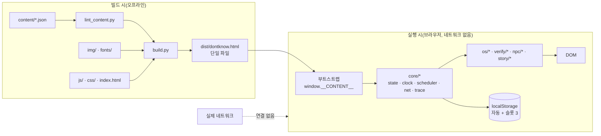

# BACKEND_ARCHITECTURE — 백엔드 없음과 게임 속 서버 시뮬레이션

> **역할:** "백엔드가 없다"는 결정과 근거를 고정하고, 게임 속 서버·클라우드·SNS·NPC가 클라이언트 어디에서 어떻게 대신 동작하는지 매핑한다. 향후 백엔드가 필요해지는 조건도 적는다(도입하지 않는다).
> **단일 출처:** 이 문서(백엔드 부재 결정, 서버 역할 → 클라이언트 매핑, 향후 도입 조건). 동기화 알고리즘은 [SYSTEM_ARCHITECTURE](SYSTEM_ARCHITECTURE.md) 4.2, 상태는 [STATE_MANAGEMENT](./STATE_MANAGEMENT.md), 보안은 [AUTHENTICATION_AND_SECURITY](./AUTHENTICATION_AND_SECURITY.md)가 단일 출처다.
> **참조:** [SYSTEM_ARCHITECTURE](SYSTEM_ARCHITECTURE.md) 1·4절, [MAIL_AND_CLOUD_SPECIFICATION](../03-features/MAIL_AND_CLOUD_SPECIFICATION.md), [PROGRESSION_AND_ENDINGS](../01-product/PROGRESSION_AND_ENDINGS.md), [TRACES_AND_REACTIONS](../01-product/TRACES_AND_REACTIONS.md), [IMPLEMENTATION_ROADMAP](../06-execution/IMPLEMENTATION_ROADMAP.md).
> **적용 버전:** v6.2 (2026-11).

## 1. 결정

**DONTKNOW v6.2는 백엔드가 없다.** 서버·DB·인증 서버·네트워크 API·클라우드 저장·원격 설정·분석 수집을 두지 않는다. 게임 속 "온라인", "동기화", "실시간", "서버", "클라우드"는 전부 **클라이언트 안의 결정론적 시뮬레이션**이다.

| 항목 | 결정 |
|---|---|
| 서버 프로세스 | 없음 |
| 데이터베이스 | 없음 |
| 인증 서버 | 없음 |
| 외부 HTTP API | 없음. `fetch`/XHR/WebSocket/EventSource/sendBeacon 금지 |
| 원격 로그·분석 | 없음 |
| 콘텐츠 배포 | 빌드 시 단일 HTML에 인라인 |
| 저장 | 브라우저 `localStorage`만 |
| 푸시 알림 | 브라우저 푸시 없음. 게임 내 알림 센터가 대신함 |
| 결제 | 없음. 게임 내 은행·지갑은 장식이며 실제 결제 없음 |

### 1.1 근거

1. **1인용 내러티브 게임이다.** 다른 실제 플레이어·실시간 대전·계정이 필요 없다.
2. **오프라인 플레이가 요구사항이다.** 단일 HTML을 열면 네트워크 없이 끝까지 플레이한다.
3. **배포·공유가 단순하다.** 파일 하나를 정적 호스팅하거나 전달하면 된다. 서버 운영비·장애 대응이 없다.
4. **개인정보를 받지 않는다.** 실제 계정·전화번호·메시지를 저장·전송하지 않는다.
5. **심의·보안 리스크가 낮다.** 실제 사기·해킹·계정 탈취 기능이 없다. 콘텐츠는 전부 가상 데이터다.
6. **테스트가 결정론적이다.** 같은 입력·같은 시계·같은 콘텐츠면 같은 결과가 나온다. 네트워크 지연·서버 상태 변수가 없다.
7. **v5 MVP에서 검증된 방식이다.** 단일 HTML·localStorage·Playwright 경로 테스트 구조를 계승한다.

### 1.2 비목표

- 멀티플레이, 계정 로그인, 클라우드 세이브, 리더보드, 원격 콘텐츠 업데이트, 실시간 운영 이벤트, 텔레메트리.
- 위 기능이 필요해지면 이 문서 6절의 조건을 먼저 검토한다. **지금은 어떤 것도 도입하지 않는다.**

## 2. 구조



- 빌드 타임에 콘텐츠 정합성을 검사하고, 런타임에는 검증된 데이터만 쓴다.
- 런타임의 "서버"는 `core/net.js` + `content/*.json` + `scheduler`의 조합이다.
- 실제 네트워크로 나가는 요청은 **0건**이다. CSP `connect-src 'none'`으로 강제한다.

## 3. 게임 속 서버 역할 → 클라이언트 시뮬레이터

| 게임 속 역할 | 게임에서 보이는 것 | 대신하는 모듈·데이터 | 지연/실패 모델 |
|---|---|---|---|
| 시러스 클라우드 | 계정 동기화, 다른 기기 기록, 원격 삭제, 원격 지우기 | `core/net.js`, `items/*.json`의 `storage`, `events.json`, `state.net` | 온라인 전환 시 일괄 적용. 오프라인이면 대기열 |
| SNS 서버(루프) | 게시물·스토리·DM·활동 중·조회자·차단 | `content/items/loop.json`, `scheduler`, `trace.js`, `npc/dialogue.js` | 게시물은 `ts` 기준 노출, 반응은 게임 분 지연 |
| 동영상·커뮤니티 서버(튜브·모아) | 영상·댓글·익명 글·쪽지 | `content/items/tube.json`, `moa.json`, `scheduler` | 정적 콘텐츠 + 시간 사건 |
| 메신저 서버(톡·메시지) | 방·메시지·읽음 "1"·다중기기 | `content/items/talk.json`, `message.json`, `trace.js`, `dialogue.js` | 읽음은 TR-02, 온라인일 때 전송 |
| 보안 메신저 서버(블링크) | 60초 삭제·캡처 알림·단일 기기 | `apps/blink.js`, `trace.js`, `state.apps.blink` | 읽음 후 실시간 60초. 일시정지 동작은 확인 사항 |
| 메일 서버 | 수신·발신·예약 발송·첨부 | `content/items/mail.json`, `scheduler`, `net.js` | 예약은 `events.json` EV-21, 온라인 필요 |
| 기기 찾기 서버 | 슬레이트 위치·소리·기기 지우기 | `content/items/find.json`, `net.js`, `events.json` | 온라인 필요, 반경 300m |
| 푸시 알림 서버 | 배너·알림 센터 | `os/shell.js`, `scheduler`, `state.device.notifications` | 배너 4초, 방해 금지면 센터만 |
| 계정 인증 | 잠금·메모·은행·부계정·블링크 | `os/shell.js`, `apps/settings/*`, `apps/blink.js`, `state.apps.*` | 실제 인증 없음. 로컬 문자열 비교 |
| 위치·지도 서버 | 저장 장소·최근 검색·경로 | `content/world.json`(places), `apps/map.js` | 정적 이동 시간표 |
| 배달 서버(한끼) | 주문 내역·배송지·실시간 주문 | `content/items/hankki.json`, `scheduler` | 07:10 EV-26, 온라인일 때만 |
| 은행 서버(누리은행) | 거래 내역·잔액 | `content/items/bank.json`, `apps/bank.js` | 정적 데이터, 온라인 게이트 |
| 택시 서버(바로택시) | 이용 내역·호출 | `apps/taxi.js`, `story/endings.js` | 호출 확정 → 최종 장면 |
| NPC 상대 | 메시지·답장·상태 변화 | `npc/dialogue.js`, `content/npc/*.json`, `trace.js` | [TRACES_AND_REACTIONS](../01-product/TRACES_AND_REACTIONS.md) 4절 지연 |
| 서버 시각 | 상태바 시계·타임스탬프 | `core/clock.js` | 게임 시계 ×4 |
| 분석·운영 | 없음 | 없음 | 수집하지 않는다 |

### 3.1 시뮬레이터 계약

`core/net.js`는 다음 계약을 지킨다.

```js
/**
 * @typedef {{
 *   id: string,
 *   kind: 'remoteDelete'|'remoteWipe'|'remoteCreate'|'remoteRead'|'upload',
 *   itemId?: string,
 *   evId?: string,
 *   atGameMin: number,
 *   requires?: string,
 *   payload?: object
 * }} RemoteAction
 */
```

| 규칙 | 내용 |
|---|---|
| 온라인 판정 | `wifi && !airplane` 하나뿐. 셀룰러는 분실 정지라 항상 오프라인 |
| 적용 순서 | [SYSTEM_ARCHITECTURE](SYSTEM_ARCHITECTURE.md) 4.2: 원격 지우기 → 시각순 원격 삭제/알림 → 이 폰의 업로드 |
| 지연 | 게임 분. 실제 시간 지연 없음 |
| 실패 | 실제 실패 없음. 오프라인은 "대기"이지 실패가 아니다 |
| 멱등성 | 같은 `RemoteAction.id`는 두 번 적용하지 않는다 |
| 노출 | 적용 전에는 UI에 존재를 알리지 않는다. 동기화 점만 깜빡인다 |
| 로그 | 모든 적용은 이벤트 로그에 남긴다 |

## 4. NPC도 서버가 아니다

- NPC 응답은 `content/npc/*.json`의 **정적 표**다. 생성 모델·실시간 추론·외부 API가 없다.
- `(인물, 상태, 입력)` → 응답 묶음 + 상태 변화 + 생성 항목. 정의되지 않은 입력은 인물별 기본 반응.
- 응답 지연은 `scheduler`가 게임 분으로 예약한다.
- 앎 매트릭스([CHARACTERS](../01-product/CHARACTERS.md) 4절)를 린터가 검사한다. NPC는 자기가 모르는 정보를 말할 수 없다.
- NPC의 "실시간 활동"(활동 중, 입력 중, 읽음)은 `trace.js`와 UI 타이머 연출이다.

## 5. 시뮬레이션하지 않는 것

| 현실의 것 | 게임에서 |
|---|---|
| 실제 사람과의 대화 | 정적 대사 표 |
| 실제 인터넷·SNS | 콘텐츠 JSON |
| 실제 전화·문자 | "서비스 없음". 전화·문자는 게임 내 기록만 |
| 실제 은행·결제 | 가상 거래 내역. 결제 API 없음 |
| 실제 지도·GPS | 가상 성원시 지도와 이동 시간표 |
| 실제 카메라·마이크 | 카메라 방 뷰어(4구도), 음성 메모는 콘텐츠 오디오 |
| 실제 스크린샷·화면 기록 | 가상 미디어 항목([FILE_AND_MEDIA_MANAGEMENT](./FILE_AND_MEDIA_MANAGEMENT.md) 6절) |
| 실제 푸시 | 게임 내 알림 센터 |
| 실제 계정·비밀번호 | 로컬 문자열 비교(게임 값) |

## 6. 향후 백엔드가 필요해지는 조건

**도입하지 않는다.** 아래는 "만약 다음 제품 결정이 나면 검토할 조건"이다.

| 조건 | 왜 백엔드가 필요한가 | 이득 | 비용·위험 | 현재 결정 |
|---|---|---|---|---|
| 기기 간 클라우드 세이브 | 폰·PC에서 이어하기 | 편의 | 계정·개인정보·운영비·실패 처리 | **안 함.** localStorage만 |
| 원격 콘텐츠 업데이트 | 오탈자·밸런스 수정 | 빠른 수정 | 버전·캐시·보안·오프라인 깨짐 | **안 함.** 재빌드·재배포 |
| 분석·텔레메트리 | 이탈 지점·엔딩 분포 | 개선 근거 | 개인정보·동의·CSP·오프라인 | **안 함.** 플레이테스트로 대체 |
| A/B 테스트 | 페이싱·힌트 튜닝 | 최적화 | 서버 분기·재현성 상실 | **안 함.** 빌드 버전으로 비교 |
| 리더보드·소셜 | 경쟁·공유 | 확장 | 멀티플레이 설계·악용 | **안 함.** 1인용 |
| 계정 복구·동기화 | 세이브 분실 대응 | 안정성 | 인증·개인정보 | **안 함.** 슬롯 3 + 내보내기(디버그) |
| 실시간 운영 이벤트 | 시즌 콘텐츠 | 운영 | 서버·스케줄·오프라인 | **안 함.** 콘텐츠에 내장 |
| 부정행위 방지 | 세이브 조작 | 무결성 | 1인용에 불필요 | **안 함.** 조작은 허용 |

### 6.1 도입 시 원칙(참고, 실행하지 않음)

1. 단일 HTML 오프라인 모드를 유지한다. 백엔드는 **선택적 어댑터**여야 한다.
2. 서버가 없어도 게임이 끝까지 진행돼야 한다.
3. 개인정보를 최소화한다. 실제 계정·연락처를 받지 않는다.
4. 콘텐츠·세이브 스키마 버전을 서버와 클라이언트가 함께 검증한다.
5. 기능 플래그로 끌 수 있어야 한다.
6. 기존 localStorage 세이브를 마이그레이션한다.

## 7. 보안·프라이버시

- 외부 요청 0. CSP `connect-src 'none'`. 상세는 [AUTHENTICATION_AND_SECURITY](./AUTHENTICATION_AND_SECURITY.md) 2절.
- localStorage에는 가상 데이터만 저장한다. 실제 개인정보·비밀값을 넣지 않는다.
- 빌드 산출물에 API 키·토큰·서버 주소를 넣지 않는다.
- 콘텐츠 금칙어 린터로 사기 수법·해킹 절차를 배제한다.

## 확인 사항

- `Q-OPEN-T07`: 블링크의 "읽고 60초 뒤 삭제"는 [SECURE_MESSAGING_SPECIFICATION](../03-features/SECURE_MESSAGING_SPECIFICATION.md)가 **실시간 60초**로 확정했다. 다만 일시정지 메뉴·시네마틱에서 카운트다운을 멈출지는 명시가 없다. 이 문서는 실시간 60초를 따르고, 일시정지 시 정지하는 쪽을 추천한다. 총괄이 확정해야 한다.
- `Q-OPEN-T08`: 예약 메일 발송(EV-21)이 오프라인일 때 다음 온라인에 발송되는지, 아니면 09:00에 발송된 것으로 간주하고 엔딩 판정하는지 캐논이 명시적이지 않다. [12](../01-product/PROGRESSION_AND_ENDINGS.md) 3.2는 "삭제됐으면 무발생 → 엔딩 판정"만 말한다. 이 문서는 "서버에서 대기 → 다음 온라인 발송"으로 가정했다. 총괄 확인 필요.
- `Q-OPEN-T09`: 향후 백엔드 도입은 제품 결정이므로 이 문서는 조건만 적는다. P0 설계 잠금에서 "도입 안 함"을 재확인해야 한다.
