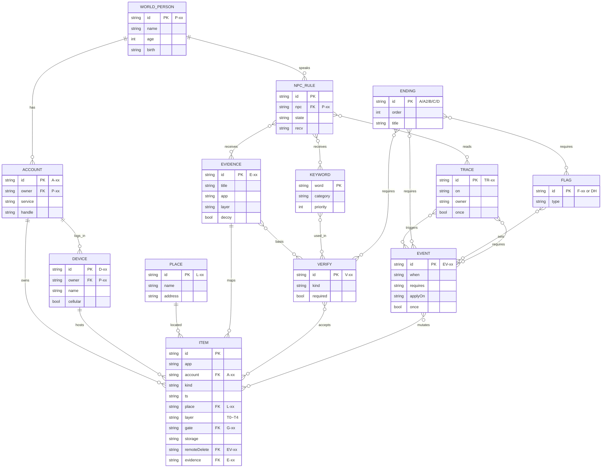

# DATABASE_SCHEMA — 콘텐츠 JSON·세이브·린터

> **역할:** 서버 DB가 없는 구조에서 데이터의 실체인 (a) 콘텐츠 JSON 스키마, (b) localStorage 세이브 스키마, (c) 콘텐츠 린터 검사 목록을 고정한다.
> **단일 출처:** 이 문서(콘텐츠 파일 스키마·세이브 봉투·린터 검사). 데이터 형식·린터의 원본은 [SYSTEM_ARCHITECTURE](SYSTEM_ARCHITECTURE.md) 3·5절이다. 상태 트리의 런타임 구조는 [STATE_MANAGEMENT](./STATE_MANAGEMENT.md)가 단일 출처다.
> **참조:** [SYSTEM_ARCHITECTURE](SYSTEM_ARCHITECTURE.md), [EVIDENCE_LEDGER](../01-product/EVIDENCE_LEDGER.md), [ACTION_PROOF](../01-product/ACTION_PROOF.md), [PROGRESSION_AND_ENDINGS](../01-product/PROGRESSION_AND_ENDINGS.md), [TRACES_AND_REACTIONS](../01-product/TRACES_AND_REACTIONS.md), [NARRATIVE_CANON](../01-product/NARRATIVE_CANON.md), [LOCATIONS](../01-product/LOCATIONS.md), [PRODUCT_PRINCIPLES](../00-foundation/PRODUCT_PRINCIPLES.md) 2절.
> **적용 버전:** v6.2 (2026-11). **서버 DB·ORM·마이그레이션 서버는 없다.** 세이브 마이그레이션은 클라이언트 코드로만 수행한다.

## 1. 데이터 계층

| 계층 | 실체 | 수명 | 저장 위치 |
|---|---|---|---|
| 콘텐츠(불변) | `game/content/*.json` | 빌드에 고정 | 빌드 시 `window.__CONTENT__`로 인라인 |
| 상태(가변) | 단일 상태 트리 | 플레이 중 | 메모리 + `localStorage` |
| 이벤트 로그(append-only) | 상태 변화 기록 | 플레이 중·세이브에 최근 N개 | 상태 트리 `log` |
| 세이브(스냅샷) | 상태 트리 + 봉투 | 자동 1 + 슬롯 3 | `localStorage` |
| 자산 | 이미지·폰트·오디오 | 빌드에 고정 | 단일 HTML 인라인 |

- 콘텐츠는 **읽기 전용**이다. 런타임에 콘텐츠를 수정하지 않는다. 삭제·읽음·체크 같은 변화는 상태 트리의 오버레이(`items`, `seen`, `flags`)에 기록한다.
- 콘텐츠 ID는 캐논 ID(E-, V-, TR-, EV-, G-, P-, A-, D-, L-, F-, 상태 ID)를 그대로 쓴다.

## 2. 엔티티 관계



- `ITEM.account`·`ITEM.place`·`ITEM.gate`·`ITEM.remoteDelete`·`ITEM.evidence`는 nullable이다.
- `TRACE.owner`는 `A-xx` 배열이 될 수 있다([TRACES_AND_REACTIONS](../01-product/TRACES_AND_REACTIONS.md) 예: A-14, A-16).
- `FLAG`는 `flags.json`이 아니라 상태 트리에 정의된다. 캐논 플래그 목록은 [12](../01-product/PROGRESSION_AND_ENDINGS.md) 6.1.

## 3. 콘텐츠 JSON 스키마

### 3.0 공통 규칙

| 규칙 | 내용 |
|---|---|
| 인코딩 | UTF-8, BOM 없음 |
| 필드 표기 | `camelCase` |
| ID 표기 | 캐논 그대로. 대소문자 구분 |
| null | "없음"은 `null`. 빈 문자열 금지(본문이 실제로 빈 경우 제외) |
| 시각 | ISO 8601 + `+09:00`. 예: `"2026-03-14T21:23:00+09:00"` |
| 게임 시각 | 정수 게임 분(`gameMin`) 또는 `when` 객체 |
| 파일 최상위 | `{ "schemaVersion": 1, ... }` |
| 참조 | ID 문자열. 정의되지 않은 ID는 린터 실패 |
| 주석 | 금지(JSON) |
| 사용자 노출 문구 | 전부 콘텐츠에 둔다. JS에 하드코딩 금지 |

### 3.1 `world.json` — 인물·계정·기기·장소·연대기·앎 매트릭스

```json
{
  "schemaVersion": 1,
  "people": [
    { "id": "P-02", "name": "이도현", "age": 20, "birth": "2007-09-21", "role": "son" }
  ],
  "accounts": [
    { "id": "A-01", "owner": "P-02", "service": "cirrus", "handle": "dohyun.lee0921@cirrus.kr", "public": false, "deviceIds": ["D-01", "D-02"] }
  ],
  "devices": [
    { "id": "D-01", "owner": "P-02", "name": "도현의 폰", "model": "LUMA 폰", "cellular": false, "note": "게임의 무대. 회선 분실 정지" }
  ],
  "places": [
    { "id": "L-01", "name": "성원아파트 103동", "address": "성원시", "aliases": ["집", "성원아파트"] }
  ],
  "timeline": [
    { "ts": "2026-03-14T21:05:00+09:00", "summary": "바로택시 승차", "evidence": ["E-12", "E-12b"] }
  ],
  "knowledge": [
    { "subject": "도현의 위치(해담 207)", "known": { "P-01": "X", "P-02": "O", "P-03": "X", "P-04": "X", "P-05": "X", "P-06": "X", "P-08": "X", "P-12": "X" } }
  ]
}
```

| 필드 | 타입 | 필수 | 설명 |
|---|---|---|---|
| `people[].id` | string `P-xx` | ✓ | 인물 ID. [03](../01-product/CHARACTERS.md) 단일 출처 |
| `people[].name` | string | ✓ | 표시 이름 |
| `people[].age` | number | ✓ | 나이(캐논) |
| `people[].birth` | string `YYYY-MM-DD` | ✓ | 생년월일(있는 경우) |
| `people[].role` | string | ✓ | `father`, `son`, `friend`, `ex`, `perpetrator`, `victim`, `police`, `other` |
| `accounts[].id` | string `A-xx` | ✓ | 계정 ID |
| `accounts[].owner` | string `P-xx` | ✓ | 소유자 |
| `accounts[].service` | string | ✓ | `cirrus`, `loop`, `talk`, `blink`, `bank`, `mailbox`, `moa`, `tube` |
| `accounts[].handle` | string | ✓ | 표시 핸들·주소 |
| `accounts[].public` | boolean | ✓ | 공개 여부 |
| `accounts[].deviceIds` | string[] `D-xx` | ✓ | 로그인 기기 |
| `devices[].id` | string `D-xx` | ✓ | 기기 ID |
| `devices[].owner` | string `P-xx` | ✓ | 소유자 |
| `devices[].name` | string | ✓ | 기기 이름(정보(i)에 표시) |
| `devices[].cellular` | boolean | ✓ | 셀룰러 유무 |
| `places[].id` | string `L-xx` | ✓ | 장소 ID. [08](../01-product/LOCATIONS.md) 단일 출처 |
| `places[].name` | string | ✓ | 표시 이름 |
| `places[].address` | string | ✓ | 주소(가상) |
| `places[].aliases` | string[] | — | 검색·표시 별칭 |
| `timeline[].ts` | ISO 8601 | ✓ | 연대기 시각. [02](../01-product/NARRATIVE_CANON.md)와 일치 |
| `timeline[].summary` | string | ✓ | 한 줄 사건 |
| `timeline[].evidence` | string[] `E-xx` | — | 관련 단서 |
| `knowledge[].subject` | string | ✓ | 앎 매트릭스 행(정보) |
| `knowledge[].known` | object `P-xx` → `O/△/X` | ✓ | 인물별 앎 상태 |

- `timeline`은 [02](../01-product/NARRATIVE_CANON.md) 3절 표를 옮긴 **검사용 사본**이다. 원본을 새로 만들지 않는다.
- `knowledge`는 [03](../01-product/CHARACTERS.md) 4절 앎 매트릭스의 검사용 사본이다.

### 3.2 `items/*.json` — 폰 속 모든 항목

파일은 앱별로 나눈다: `items/mail.json`, `items/message.json`, `items/talk.json`, `items/loop.json`, `items/blink.json`, `items/photo.json`, `items/note.json`, `items/reminder.json`, `items/contacts.json`, `items/calendar.json`, `items/voice.json`, `items/file.json`, `items/wave.json`, `items/tube.json`, `items/moa.json`, `items/bank.json`, `items/hankki.json`, `items/market.json`, `items/map.json`, `items/find.json`, `items/settings.json`, `items/system.json` 등. 파일 하나의 최상위는 배열이다.

```json
[
  {
    "id": "mail.taxi.0314",
    "app": "mail",
    "account": "A-01",
    "kind": "mail",
    "ts": "2026-03-14T21:23:00+09:00",
    "place": "L-02",
    "layer": "T1",
    "gate": null,
    "storage": "cloud",
    "remoteDelete": null,
    "evidence": "E-12",
    "data": {
      "from": "receipt@baro-taxi.kr",
      "to": "dohyun.lee0921@cirrus.kr",
      "subject": "이용 영수증",
      "body": "…",
      "meta": { "pickup": "리버뷰타워", "pickupTs": "21:05", "drop": "성원구청역 2번 출구", "dropTs": "21:22", "fare": 12400 }
    },
    "search": ["바로택시", "리버뷰타워", "성원구청역", "12400"]
  }
]
```

| 필드 | 타입 | 필수 | 설명 |
|---|---|---|---|
| `id` | string | ✓ | 전역 유일. 예: `mail.taxi.0314`, `note.letter.dad` |
| `app` | enum | ✓ | 앱 ID 30종 중 하나([06](../01-product/FEATURE_SPECIFICATION.md)) |
| `account` | string `A-xx` | — | 계정. 계정 개념이 없는 앱은 `null` |
| `kind` | enum | ✓ | `mail`, `message`, `talk`, `dm`, `post`, `story`, `comment`, `photo`, `video`, `audio`, `note`, `reminder`, `contact`, `calendar`, `call`, `transaction`, `file`, `setting`, `order`, `listing`, `health`, `wallet`, `location`, `searchHistory`, `notification`, `system` |
| `ts` | ISO 8601 | ✓ | 항목 시각. 게임 중 생성 항목은 `clock`으로 계산해 기록 |
| `place` | string `L-xx` | — | 연관 장소. 없으면 `null` |
| `layer` | enum `T0`~`T4` | ✓ | 정보의 층([04](../01-product/BUSINESS_RULES.md) 3절). `T4`는 대화로 생성된 항목 |
| `gate` | string `G-xx` | — | 열기 위한 게이트. 없으면 `null` |
| `storage` | enum | ✓ | `device`, `cloud`, `server`([09](../03-features/MAIL_AND_CLOUD_SPECIFICATION.md)) |
| `remoteDelete` | string `EV-xx` | — | 이 EV 적용 시 영구 삭제. 없으면 `null` |
| `evidence` | string `E-xx` | — | 핵심 단서면 E, 노이즈면 `null` |
| `data` | object | ✓ | `kind`별 스키마(3.2.1) |
| `search` | string[] | — | 추가 검색 색인. 본문 자동 색인에 더한다 |
| `syncApp` | string | — | 앱별 동기화 스위치 키. 없으면 `app` |
| `sourceDevice` | string `D-xx` | — | 다른 기기에서 생긴 항목이면 그 기기 |
| `createdBy` | string | — | `content`, `EV-xx`, `P-xx`(NPC), `player` |
| `readState` | string | — | `unread`, `read`, `none` |
| `tags` | string[] | — | 검색·필터 보조. 캐논 ID를 태그로 쓰지 않는다 |

#### 3.2.1 `data`의 kind별 필수 필드

| kind | 필수 필드 | 선택 필드 | 예 |
|---|---|---|---|
| `mail` | `from`, `subject`, `body` | `to`, `cc`, `attachments`, `meta`, `folder` | 3.2 예 |
| `message`·`talk`·`dm` | `roomId`, `from`, `body` | `attachments`, `readAt`, `sentDevice`, `system` | `{ "roomId":"talk.dad", "from":"P-01", "body":"도현아 어디냐" }` |
| `post` | `author`, `body` | `mediaIds`, `place`, `tags`, `likeCount`, `comments` | `{ "author":"A-15", "body":"…", "mediaIds":["photo.harin.0308"] }` |
| `story` | `author`, `mediaId`, `expiresAt` | `viewers`, `placeSticker` | `{ "author":"A-14", "mediaId":"photo.seoa.0314", "expiresAt":"2026-03-15T21:40:00+09:00" }` |
| `comment` | `postId`, `author`, `body` | `deleted`, `replies` | `{ "postId":"post.kang.0305", "author":"A-17", "body":"도현아 연락 좀 해" }` |
| `photo` | `assetId`, `width`, `height` | `capturedAt`, `location`, `device`, `edited`, `originalAssetId`, `album`, `burstIndex`, `hidden` | `{ "assetId":"img/burst.0314.11.webp", "width":1100, "height":825, "burstIndex":11, "album":"burst.0314" }` |
| `video`·`audio` | `assetId`, `durationSec` | `transcript`, `syncState`, `peaks` | `{ "assetId":"audio.rec37", "durationSec":2551 }` |
| `note` | `title`, `body` | `locked`, `lockHint`, `updatedAt` | `{ "title":"아빠한테", "body":"…", "locked":true, "lockHint":"아빠" }` |
| `reminder` | `listId`, `title`, `done` | `doneAt` | `{ "listId":"list.0318", "title":"녹음 백업", "done":false }` |
| `contact` | `name`, `phone` | `birthday`, `company`, `memo`, `favorite` | `{ "name":"아빠", "phone":"010-XXXX-0403", "birthday":"1968-04-03" }` |
| `calendar` | `title`, `startAt`, `allDay` | `repeat`, `location` | `{ "title":"엄마", "startAt":"2026-11-02T00:00:00+09:00", "repeat":"yearly" }` |
| `call` | `direction`, `number`, `durationSec` | `contactId` | `{ "direction":"out", "number":"1588-XXXX", "durationSec":852 }` |
| `transaction` | `direction`, `amount`, `counterparty` | `memo`, `balanceAfter`, `accountNumber` | `{ "direction":"out", "amount":3400000, "counterparty":"한결캐피탈(이상철)" }` |
| `file` | `name`, `mime`, `size` | `receivedFrom`, `receivedVia`, `receivedAt` | `{ "name":"교육자료.pdf", "mime":"application/pdf", "receivedFrom":"민석의 폰" }` |
| `setting` | `path`, `value` | `updatedAt`, `sourceDevice` | `{ "path":"wifi.known.HAEDAM_2F", "value":true, "sourceDevice":"D-02" }` |
| `order` | `store`, `items`, `address`, `payment` | `request`, `orderDevice` | `{ "store":"한끼", "items":["컵밥 1"], "address":"성원구청로 31, 해담고시텔 207호", "payment":"만나서 현금 결제" }` |
| `listing` | `title`, `price`, `status` | `chats` | `{ "title":"모니터 12만", "price":120000, "status":"예약 중" }` |
| `health` | `date`, `steps`, `heartRate` | `segments` | `{ "date":"2026-03-14", "steps":[…], "heartRate":[…] }` |
| `wallet` | `type`, `amount`, `from` | `to`, `ts` | `{ "type":"transit", "from":"성원구청역", "to":"리버뷰역" }` |
| `location` | `type`, `name` | `firstSeen`, `lastSeen`, `sourceDevice`, `count` | `{ "type":"wifi", "name":"HAEDAM_2F", "sourceDevice":"D-02" }` |
| `searchHistory` | `query`, `ts`, `sourceDevice` | `result` | `{ "query":"해담고시텔", "sourceDevice":"D-02" }` |
| `notification` | `app`, `title`, `body` | `previewPolicy`, `originalItemId` | `{ "app":"blink", "title":"블링크", "body":"새 메시지" }` |
| `system` | `code`, `text` | `severity` | `{ "code":"NO_SERVICE", "text":"서비스 없음" }` |

- `photo.assetId`·`video.assetId`·`audio.assetId`는 [FILE_AND_MEDIA_MANAGEMENT](./FILE_AND_MEDIA_MANAGEMENT.md)의 자산 ID 규칙을 따른다.
- `notification`은 **알림 기록**이다. 원본이 삭제돼도 남는다([05](../03-features/SYSTEM_SHELL_SPECIFICATION.md)). 미리보기 설정은 표시 시점에 적용한다.
- `system`은 "서비스 없음" 같은 게임 내 시스템 항목이다. 실제 오류와 구분한다([ERROR_HANDLING](../05-quality/ERROR_HANDLING.md)).

### 3.3 `evidence.json` — E-xx ↔ 항목 매핑

```json
{
  "schemaVersion": 1,
  "evidence": [
    {
      "id": "E-12",
      "title": "바로택시 이용 영수증",
      "app": "mail",
      "layer": "T1",
      "itemIds": ["mail.taxi.0314", "taxi.receipt.0314"],
      "basisFor": ["V-05", "TR-18"],
      "loss": "none",
      "decoy": false,
      "location": "L-02",
      "canonRef": "10#3.2"
    }
  ]
}
```

| 필드 | 타입 | 필수 | 설명 |
|---|---|---|---|
| `id` | string `E-xx` | ✓ | 단서 ID. [10](../01-product/EVIDENCE_LEDGER.md) 단일 출처 |
| `title` | string | ✓ | 내부 제목. 화면에 자동 표시하지 않는다 |
| `app` | enum | ✓ | 주 단서 앱 |
| `layer` | enum | ✓ | 최소 노출 층 |
| `itemIds` | string[] | ✓ | 이 단서를 구성하는 항목. 여러 개 가능 |
| `basisFor` | string[] | — | V/TR/EV 참조. 린터가 역참조 검사 |
| `loss` | enum | ✓ | `none`, `EV-04`, `EV-05`, `EV-07`, `EV-08`, `EV-09`, `EV-22`, `EV-23`, `blink60` |
| `decoy` | boolean | ✓ | 미끼 여부 |
| `decoyOf` | string `L-xx` | — | 미끼가 가리키는 장소 |
| `location` | string `L-xx` | — | 장소 단서면 표기 |
| `canonRef` | string | — | 원본 문서 절. 예: `10#3.2` |

- `itemIds`에 없는 E는 린터 실패.
- `basisFor`에 없는 E는 "고아 단서"로 경고한다(장식 단서는 `basisFor: []` 허용).
- `decoy: true`인데 `decoyOf`가 없으면 경고.

### 3.4 `verify.json` — 행동 증명(V)

```json
{
  "schemaVersion": 1,
  "verify": [
    {
      "id": "V-12",
      "kind": "taxi+input",
      "accept": [
        { "event": "taxi.call", "dest": ["L-11"] },
        { "event": "final.roomInput", "value": "207" }
      ],
      "basis": ["E-150", "E-198", "E-219", "E-220", "E-74", "E-214b", "E-73", "E-151", "E-218"],
      "required": "A",
      "onDone": [
        { "set": { "F-GO": true, "F-LOC": "exact" } }
      ],
      "sourceRef": "11#2"
    }
  ]
}
```

| 필드 | 타입 | 필수 | 설명 |
|---|---|---|---|
| `id` | string `V-xx` | ✓ | V ID. [11](../01-product/ACTION_PROOF.md) 단일 출처 |
| `kind` | string | ✓ | `unlock`, `memoPassword`, `bankLogin`, `identity`, `share`, `search`, `directInput`, `setting`, `call`, `taxi+input`, `mail`, `combo` |
| `accept` | object[] | ✓ | 받는 입력 조건. 모든 조건을 만족하면 성립(`all`) |
| `accept[].event` | string | ✓ | 행동 이벤트 이름([API_SPECIFICATION](./API_SPECIFICATION.md) 3절) |
| `accept[].value` | string \| string[] | — | 정확히 일치해야 하는 값(정규화 후) |
| `accept[].dest` | string[] `L-xx` | — | 목적지 장소 ID |
| `accept[].itemId` | string | — | 공유·첨부 항목 |
| `accept[].target` | string `P-xx`/`A-xx` | — | 대상 인물·계정 |
| `accept[].path` | string | — | 설정 경로 |
| `accept[].state` | string | — | 설정 값 |
| `basis` | string[] `E-xx` | ✓ | 린터용 근거. 게임은 확인하지 않는다 |
| `required` | `"A"` \| `"A2"` \| `"quality"` \| `false` | ✓ | `A`=엔딩 A 필수, `quality`=후일담·대체 경로, `false`=선택 |
| `onDone` | object[] | — | 상태 변화. `set`, `openGate`, `makeItem`, `notify` |
| `sourceRef` | string | — | 원본 절 |

- `basis`는 **서로 다른 `app` 2개 이상**이어야 한다(필수 V). 린터 검사.
- `basis`는 플레이어가 근거를 봤는지와 무관하다. 게임은 `seen`을 판정에 쓰지 않는다([11](../01-product/ACTION_PROOF.md)).
- `onDone`에서 엔딩 판정을 직접 호출하지 않는다. 상태 변화만 하고 `endings.js`가 평가한다.

### 3.5 `traces.json` — 흔적(TR)

```json
{
  "schemaVersion": 1,
  "traces": [
    {
      "id": "TR-05",
      "on": "loop.story.view",
      "owner": ["A-14", "A-16"],
      "requires": "online && !loop.viewedAs('dontknow__')",
      "visibleTo": "owner",
      "delayGameMin": { "min": 10, "max": 20 },
      "react": [
        { "if": "owner == 'A-14'", "ev": "EV-34" },
        { "if": "owner == 'A-16'", "ev": "EV-31" }
      ],
      "once": true,
      "sourceRef": "19#2"
    }
  ]
}
```

| 필드 | 타입 | 필수 | 설명 |
|---|---|---|---|
| `id` | string `TR-xx` | ✓ | TR ID. [19](../01-product/TRACES_AND_REACTIONS.md) 단일 출처 |
| `on` | string | ✓ | 트리거 행동 이벤트 |
| `owner` | string[] `A-xx` | ✓ | 이 흔적을 보는 계정·인물 |
| `requires` | string | — | 조건식(3.7). 없으면 항상 |
| `visibleTo` | enum | ✓ | `owner`, `self`, `public`, `none` |
| `delayGameMin` | number \| `{min,max}` | ✓ | 반응 지연. [TRACES_AND_REACTIONS](../01-product/TRACES_AND_REACTIONS.md) 4절 |
| `react` | object[] | ✓ | 반응. `if`, `ev`, `set`, `makeItem`, `notify` |
| `once` | boolean | ✓ | 같은 TR은 1회만([TRACES_AND_REACTIONS](../01-product/TRACES_AND_REACTIONS.md) 6절) |
| `sourceRef` | string | — | 원본 절 |

- 모든 TR은 반응(EV 또는 상태 변화)을 가져야 한다. 모든 반응 EV는 트리거를 가져야 한다(린터 L04).
- `delayGameMin`의 `min/max`는 게임 분이다. 랜덤은 시드 고정(세이브 재현성).

### 3.6 `keywords.json` — 직접 입력 낱말 사전

```json
{
  "schemaVersion": 1,
  "normalize": { "ignoreCase": true, "ignoreSpace": true, "stripParticles": true, "foldJamo": false },
  "entries": [
    { "word": "강민석", "canonical": "강민석", "category": "person", "priority": 2, "variants": ["강민석이", "강민석씨", "강민석님"], "usedIn": ["V-11"] },
    { "word": "해담", "canonical": "해담", "category": "place", "priority": 1, "variants": ["해담고시텔", "해담 고시텔"], "usedIn": ["V-12"] }
  ],
  "leakWords": ["해담", "207", "성원구청로 31", "성원구청역", "성원스파"]
}
```

| 필드 | 타입 | 필수 | 설명 |
|---|---|---|---|
| `normalize.ignoreCase` | boolean | ✓ | 영문 대소문자 무시 |
| `normalize.ignoreSpace` | boolean | ✓ | 띄어쓰기 무시 |
| `normalize.stripParticles` | boolean | ✓ | 조사 제거(이/가/은/는/을/를/씨/님 등) |
| `entries[].word` | string | ✓ | 대표 표기 |
| `entries[].canonical` | string | ✓ | 정규화 결과 |
| `entries[].category` | enum | ✓ | `person`, `place`, `money`, `identity`, `other`, `leak` |
| `entries[].priority` | number | ✓ | 매칭 우선순위. 낮을수록 먼저(위험 낱말 = 1) |
| `entries[].variants` | string[] | — | 표기 변형 |
| `entries[].usedIn` | string[] `V-xx` | ✓ | 이 낱말을 쓰는 V |
| `leakWords` | string[] | ✓ | 위치 유출(F-LEAK) 판정 낱말([12](../01-product/PROGRESSION_AND_ENDINGS.md) 6.2) |

- 매칭 우선순위: **위험 낱말(장소) → 사람 → 돈 → 정체**([12](../01-product/PROGRESSION_AND_ENDINGS.md) 5절). `priority`가 이를 구현한다.
- 사전에 없는 문장은 인물별 기본 반응. 오류가 아니다.
- 모든 V의 직접 입력 값과 6.2 유출 낱말이 사전에 있어야 한다(린터 L05).

### 3.7 조건식

조건식은 문자열이며 다음 토큰만 허용한다. `eval`·`new Function` 금지.

| 토큰 | 의미 | 예 |
|---|---|---|
| `flag.F-xx` | 플래그 참 | `flag.F-GO` |
| `gate.G-xx` | 게이트 열림 | `gate.G-03` |
| `v.V-xx` | V 성립 | `v.V-04` |
| `trace.TR-xx` | TR 발생 | `trace.TR-02` |
| `dh` | 도현 상태 숫자 | `dh >= 3` |
| `loc` | 위치 정밀도 | `loc == 'exact'` |
| `item.exists('id')` | 항목 존재·가시 | `item.exists('voice.37')` |
| `online` | 온라인 | `online` |
| `airplane` | 비행기 모드 | `!airplane` |
| `time >= 'ISO'` | 게임 시각 | `time >= '2026-03-18T08:00'` |
| `app.sync('photo')` | 앱 동기화 켜짐 | `app.sync('photo')` |
| `npc.state('DH')` | NPC 상태 | `npc.state('DH') == 'DH-2'` |
| `seen('E-xx')` | 열람 기록(힌트 전용) | `seen('E-218')` |
| `&&`, `\|\|`, `!`, `==`, `!=`, `>=`, `<=`, `>` `<` | 논리·비교 | `online && !flag.F-WIPED` |

- `seen`은 **힌트 단계 선택에만** 쓴다. V·엔딩 판정에 쓰지 않는다([10](../01-product/EVIDENCE_LEDGER.md) 1절).
- 린터는 화이트리스트 밖 토큰·미정의 ID·괄호 불균형을 실패로 처리한다.

### 3.8 `events.json` — 사건(EV)

```json
{
  "schemaVersion": 1,
  "events": [
    {
      "id": "EV-04",
      "when": { "after": "T", "plusGameMin": 18 },
      "requires": "flag.firstOnline && !dh.cancelDeletes",
      "applyOn": "online",
      "do": [ { "remoteDelete": "note.letter.dad" } ],
      "once": true,
      "sourceRef": "12#3.1"
    }
  ]
}
```

| 필드 | 타입 | 필수 | 설명 |
|---|---|---|---|
| `id` | string `EV-xx` | ✓ | EV ID. [12](../01-product/PROGRESSION_AND_ENDINGS.md) 단일 출처 |
| `when.at` | `"HH:mm"` \| `gameMin` | △ | 절대 시각. `when.after`와 택일 |
| `when.after` | string | △ | 기준: `T`(첫 온라인), `EV-xx`, `V-xx`, `TR-xx`, `state` |
| `when.plusGameMin` | number | ✓(after 사용 시) | 기준 + 게임 분 |
| `requires` | string | — | 조건식(3.7) |
| `applyOn` | enum | ✓ | `immediate`, `online`. `online`이면 오프라인 시 대기열 |
| `do` | object[] | ✓ | `remoteDelete`, `remoteWipe`, `remoteCreate`, `setFlag`, `setNpc`, `openGate`, `notify`, `makeItem`, `addTrace`, `schedule` |
| `once` | boolean | ✓ | 1회만 |
| `priority` | number | — | 같은 분에 여러 EV면 낮을수록 먼저 |
| `sourceRef` | string | — | 원본 절 |

- `applyOn: "online"`은 [12](../01-product/PROGRESSION_AND_ENDINGS.md) 3.2 오프라인 규칙을 구현한다.
- `remoteWipe`는 대기열에서 **다른 무엇보다 먼저** 실행한다([14](SYSTEM_ARCHITECTURE.md) 4.2).
- `notify`는 알림 기록을 만들 뿐, 실제 푸시를 보내지 않는다.

### 3.9 `npc/*.json` — 대화 표

파일: `npc/dohyun.json`, `jihoon.json`, `seoa.json`, `harin.json`, `minji.json`, `taeyun.json`, `kang.json`, `cheongun.json` 등.

```json
{
  "schemaVersion": 1,
  "npc": "P-03",
  "states": ["JH-0", "JH-0′", "JH-1", "JH-2"],
  "default": {
    "reply": ["무슨 말이에요?"],
    "delayGameMin": 3
  },
  "rules": [
    {
      "state": "JH-1",
      "recv": { "kind": "share", "value": "E-23" },
      "reply": ["…도현이 살아 있어요", "어딘지는 진짜 몰라요", "근데 걔 2월에 방 구한다고 했었어요"],
      "delayGameMin": 4,
      "set": { "JH": "JH-2" },
      "makeItem": null,
      "requires": "online",
      "once": true,
      "sourceRef": "12#4.2"
    }
  ]
}
```

| 필드 | 타입 | 필수 | 설명 |
|---|---|---|---|
| `npc` | string `P-xx` | ✓ | 인물 ID |
| `states` | string[] | ✓ | 상태 목록(캐논 상태 ID) |
| `default` | object | ✓ | 정의되지 않은 입력의 기본 반응 |
| `rules[]` | object[] | ✓ | 반응 표 |
| `rules[].state` | string | ✓ | 이 규칙이 적용되는 상태 |
| `rules[].recv` | object | ✓ | `{kind, value}`. `kind`=`share`\|`chip`\|`keyword`\|`trace` |
| `rules[].recv.value` | string | ✓ | E-ID, 추천 문장 ID, 사전 낱말, TR-ID |
| `rules[].reply` | string[] | ✓ | 말풍선 문장 배열(한 버블=한 생각) |
| `rules[].delayGameMin` | number | ✓ | 응답 지연(게임 분) |
| `rules[].set` | object | — | 상태 변화. 예: `{ "JH": "JH-2" }` |
| `rules[].makeItem` | object | — | 생성 항목 초안(진술 캡처 등) |
| `rules[].requires` | string | — | 추가 조건식 |
| `rules[].once` | boolean | ✓ | 1회만 |
| `rules[].sourceRef` | string | — | 원본 절 |

- 입력 우선순위는 [12](../01-product/PROGRESSION_AND_ENDINGS.md) 5절: 공유 첨부 → 추천 문장 → 사전 낱말 → 기본 반응.
- `makeItem`은 `items` 스키마의 부분 객체다. `id`는 빌드 시 `makeItem` 소유 규칙으로 유일성을 검사한다.
- 응답 문장은 [03](../01-product/CHARACTERS.md) 앎 매트릭스를 어길 수 없다(린터 L09).

### 3.10 `endings.json` — 엔딩

```json
{
  "schemaVersion": 1,
  "resolveOrder": ["D", "B", "A", "A2", "C"],
  "epilogueRules": [
    { "key": "epilogue.arrest.kang", "condition": "F-REC-SENT || F-NAME-SENT || F-PLATE-SENT", "text": "강민석, 전기통신금융사기 혐의로 구속." }
  ],
  "endings": [
    {
      "id": "A",
      "order": 3,
      "title": "알았어",
      "condition": "F-GO && F-LOC == 'exact' && threatCleared && F-CONFESS",
      "cinematic": "cine.ending.a",
      "phoneScreen": "talk.dad.read",
      "epilogue": ["epilogue.arrest.kang", "epilogue.victim.return", "epilogue.harin.court", "epilogue.debt"],
      "sourceRef": "12#6.4"
    }
  ]
}
```

| 필드 | 타입 | 필수 | 설명 |
|---|---|---|---|
| `resolveOrder` | string[] | ✓ | 위에서부터 처음 맞는 엔딩. 캐논 순서 D→B→A→A′→C |
| `endings[].id` | string | ✓ | `A`, `A2`, `B`, `C`, `D` |
| `endings[].order` | number | ✓ | 표시·검증용 순서 |
| `endings[].title` | string | ✓ | 캐논 제목 |
| `endings[].condition` | string | ✓ | 조건식. `threatCleared`는 파생 불리언 |
| `endings[].cinematic` | string | ✓ | 시네마틱 자산 키 |
| `endings[].phoneScreen` | string | ✓ | 마지막 폰 화면 설명 키 |
| `endings[].epilogue` | string[] | ✓ | 후일담 변주 키. 조건은 `world.json`·`endings.json`의 `epilogueRules` |
| `endings[].sourceRef` | string | — | 원본 절 |
| `epilogueRules[].key` | string | ✓ | 후일담 키. `endings[].epilogue`가 참조 |
| `epilogueRules[].condition` | string | ✓ | 조건식 |
| `epilogueRules[].text` | string | ✓ | 후일담 문장(캐논 원문) |

- `threatCleared = F-REC-SENT || F-NAME-SENT || F-PLATE-SENT || F-REC == 'synced'`([12](../01-product/PROGRESSION_AND_ENDINGS.md) 6.4).
- 엔딩 판정은 `endings.js`만 한다. 콘텐츠의 `condition`을 UI가 해석하지 않는다.

## 4. 세이브 스키마(localStorage)

### 4.1 키

| 키 | 내용 | 덮어쓰기 |
|---|---|---|
| `dontknow.v6.auto` | 자동 저장 1개 | 매 자동 저장 |
| `dontknow.v6.slot.1` | 수동 슬롯 1 | 사용자 확인 후 |
| `dontknow.v6.slot.2` | 수동 슬롯 2 | 〃 |
| `dontknow.v6.slot.3` | 수동 슬롯 3 | 〃 |
| `dontknow.v6.meta` | 설정·마지막 슬롯·마이그레이션 메모 | 수시 |
| `dontknow.v6.backup.<epoch>` | 손상·미래 버전 세이브 백업 | 생성만 |
| `dontknow.v6.build` | 마지막 실행 빌드 해시 | 부팅 시 |

- 모든 키는 `dontknow.v6.` 접두를 쓴다. 다른 게임·앱 키와 충돌하지 않는다.
- `localStorage` 접근은 `core/save.js`만 한다.

### 4.2 봉투

```json
{
  "schemaVersion": 3,
  "appVersion": "6.2.0",
  "contentVersion": "2026.11.1",
  "savedAt": "2026-11-08T10:30:00.000Z",
  "reason": "autosave",
  "gameMin": 128,
  "clockLabel": "3월 17일 화요일 23:18",
  "state": { "clock": {}, "net": {}, "device": {}, "flags": {}, "apps": {}, "items": {}, "seen": {}, "traces": {}, "verify": {}, "queue": {}, "log": [], "ui": {}, "meta": {} },
  "checksum": "fnv1a32:8f3a91c2"
}
```

| 필드 | 타입 | 필수 | 설명 |
|---|---|---|---|
| `schemaVersion` | number | ✓ | 세이브 구조 버전. 현재 3 |
| `appVersion` | string | ✓ | 앱 버전(빌드) |
| `contentVersion` | string | ✓ | 콘텐츠 버전 |
| `savedAt` | ISO 8601 | ✓ | 실제 저장 시각(벽시계). 게임 판정에 쓰지 않음 |
| `reason` | enum | ✓ | `autosave`, `manual`, `ending`, `migration` |
| `gameMin` | number | ✓ | 게임 시각(빠른 표시용) |
| `clockLabel` | string | ✓ | 슬롯 목록 표시용 |
| `state` | object | ✓ | [STATE_MANAGEMENT](./STATE_MANAGEMENT.md)의 직렬화 상태 |
| `checksum` | string | ✓ | `fnv1a32:<hex>`. 무결성(보안 아님) |

- `state`에서 파생 캐시(`visibility`, `searchIndex`, 렌더 HTML)는 저장하지 않는다.
- `log`는 최근 **500개**만 저장한다. 그 이전은 버린다(세이브 크기·재현성 균형).
- 세이브 1개 목표 크기 ≤ 512KB. 3슬롯 + 자동 + 백업 포함 2MB 이하.

### 4.3 슬롯 메타

`listSlots()`는 각 키의 봉투에서 다음만 읽는다.

```json
{ "slot": 1, "savedAt": "2026-11-08T10:30:00.000Z", "gameMin": 128, "clockLabel": "3월 17일 화요일 23:18", "appVersion": "6.2.0", "contentVersion": "2026.11.1", "endingSeen": null }
```

### 4.4 마이그레이션

| 규칙 | 내용 |
|---|---|
| 레지스트리 | `MIGRATIONS = { 1: v1to2, 2: v2to3 }`. 순차 적용 |
| 실패 | 원본을 `dontknow.v6.backup.<epoch>`에 백업하고, 자동 저장 → 슬롯 순으로 복구 시도 |
| 미래 버전 | `schemaVersion > 3`이면 읽지 않고 백업. 화면: "이 저장은 최신 버전에서 만들어졌습니다." |
| 과거 버전 | 체인 적용. 중간 실패 시 백업 후 이전 슬롯 |
| 콘텐츠 변경 | 항목 ID가 사라졌으면 해당 상태 키를 버리고 경고 로그. 게임은 계속 |
| 알 수 없는 키 | 무시하고 보존(다음 저장에 포함하지 않음) |
| 체크섬 불일치 | 손상으로 간주. 자동 복구 시도. 실패 시 백업 |

### 4.5 자동 저장 시점

[05](../03-features/SYSTEM_SHELL_SPECIFICATION.md): **접근 해제·EV·공유·메일 발송**. 추가로 엔딩 판정 직후, 수동 슬롯 저장 직전, 원격 지우기(EV-08) 적용 직전에 저장한다.

- 저장은 20ms 안에 끝나야 한다([PERFORMANCE_REQUIREMENTS](../05-quality/PERFORMANCE_REQUIREMENTS.md)).
- 저장 실패(용량·권한)는 [ERROR_HANDLING](../05-quality/ERROR_HANDLING.md) 3절.

## 5. 콘텐츠 린터 검사 목록

`game/tools/lint_content.py`가 빌드 전에 검사한다. 하나라도 실패하면 빌드하지 않는다.

| # | 검사 | 대상 | 규칙 | 실패 예 |
|---|---|---|---|---|
| L01 | **ID 참조** | verify·traces·events·npc·endings | 모든 E/G/EV/V/TR/P/A/D/L/F 참조가 정의되어 있는가 | `basis: ["E-999"]` |
| L02 | **이중 경로** | verify | 필수 V(`required: "A"`)마다 `basis`가 서로 다른 `app` **2개 이상**인가(P4) | V-12 basis가 전부 `hankki` |
| L03 | **소실 안전** | verify·evidence·events | 각 필수 V의 `basis` 중 `remoteDelete`·실장 정리(EV-22/23) 대상이 **아닌** 항목이 서로 다른 앱 2개 이상 남는가 | V-13 근거가 전부 EV-05 삭제 대상 |
| L04 | **흔적 짝** | traces·events | 모든 TR이 반응(EV 또는 상태 변화)을 가지는가. 모든 반응 EV가 트리거를 가지는가 | TR-05 `react: []` |
| L05 | **낱말 사전** | keywords·verify | V의 직접 입력 값과 [PROGRESSION_AND_ENDINGS](../01-product/PROGRESSION_AND_ENDINGS.md) 6.2 유출 낱말이 사전에 있는가 | V-11 `"강민석"` 미등록 |
| L06 | **미끼 격리** | evidence·items | L-11(해담) 근거 항목이 전부 T2인가. 예외는 E-130 댓글 한 줄만 | 해담 근거가 T1 |
| L07 | **타임라인** | items·world | 항목 `ts`가 [NARRATIVE_CANON](../01-product/NARRATIVE_CANON.md) 연대기와 같은가. `world.timeline` 사본과 대조 | 3/14 21:05가 21:50으로 |
| L08 | **이동 시간** | world·items | 같은 인물의 연속 위치 사이 시간이 [LOCATIONS](../01-product/LOCATIONS.md) 이동 시간표 이상인가 | 리버뷰→홍대 30분 |
| L09 | **앎 매트릭스** | npc | NPC 응답 문장에 인물별 ✕ 정보의 금지 키워드가 있는가 | 지훈이 "해담"을 말함 |
| L10 | **금칙어** | 모든 콘텐츠 | [PRODUCT_PRINCIPLES](../00-foundation/PRODUCT_PRINCIPLES.md) 2절 수법 구체어(사기 대본·세탁·계정 탈취 절차)가 없는가 | "세탁" 절차 설명 |
| L11 | **스키마** | 모든 콘텐츠 | 필수 필드·타입·enum·null 규칙을 지키는가 | `layer: "T5"` |
| L12 | **중복 ID** | 모든 콘텐츠 | E/V/TR/EV/아이템/규칙 ID가 전역 유일한가 | 두 파일에 `item.note.same` |
| L13 | **조건식** | verify·traces·events·npc·endings | 화이트리스트 토큰만 쓰는가. 괄호·비교가 유효한가. 미정의 ID가 없는가 | `eval('...')` |
| L14 | **층·게이트** | items·evidence | `T2` 항목이 `online` 없이 열리지 않는가. `gate`가 정의되어 있는가 | T2인데 `gate: null` 허용? → 온라인 규칙으로 검사 |
| L15 | **엔딩** | endings | `resolveOrder`가 캐논 순서(D→B→A→A′→C)인가. 조건의 F/V/EV가 정의되어 있는가 | A가 D보다 먼저 |
| L16 | **자산 참조** | items·endings | `assetId`·`cinematic`·`phoneScreen` 키가 `img/`·`fonts/`·시네마틱 목록에 있는가 | 없는 이미지 |
| L17 | **NPC 생성 항목** | npc | `makeItem.id`가 아이템 ID 규칙을 지키고 중복되지 않는가 | 빈 ID |
| L18 | **금지 어휘** | 모든 콘텐츠 | 폐기 용어(카드 판정·C-/I-/Q- ID·기기 잠금과 메모 암호를 혼동한 서술)가 없는가 | "메모 암호를 기기 잠금으로 씀" |

### 5.1 린터 실행

```text
python3 game/tools/lint_content.py --content game/content --strict
```

- `--strict`: 경고도 실패로 처리. 배포 전 필수.
- 출력: `L07 FAIL items/mail.json#mail.taxi.0314 ts=2026-03-14T21:50:00+09:00 expected 21:23`.
- 린터는 콘텐츠를 수정하지 않는다. 읽기 전용.

## 확인 사항

- `Q-OPEN-T10`: `items/*.json`의 `kind` enum과 `data` 스키마는 이 문서가 정의했지만, 03-features 작성자가 앱별 데이터 필드를 더 추가할 수 있다. 추가 필드는 허용하되(선택 필드), 필수 필드 변경은 이 문서를 갱신해야 한다.
- `Q-OPEN-T11`: 세이브 `schemaVersion`을 3으로 시작하는 이유는 v6.0·v6.1의 폐기된 세이브와 구분하기 위해서다. 실제 첫 구현은 1로 시작하고 이 문서를 고칠지, 3을 유지할지 총괄이 정해야 한다(추천: 첫 구현 1, 마이그레이션 테스트를 위해 1→2→3 체인을 인위적으로 만들지 않는다).
- `Q-OPEN-T12`: 린터 L14의 "T2 항목이 `online` 없이 열리지 않는가"는 캐시 규칙([SYSTEM_ARCHITECTURE](SYSTEM_ARCHITECTURE.md) 4.1: 한 번 온라인에서 본 T2는 오프라인에서도 캐시로 보임)과 충돌하지 않도록 "최초 노출은 online"으로 검사해야 한다. 구현 시 캐시 예외를 명시해야 한다.
- `Q-OPEN-T13`: 블링크 60초 삭제의 세이브 표현(실시간 초를 게임 분으로 환산할지)은 [BACKEND_ARCHITECTURE](./BACKEND_ARCHITECTURE.md) Q-OPEN-T07과 같은 미결이다.
