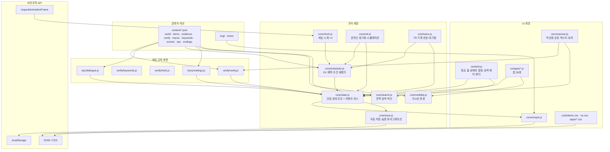
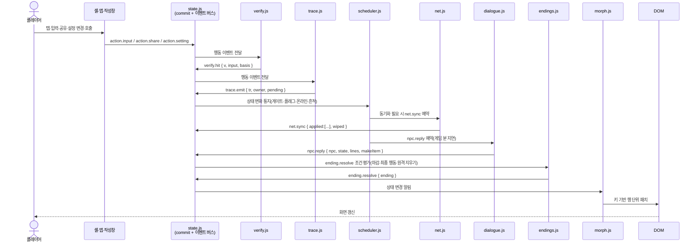
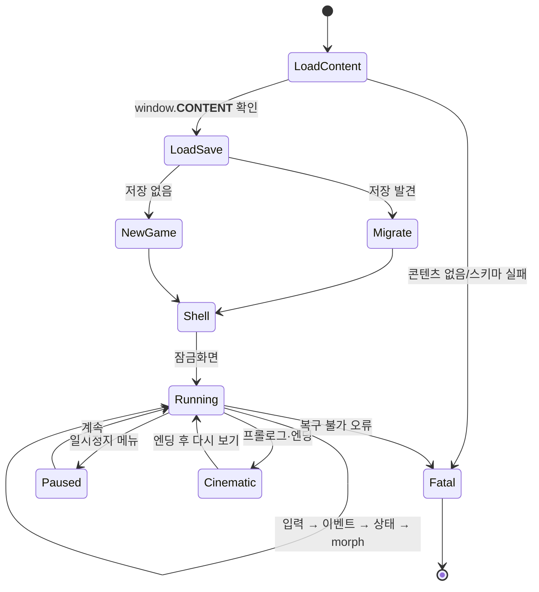

# SYSTEM_ARCHITECTURE — 전체 구조와 데이터 흐름

> **역할:** DONTKNOW v6.2 클라이언트의 전체 구조, 계층 경계, 모듈 책임, 데이터 흐름, "실시간"의 정의를 고정한다. 구현자가 "어디에 무엇을 넣을지" 판단하지 않게 한다.
> **단일 출처:** 이 문서(전체 구조·계층·데이터 흐름·실시간 정의). 모듈 트리의 원본은 [SYSTEM_ARCHITECTURE](SYSTEM_ARCHITECTURE.md) 2절이며, 파일별 상세 책임은 [FRONTEND_ARCHITECTURE](./FRONTEND_ARCHITECTURE.md)가 단일 출처다.
> **참조:** [SYSTEM_ARCHITECTURE](SYSTEM_ARCHITECTURE.md), [BUSINESS_RULES](../01-product/BUSINESS_RULES.md), [PROGRESSION_AND_ENDINGS](../01-product/PROGRESSION_AND_ENDINGS.md), [TRACES_AND_REACTIONS](../01-product/TRACES_AND_REACTIONS.md), [ACTION_PROOF](../01-product/ACTION_PROOF.md), [SYSTEM_SHELL_SPECIFICATION](../03-features/SYSTEM_SHELL_SPECIFICATION.md), [IMPLEMENTATION_ROADMAP](../06-execution/IMPLEMENTATION_ROADMAP.md).
> **적용 버전:** v6.2 (2026-11). 서버·DB·외부 API·외부 라이브러리를 도입하지 않는다.

## 1. 결정 요약

| 항목 | 결정 | 근거 |
|---|---|---|
| 실행 형태 | **단일 HTML 파일**. CSS·JS·콘텐츠 JSON·이미지·폰트를 빌드 시 인라인 | [14](SYSTEM_ARCHITECTURE.md) 1절 |
| 언어 | 바닐라 JavaScript(ES2020 모듈) + JSDoc. 프레임워크 없음 | 〃 |
| 렌더링 | DOM + CSS + 자체 `morph()` 패치. 전체 다시 그리기는 앱 전환 때만 | [05](../03-features/SYSTEM_SHELL_SPECIFICATION.md) |
| 상태 | 단일 상태 트리 + append-only 이벤트 로그 | 이 문서 6절, [STATE_MANAGEMENT](./STATE_MANAGEMENT.md) |
| 저장 | localStorage. 자동 저장 1 + 수동 슬롯 3 | [DATABASE_SCHEMA](./DATABASE_SCHEMA.md) 4절 |
| 네트워크 | **없음.** `fetch`·`XMLHttpRequest`·`WebSocket`·`EventSource`·`sendBeacon` 사용 금지 | 이 문서 7절 |
| 게임 속 서버 | 클라이언트 시뮬레이터(`net.js`)와 콘텐츠 데이터가 대신한다 | [BACKEND_ARCHITECTURE](./BACKEND_ARCHITECTURE.md) |
| 테스트 | Playwright 클릭 경로 테스트 + Python 콘텐츠 린터 | [TESTING_STRATEGY](../05-quality/TESTING_STRATEGY.md) |

## 2. 전체 구조

- 화살표는 **호출/데이터 의존**이다. 역방향 호출(코어가 UI를 직접 호출)은 금지한다. 코어는 상태를 바꾸고 이벤트를 발행할 뿐, DOM을 모른다.
- `verify`·`trace`·`scheduler`·`net`·`npc`·`endings`는 서로 직접 호출하지 않는다. 모두 `state.js`의 이벤트 버스를 거친다. 순서 보장은 5절 시퀀스가 단일 출처다.
- `visibility`·`search`는 **파생 상태**다. 자기 상태를 저장하지 않고 `state`에서 매번 계산한다.

## 3. 클라이언트 단독 책임 표

| 계층 | 모듈 | 책임(한다) | 하지 않는다 |
|---|---|---|---|
| 셸 | `os/shell.js` | 잠금화면·상태바·홈·알림 센터·제어 센터·전역 검색·앱 전환·일시정지 메뉴 | 앱 내부 화면 렌더, 게임 규칙 판정 |
| 앱 | `os/apps/*.js` | 앱 30종의 화면·목록·상세·정보(i)·앱 상태 | 전역 상태 직접 변경, 자체 타이머로 사건 발생 |
| 작성창 | `os/composer.js` | 추천 문장·직접 입력·공유 첨부·텍스트 대치·클립보드 칩 | NPC 응답 결정, V 판정 |
| 코어 | `core/state.js` | 단일 상태 트리, `commit`/`transaction`, 이벤트 버스, 이벤트 로그 | DOM 접근, 콘텐츠 파일 읽기 |
| 코어 | `core/clock.js` | 게임 시계 ×4, 일시정지, 백그라운드 정지, 시간 흐름 끄기 | 사건 실행(스케줄러에 위임) |
| 코어 | `core/scheduler.js` | EV 시각 예약·조건 재평가·오프라인 대기열 트리거 | 삭제 연출, NPC 대사 생성 |
| 코어 | `core/net.js` | 온라인/오프라인, 동기화 적용, 원격 삭제·원격 지우기, 다른 기기 기록 유입 | 실제 HTTP, 실제 계정 |
| 코어 | `core/trace.js` | TR 발생 기록, 전송 대기열, 반응 트리거 | 반응 대사 작성 |
| 코어 | `core/visibility.js` | 항목·화면의 가시성 판정(층·게이트·온라인·삭제) | 상태 저장, UI 렌더 |
| 코어 | `core/search.js` | 현재 접근 가능한 항목의 검색 색인 | 전체 콘텐츠 검색(잠긴 것은 제외) |
| 코어 | `core/morph.js` | 키 기반 DOM 패치, 스크롤 유지 | 상태 계산, 이벤트 발행 |
| 코어 | `core/save.js` | 자동 저장·슬롯 3·직렬화·버전 마이그레이션 | localStorage 외 저장소 사용 |
| 검증 | `verify/verify.js` | 행동 이벤트를 V 정의와 대조, `verify.hit` 발행. 화면 표시 없음 | 플레이어에게 정답 알림 |
| 검증 | `verify/keywords.js` | 직접 입력 정규화·낱말 사전 매칭 | 문장 생성 |
| 검증 | `verify/hints.js` | 일시정지 메뉴의 3단계 힌트 선택 | 힌트 자동 표시 |
| NPC | `npc/dialogue.js` | `(인물, 상태, 입력)` → 응답 표 실행, 지연 예약, 상태 변화·항목 생성 | 앎 매트릭스 밖의 정보 생성 |
| 이야기 | `story/endings.js` | [PROGRESSION_AND_ENDINGS](../01-product/PROGRESSION_AND_ENDINGS.md) 6.4 판정, 엔딩 시네마틱 재생 | 엔딩 조건 임의 변경 |
| 디버그 | `debug/panel.js` | `?debug=1`에서 시각 이동·게이트·플래그·EV 강제 실행 | 일반 모드 노출 |
| 콘텐츠 | `content/*.json` | 모든 사용자 노출 문구·항목·규칙 데이터 | 코드 실행 |
| 빌드 | `tools/build.py` | 검증된 콘텐츠를 단일 HTML로 인라인, 버전·해시 기록 | 게임 규칙 구현 |
| 린터 | `tools/lint_content.py` | 콘텐츠 정합성 검사(6절) | 런타임 동작 변경 |

## 4. 데이터 흐름(시퀀스)

입력 → 행동 이벤트 → verify/trace → scheduler → NPC 반응 → 상태 → morph 렌더 순서를 고정한다.

### 4.1 규칙

1. UI는 **행동 이벤트만** 발행한다. V·TR을 직접 판정하지 않는다.
2. `verify.hit`와 `trace.emit`은 같은 입력에서 **각각 독립적으로** 발생할 수 있다. V가 성립해도 TR이 남고, TR이 남아도 V가 성립하지 않을 수 있다.
3. 스케줄러는 **게임 분 경계**에서만 평가한다. 프레임마다 전체 EV를 훑지 않는다.
4. NPC 응답은 즉시 렌더하지 않는다. `delayGameMin`([TRACES_AND_REACTIONS](../01-product/TRACES_AND_REACTIONS.md) 4절) 뒤에 `npc.reply`가 발생한다.
5. 엔딩은 마지막에 한 번만 판정한다. 판정 후 상태 변경은 엔딩 화면·후일담 변주에만 허용한다.
6. 렌더는 상태 변경 알림을 모아 **한 프레임에 한 번** 수행한다(`requestAnimationFrame` 마이크로배치).

## 5. "실시간"의 정의

이 게임의 "실시간"은 **실제 네트워크도 실제 시간도 아니다.** 게임 시계와 이벤트 스케줄러가 만드는 시뮬레이션이다.

| 항목 | 정의 | 값 |
|---|---|---|
| 게임 시계 | `requestAnimationFrame` 누적 + `performance.now()` 차이 | 1 실시간 초 = 4 게임 초 |
| 배속 | 실시간 1분 = 게임 4분 | ×4 |
| 시작 | 3/17(화) 21:10 | 게임 분 0 |
| 마감 | 3/18(수) 09:00 | 게임 분 710 = 실시간 177분 30초 |
| "30분" 위기 | EV-06 → EV-08 | 게임 30분 = 실시간 7분 30초 |
| 사건 시각 | 모든 EV는 게임 분 단위로 저장 | `events.json`의 `when.gameMin` 또는 `after + plusGameMin` |
| NPC 지연 | 게임 분 단위 | [TRACES_AND_REACTIONS](../01-product/TRACES_AND_REACTIONS.md) 4절(도현 3~8분 등) |
| 정지 | 일시정지 메뉴, 시네마틱, 탭 백그라운드 | `visibilitychange` |
| 시간 흐름 끄기 | 접근성 옵션 | 앱 전환 1회 = 게임 1분 |
| 네트워크 지연 | 연출용 게임 분 지연 | 실제 왕복 없음 |

### 5.1 실시간으로 보이는 것과 아닌 것

| 실시간처럼 보이는 것 | 실제 구현 |
|---|---|
| 메시지가 몇 분 뒤 도착 | `scheduler`가 `gameMin + delay`에 `npc.reply` 예약 |
| 온라인 순간 밀린 삭제가 몰려옴 | `net.js`가 오프라인 대기열을 온라인 전환 시 일괄 적용 |
| SNS 활동 중·읽음 | `trace.js`가 TR을 기록하고 `net.js`가 전송 상태를 바꿈 |
| 원격 지우기 8초 진행 | 엔딩 연출 타이머(실시간 8초), 게임 상태는 즉시 `wiped` |
| 다른 기기에서 실시간 기록 | 콘텐츠에 정의된 `ts`를 온라인 시점에 노출 |

- **금지:** `setTimeout`/`setInterval`로 사건을 발생시키지 않는다. 연출(페이드·진행 막대)만 실시간 타이머를 쓸 수 있고, 게임 상태 변경은 반드시 `clock`/`scheduler`를 거친다.
- **금지:** 실제 날짜·시간(`Date.now()`)을 게임 시각으로 쓰지 않는다. 게임 시각은 `clock.gameMin` 하나뿐이다.

## 6. 부팅·실행 루프

1. `index.html`이 `window.__CONTENT__`(빌드 인라인)와 모듈을 로드한다.
2. `save.js`가 자동 저장을 읽는다. 없으면 3/17 21:10 초기 상태를 만든다.
3. `shell.js`가 잠금화면을 렌더한다.
4. `clock.js`가 rAF 루프를 시작한다. 매 게임 분 경계마다 `scheduler.tick()`을 호출한다.
5. 입력은 UI → `state.commit` → 이벤트 버스 → 규칙 모듈 순서로 흐른다.
6. `morph.js`가 변경된 화면만 패치한다.

## 7. 경계와 금지

| 금지 | 이유 |
|---|---|
| `fetch`, `XMLHttpRequest`, `WebSocket`, `EventSource`, `navigator.sendBeacon` | 서버 없음, 오프라인 플레이 |
| 외부 CDN·폰트·이미지 URL | 단일 HTML, 오프라인 |
| `eval`, `new Function`, 동적 `import(url)` | 조건식은 화이트리스트 파서만 |
| 외부 라이브러리·프레임워크·번들러 | [BRIEF 3.1] 새 기술 도입 금지 |
| `localStorage` 직접 접근(코어 밖) | 저장 일관성. `save.js`만 접근 |
| 전역 `setTimeout`으로 게임 사건 발생 | 시계·재현성 위반 |
| 앱 모듈이 다른 앱 모듈을 직접 import | 결합도. 공유는 `state`/이벤트 버스로 |
| 렌더 함수에서 상태 변경 | 무한 루프·재현성 위반 |

## 8. 실패 시 경계

- 콘텐츠·저장·localStorage 오류는 [ERROR_HANDLING](../05-quality/ERROR_HANDLING.md)이 단일 출처다.
- 성능 예산은 [PERFORMANCE_REQUIREMENTS](../05-quality/PERFORMANCE_REQUIREMENTS.md)가 단일 출처다.
- 빌드·배포는 [DEPLOYMENT_ARCHITECTURE](../05-quality/DEPLOYMENT_ARCHITECTURE.md)가 단일 출처다.

## 확인 사항

- `Q-OPEN-T01`: [SYSTEM_ARCHITECTURE](SYSTEM_ARCHITECTURE.md) 2절 모듈 트리에 인증 전용 모듈이 없다. 잠금·메모·은행·부계정·블링크 인증 로직을 `os/shell.js`와 각 앱 모듈에 두는 것으로 이 문서는 가정한다. 별도 `core/auth.js`를 둘지는 구현 착수 시 확정이 필요하다(추천: 모듈 트리 유지, 앱별 인증 상태만 `apps.*`에 저장).
- `Q-OPEN-T02`: "첫 화면 2초"의 측정 정의(잠금화면 페인트 vs 조작 가능 시점)는 [PERFORMANCE_REQUIREMENTS](../05-quality/PERFORMANCE_REQUIREMENTS.md)에서 "잠금화면 조작 가능 2.0초"로 확정했다. 실기기 측정 결과와 다르면 총괄이 조정한다.
- `Q-OPEN-T03`: 일시정지 메뉴·시네마틱 외에 "설정 앱의 시간 흐름 끄기"가 게임 시계를 완전히 멈추는지, 앱 전환 1회당 1분 적립인지의 경계는 [STATE_MANAGEMENT](./STATE_MANAGEMENT.md) 9절에 설계로 적었다. 캐논 문구와 충돌하지 않는지 확인이 필요하다.
