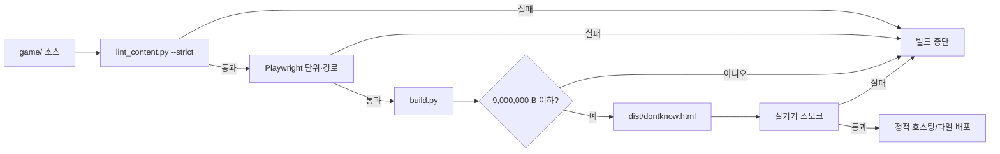

# DEPLOYMENT_ARCHITECTURE — 빌드·정적 배포·버전·세이브 호환

> **역할:** Python 빌드 스크립트가 단일 HTML(`dist/dontknow.html`)을 만드는 절차, 정적 호스팅/파일 공유, 버전·세이브 호환, 배포 전 체크리스트를 고정한다.
> **단일 출처:** 이 문서(빌드·배포·버전·세이브 호환·배포 체크). 자산 인라인 규격은 [FILE_AND_MEDIA_MANAGEMENT](../04-tech/FILE_AND_MEDIA_MANAGEMENT.md), 세이브 스키마·마이그레이션은 [DATABASE_SCHEMA](../04-tech/DATABASE_SCHEMA.md) 4절, 테스트 합격 기준은 [TESTING_STRATEGY](./TESTING_STRATEGY.md), 성능 예산은 [PERFORMANCE_REQUIREMENTS](./PERFORMANCE_REQUIREMENTS.md)가 단일 출처다.
> **참조:** [SYSTEM_ARCHITECTURE](../04-tech/SYSTEM_ARCHITECTURE.md) 1·2절, [BACKEND_ARCHITECTURE](../04-tech/BACKEND_ARCHITECTURE.md) 1절, [ERROR_HANDLING](./ERROR_HANDLING.md) 3.3절.
> **적용 버전:** v6.2 (2026-11). **이 문서는 배포를 실행하지 않는다.** 절차와 기준만 정의한다.

## 1. 원칙

1. **산출물은 파일 하나.** `dist/dontknow.html`. 서버·DB·CDN·환경 변수가 없다.
2. **빌드는 결정론적.** 같은 소스·같은 도구 버전 → 같은 바이트.
3. **검증 없이 배포 없음.** 린터·테스트·크기·실기기 스모크를 통과해야 한다.
4. **세이브를 깨뜨리지 않는다.** 버전 업은 마이그레이션 또는 백업을 동반한다.
5. **되돌릴 수 있게.** 이전 산출물과 세이브 백업을 보관한다.
6. **비밀값 없음.** 빌드 산출물에 키·토큰·서버 주소를 넣지 않는다.

## 2. 빌드 파이프라인



### 2.1 명령(예정)

```text
# 1. 콘텐츠 검증
python3 game/tools/lint_content.py --content game/content --strict

# 2. 테스트
npx playwright test

# 3. 빌드
python3 game/tools/build.py --out dist/dontknow.html

# 4. 크기·버전 확인
python3 game/tools/build.py --report
```

- 실제 명령·옵션은 구현 단계에서 확정한다. 이 문서는 **순서와 게이트**의 단일 출처다.
- `build.py`는 Python 표준 라이브러리만 쓴다.

### 2.2 빌드 입력·출력

| 입력 | 내용 |
|---|---|
| `game/index.html` | 셸 HTML |
| `game/css/*` | 토큰·OS·앱 CSS |
| `game/js/**` | ES 모듈 |
| `game/content/**` | JSON |
| `game/img/**`, `game/fonts/**` | 자산 |
| `game/tools/build.py` | 빌드 스크립트 |

| 출력 | 내용 |
|---|---|
| `dist/dontknow.html` | 단일 HTML(모든 인라인) |
| `dist/dontknow-<appVersion>.html` | 선택: 버전 파일명 사본 |
| `dist/manifest.txt` | 크기·해시·버전·빌드 시각(배포 기록용) |

- `manifest.txt`는 배포 기록용이며 게임이 읽지 않는다.
- 소스맵은 만들지 않는다.

### 2.3 빌드 메타

```js
window.__BUILD__ = {
  appVersion: '6.2.0',
  contentVersion: '2026.11.1',
  saveSchemaVersion: 3,
  hash: 'sha256:…',
  builtAt: '2026-11-08T10:00:00.000Z'
};
```

- `builtAt`은 재현성 비교에서 제외한다(또는 `SOURCE_DATE_EPOCH` 고정).
- `hash`는 소스·콘텐츠·자산 전체의 해시다.

## 3. 산출물·호스팅

### 3.1 정적 호스팅

| 항목 | 규칙 |
|---|---|
| 종류 | 정적 파일 호스팅(어떤 제공자든) |
| 파일 | `dontknow.html` 하나 |
| MIME | `text/html; charset=utf-8` |
| HTTPS | 권장(클립보드 등 브라우저 기능) |
| 압축 | gzip/brotli 권장(단, 예산은 비압축 기준) |
| 캐시 | 버전 파일은 `Cache-Control: public, max-age=31536000, immutable`. `index.html` 별칭은 `no-cache` |
| 리라이트 | 불필요. SPA 라우팅 없음(내부 스택) |
| 서비스 워커 | 사용하지 않는다 |
| 서버 로직 | 없음 |

### 3.2 파일 공유

- `dontknow.html`을 그대로 전달한다. 이메일·메신저·USB·클라우드 드라이브 모두 가능.
- **주의:** `file://`로 열면 브라우저에 따라 `localStorage`·`history.pushState`가 제한된다. 저장이 안 되면 [ERROR_HANDLING](./ERROR_HANDLING.md) 3.5 문구가 나온다.
- iPhone Safari에서 파일 앱의 HTML을 여는 동작은 OS 버전에 따라 다르다. **권장: 정적 호스팅 URL로 열거나 홈 화면에 추가.**
- 오프라인: 한 번 로드된 파일은 브라우저 캐시/로컬 파일로 동작한다. 서비스 워커가 없으므로 브라우저 캐시 정책에 의존한다.

### 3.3 CSP

- `<meta http-equiv="Content-Security-Policy">`를 산출물에 포함한다([AUTHENTICATION_AND_SECURITY](../04-tech/AUTHENTICATION_AND_SECURITY.md) 3.2).
- 정적 호스팅이 HTTP 헤더를 지원하면 `Content-Security-Policy` 헤더로도 준다. 특히 `frame-ancestors`는 meta에서 무시될 수 있다.
- `X-Content-Type-Options: nosniff` 권장. `Referrer-Policy: no-referrer` 권장.

## 4. 버전

| 버전 | 형식 | 올리는 때 |
|---|---|---|
| `appVersion` | SemVer `MAJOR.MINOR.PATCH` | 코드·UI·콘텐츠 묶음 변경 |
| `contentVersion` | `YYYY.MM.N` | 콘텐츠 JSON 변경 |
| `saveSchemaVersion` | 정수 | 세이브 구조 변경(마이그레이션 필요) |
| `buildHash` | `sha256:<16>` | 모든 빌드 |

### 4.1 규칙

- **MAJOR:** 세이브 호환을 깨는 변경. 마이그레이션 필수.
- **MINOR:** 기능·콘텐츠 추가. 세이브 호환 유지.
- **PATCH:** 버그·오탈자. 세이브 호환 유지.
- `contentVersion`은 콘텐츠만 바뀌어도 올린다. `appVersion`과 독립.
- `saveSchemaVersion`은 세이브 구조가 바뀔 때만 올린다. 콘텐츠 ID 변경은 마이그레이션 또는 상태 드롭으로 처리.

## 5. 세이브 호환

### 5.1 호환 매트릭스

| 세이브 버전 | 현재 앱 | 동작 |
|---|---|---|
| 같음 | 같음 | 정상 |
| 과거 | 최신 | 마이그레이션 체인 → 정상 |
| 미래 | 구버전 | 읽지 않음. 백업 후 "최신 버전에서 만들어졌습니다" |
| 손상 | 어떤 버전 | 백업 → 자동/슬롯 복구 |
| 콘텐츠 ID 없음 | 최신 | 해당 상태 키 드롭 + 경고 로그. 진행 지속 |

### 5.2 마이그레이션 테스트

- 이전 버전 세이브 픽스처를 `game/tests/fixtures/saves/`에 둔다.
- 각 마이그레이션 단계마다 "로드 → 필수 상태 확인 → 엔딩까지 진행" 테스트.
- 새 `saveSchemaVersion`을 올릴 때 **이전 버전 세이브로 시작한 경로 테스트**를 추가한다.

### 5.3 롤백

1. 이전 산출물(`dist/dontknow-<oldVersion>.html`)을 보관한다.
2. 새 버전에서 저장한 세이브는 구버전에서 읽지 않는다(미래 버전). 구버전은 백업 후 새 게임을 제안한다.
3. 롤백 공지에 "롤백 이전 세이브는 구버전에서 열리지 않는다"를 명시한다.
4. 가능하면 롤백 대신 핫픽스(PATCH)를 낸다.

### 5.4 저장 키 네임스페이스

- `dontknow.v6.auto`, `dontknow.v6.slot.1..3`, `dontknow.v6.meta`, `dontknow.v6.backup.*`.
- v6.0·v6.1의 폐기 세이브와 섞이지 않게 `v6` 접두를 쓴다.
- 새 MAJOR에서 키 접두를 바꾸지 않는다. 마이그레이션으로 처리한다.

## 6. 배포 전 체크리스트

### 6.1 자동

- [ ] `lint_content.py --strict` 통과(L01~L18).
- [ ] 단위 테스트 통과.
- [ ] 경로 테스트 `route_a`, `route_a2`, `route_b`, `route_c`, `route_d`, `crisis`, `traces`, `moved` 통과.
- [ ] 불변식: 페이지 에러 0, 콘솔 에러 0, 외부 요청 0, 판정 문구 0.
- [ ] 시각 회귀(390×844 다크/라이트) 통과.
- [ ] 접근성 자동 검사 통과.
- [ ] 파일 크기 ≤ 9,000,000 B(경고 8.4MB).
- [ ] 세이브 마이그레이션 테스트 통과.
- [ ] 빌드 재현성: 같은 입력 → 같은 해시(시각 제외).

### 6.2 수동

- [ ] iPhone 12급 Safari에서 첫 화면 2초·상호작용 100ms.
- [ ] 320/390/430 폭, 다크/라이트, 큰 글자 1.3배.
- [ ] 키보드 한글 IME·조합 중 제출 없음.
- [ ] 제스처(뒤로·홈·알림·제어 센터·핀치) 충돌 없음.
- [ ] 프라이빗 모드 저장 실패 문구.
- [ ] 오프라인(비행기 모드)에서 끝까지 플레이.
- [ ] 원격 지우기·엔딩 A/A′/B/C/D 1회씩.
- [ ] `?debug=1` 비활성 확인(일반 URL).
- [ ] 실제 서비스명·금칙어·폐기 용어 0.
- [ ] 빌드 산출물에 키·토큰·서버 주소 0.
- [ ] CSP 위반 0(콘솔).
- [ ] `__errors` 비어 있음(정상 플레이 1회).

### 6.3 배포 기록

```text
appVersion: 6.2.0
contentVersion: 2026.11.1
saveSchemaVersion: 3
buildHash: sha256:…
size: 8,432,118 B
tests: route_a..moved PASS, visual PASS
device: iPhone 12 / iOS …
date: 2026-11-08
notes: …
```

## 7. 릴리스 절차

1. 소스 동결(코드·콘텐츠).
2. 린터 → 테스트 → 빌드.
3. `manifest.txt` 생성.
4. 스테이징 정적 호스팅에 업로드.
5. iPhone 실기기 스모크(6.2).
6. 세이브 호환 확인(이전 버전 픽스처).
7. 프로덕션 업로드.
8. 이전 산출물 보관.
9. 배포 기록 작성.

- 실제 배포·git 명령은 이 작업에서 실행하지 않는다.
- 배포 후 문제가 생기면 [ERROR_HANDLING](./ERROR_HANDLING.md)의 복구 절차를 따른다.

## 8. 배포 후

| 항목 | 방법 |
|---|---|
| 오류 확인 | 플레이어 제보 + `?debug=1`의 `__errors`(플레이어가 캡처) |
| 분석 | 없음(텔레메트리 없음). 플레이테스트·제보로 대체 |
| 세이브 문제 | 백업 키·슬롯 확인 안내 |
| 긴급 수정 | PATCH 빌드. 세이브 스키마 유지 |
| 롤백 | 이전 산출물. 세이브는 미래 버전으로 남음 |

## 확인 사항

- `Q-OPEN-Q14`: `file://`에서의 localStorage·history 동작은 브라우저·OS 버전마다 다르다. 파일 공유를 1차 배포 수단으로 할지, 정적 호스팅을 1차로 할지 총괄이 정해야 한다(추천: 정적 호스팅 1차, 파일 공유는 보조).
- `Q-OPEN-Q15`: 버전 파일명(`dontknow-6.2.0.html`)을 유지할지, 항상 `dontknow.html` 하나만 배포할지 결정이 필요하다. 캐시 무효화에는 버전 파일명이 유리하다.
- `Q-OPEN-Q16`: 세이브 `saveSchemaVersion` 시작 값을 3으로 할지 1로 할지 [DATABASE_SCHEMA](../04-tech/DATABASE_SCHEMA.md) Q-OPEN-T11과 함께 확정해야 한다.
- `Q-OPEN-Q17`: 배포 후 오류 수집을 하지 않으므로, 플레이어 제보 경로(이메일·폼)를 제품 차원에서 정해야 한다. 이 문서는 게임 외부 채널을 만들지 않는다.
