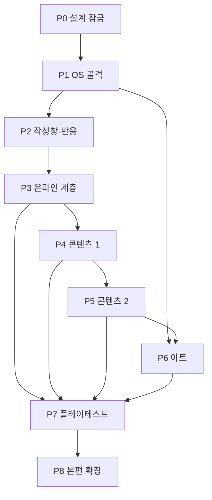

# DEVELOPMENT_PHASES — DONTKNOW v6.2 작업 패킷

> **역할:** P1~P8 단계를 구현 가능한 작업 패킷(WP)으로 분해한다. 각 패킷의 선행 패킷, 만들 모듈, 다룰 화면(SCR), 기능(FEAT)·요구사항(REQ), 산출물, 검증 테스트, 예상 위험을 고정한다.
> **단일 출처:** 작업 패킷 ID(`WP-xx`), 패킷 순서·의존 관계, 단계별 게이트. 단계의 내용·산출물·완료 기준은 [`IMPLEMENTATION_ROADMAP.md`](./IMPLEMENTATION_ROADMAP.md) 3절, 모듈 이름은 [`FRONTEND_ARCHITECTURE`](../04-tech/FRONTEND_ARCHITECTURE.md) 1절, 화면 ID는 [`NAVIGATION_ARCHITECTURE`](../02-design/NAVIGATION_ARCHITECTURE.md) 3절, 테스트 이름은 [`TESTING_STRATEGY`](../05-quality/TESTING_STRATEGY.md)이 단일 출처다.
> **참조:** [`ACTION_PROOF`](../01-product/ACTION_PROOF.md), [`PROGRESSION_AND_ENDINGS`](../01-product/PROGRESSION_AND_ENDINGS.md), [`TRACES_AND_REACTIONS`](../01-product/TRACES_AND_REACTIONS.md), [`BUSINESS_RULES`](../01-product/BUSINESS_RULES.md), [`FEATURE_SPECIFICATION`](../01-product/FEATURE_SPECIFICATION.md), [`REQUIREMENTS`](../00-foundation/REQUIREMENTS.md), [`ACCEPTANCE_CRITERIA.md`](./ACCEPTANCE_CRITERIA.md), [`OPEN_QUESTIONS.md`](./OPEN_QUESTIONS.md).
> **적용 버전:** v6.2 (2026-11). 구현 착수 전제는 P0 설계 잠금 = 서현 승인이다.

## 1. 작업 패킷 원칙

1. **기간을 창작하지 않는다.** 이 문서는 상대 순서와 의존 관계만 정한다. 달력 날짜·주차·공수는 쓰지 않는다.
2. **모듈을 새로 만들지 않는다.** 만들 모듈 열은 [`FRONTEND_ARCHITECTURE`](../04-tech/FRONTEND_ARCHITECTURE.md) 1절의 파일만 가리킨다. `os/apps/settings/*.js` 하위 분리만 허용된다.
3. **테스트를 먼저 쓴다.** 각 WP는 실패하는 테스트(또는 린터 규칙)를 먼저 만들고, 통과한 뒤 다음 WP로 간다. 테스트는 [`TESTING_STRATEGY`](../05-quality/TESTING_STRATEGY.md)의 이름을 쓴다.
4. **P2·P3 지시서에는 원문을 붙인다.** [`ACTION_PROOF`](../01-product/ACTION_PROOF.md), [`PROGRESSION_AND_ENDINGS`](../01-product/PROGRESSION_AND_ENDINGS.md), [`TRACES_AND_REACTIONS`](../01-product/TRACES_AND_REACTIONS.md)의 해당 절 전문을 opencode 지시서에 그대로 넣는다. 요약본만 주지 않는다.
5. **판정 UI를 만들지 않는다.** verify·trace·endings 모듈은 DOM을 직접 건드리지 않는다. 화면에는 세계의 반응만 온다.
6. **완료의 정의:** ① 지정 테스트 통과 ② `lint_content.py --strict` 통과 ③ 판정·정답 문구 0 ④ 페이지·콘솔 에러 0 ⑤ 해당 WP가 화면을 바꾸면 `visual.spec.js` 기준 갱신 리뷰 ⑥ P1부터 매 단계 iPhone Safari 실기기 확인.
7. **P0 잠금 전 금지:** 코드·콘텐츠 JSON·테스트 파일을 만들지 않는다. P0 승인 뒤 WP-01부터 시작한다.

## 2. 단계·패킷 요약

| 단계 | WP | 패킷 수 | 핵심 모듈 | 화면 범위 | 단계 게이트 |
|---|---|---|---|---|---|
| P1 OS 골격 | WP-01~WP-06 | 6 | `core/state.js` `core/morph.js` `core/clock.js` `core/visibility.js` `core/search.js` `core/save.js` `os/shell.js` `os/apps/*.js`(빈) `debug/panel.js` | 셸·일시정지 19개, 앱 30종 루트 | 잠금 → 홈 → 앱 왕복, 깜빡임 0 |
| P2 작성창·반응 | WP-07~WP-10 | 4 | `os/composer.js` `verify/verify.js` `verify/keywords.js` `core/trace.js` `npc/dialogue.js` `os/apps/talk.js` `os/apps/loop.js` | `SCR-OS-COMPOSER`·`SHARE-SHEET`·`INFO-PANEL`, `SCR-TALK-*`, `SCR-MSG-*`, `SCR-LOOP-DM-*` | 서아 SA-2, 지훈 JH-2 |
| P3 온라인 계층 | WP-11~WP-15 | 5 | `core/net.js` `core/scheduler.js` `npc/dialogue.js` `os/apps/camera.js` `os/apps/photo.js` `story/endings.js` | `SCR-OS-SYSTEM-ALERT`, `SCR-MSG-ROOM`, `SCR-CAM-*`, `SCR-PHOTO-*`, `SCR-SET-WIFI`·`CIRRUS-SYNC` | crisis.js 다섯 해법 |
| P4 콘텐츠 1 | WP-16~WP-20 | 5 | `os/apps/mail.js` `find.js` `note.js` `reminder.js` `contacts.js` `calendar.js` `photo.js` `voice.js` `file.js` `map.js` `settings.js` `tools/lint_content.py` | `SCR-MAIL-*` `FIND-*` `NOTE-*` `REM-*` `CONT-*` `CAL-*` `PHOTO-*` `VOICE-*` `FILE-*` `MAP-*` `SET-*` | 미끼 격리·이중 경로 린터 |
| P5 콘텐츠 2 | WP-21~WP-25 | 5 | `os/apps/loop.js` `tube.js` `moa.js` `wave.js` `bank.js` `hankki.js` `market.js` `taxi.js` `wallet.js` `blink.js` `npc/dialogue.js` `story/endings.js` `verify/hints.js` | `SCR-LOOP-*` `TUBE-*` `MOA-*` `WAVE-*` `BANK-*` `HANKKI-*` `MARKET-*` `TAXI-*` `WALLET-*` `BLINK-*` `PAUSE-HINT` `CINE-ENDING` | route_a~d, traces, moved |
| P6 아트 | WP-26~WP-28 | 3 | `img/`, `css/tokens.css`, `css/apps/*.css` | 전체(아이콘·사진·카메라·엔딩) | 16px 실루엣, 확대 판독 |
| P7 플레이테스트 | WP-29~WP-30 | 2 | `debug/panel.js`, `core/save.js`, 테스트 | 전체 | 숙련 2 + 일반 4 지표 |
| P8 본편 확장 | WP-31~WP-32 | 2 | `os/apps/loop.js` `mail.js` `voice.js` `core/save.js` `npc/dialogue.js` | `SCR-LOOP-ACCOUNT-SWITCH`, `SCR-PAUSE-SAVE`, `SCR-VOICE-*`, `SCR-CINE-ENDING` | 일반 165분 페이싱 |

**합계: 8단계, 32개 작업 패킷.**

## 3. 의존 그래프

기간은 표시하지 않는다. 화살표는 "선행 → 후행"만 뜻한다.

- P6(아트)는 P1 이후 시작할 수 있으나, 화면 레이아웃이 P4·P5에서 확정되므로 **최종 교체 게이트는 P5 뒤**다.
- P7은 P3(crisis)·P4(린터)·P5(경로)·P6(시각)가 모두 끝난 뒤에만 시작한다.
- WP 수준 의존은 각 단계 표의 "선행" 열을 따른다. 같은 단계 안에서도 선행이 있으면 순서를 지킨다.

## 4. P1 — OS 골격 (WP-01~WP-06)

**지시서 첨부:** [`SYSTEM_SHELL_SPECIFICATION`](../03-features/SYSTEM_SHELL_SPECIFICATION.md) 1~11절, [`FRONTEND_ARCHITECTURE`](../04-tech/FRONTEND_ARCHITECTURE.md) 3~6절, [`NAVIGATION_ARCHITECTURE`](../02-design/NAVIGATION_ARCHITECTURE.md) 1~2절.

| WP | 선행 | 만들 모듈 | SCR | FEAT / REQ | 산출물 | 검증 | 예상 위험 |
|---|---|---|---|---|---|---|---|
| **WP-01** | P0 승인 | `core/state.js`, `core/morph.js`, `core/save.js` | `SCR-OS-LOCK`, `SCR-OS-HOME`(부트스트랩) | FEAT-01·02·52 / REQ-F-061, REQ-N-022 | 단일 상태 트리, 이벤트 로그, 콘텐츠 로더, morph, 자동 저장 뼈대 | 단위 `morph`·`상태`; Playwright `p1_shell.spec.js`(신규 게이트, Q-OPEN-D01) | `data-k` 없는 리스트가 전체 교체를 유발 |
| **WP-02** | WP-01 | `core/clock.js` | `SCR-OS-HOME`, `SCR-PAUSE-SETTINGS` | FEAT-49 / REQ-F-058, REQ-N-013 | ×4 시계, 일시정지·백그라운드 정지, 시간 흐름 끄기 | 단위 `clock`(×4·710분·30분·정지·끄기·복원·단조성) | rAF 누적 오차, 백그라운드 복귀 따라잡기 |
| **WP-03** | WP-01·02 | `os/shell.js` | `SCR-OS-LOCK`, `SCR-OS-PASSCODE`, `SCR-OS-EMERGENCY`, `SCR-OS-HOME`, `SCR-OS-FOLDER` | FEAT-01·02·03·60 / REQ-F-001~004, REQ-F-016, REQ-F-070 | 상태바, 잠금화면 알림 23개·분실 모드·위젯, 응급정보, 키패드, 홈 3페이지·독·유틸 폴더 | Playwright `p1_shell.spec.js`; `visual.spec.js`(`SCR-OS-LOCK`, `SCR-OS-HOME`) | 오답 6회 30초 대기 구현 누락, 4×5 격자 붕괴 |
| **WP-04** | WP-03 | `os/shell.js`, `core/visibility.js`, `core/search.js` | `SCR-OS-NOTIF-CENTER`, `SCR-OS-CONTROL-CENTER`, `SCR-OS-SEARCH`, `SCR-OS-APP-SWITCHER`, `SCR-OS-SYSTEM-ALERT` | FEAT-03·04·40 / REQ-F-005~008, REQ-F-048 | 배너·알림 센터·집중 모드, 제어 센터, 전역 검색, 앱 전환기, 시스템 경고 | 단위 `visibility`; `p1_shell.spec.js`; `visual.spec.js`(알림·검색·제어) | 알림 기록이 원본 삭제와 함께 사라짐 |
| **WP-05** | WP-01·03 | `os/shell.js`, `core/save.js`, `debug/panel.js` | `SCR-PAUSE-MENU`, `SCR-PAUSE-SETTINGS`, `SCR-PAUSE-SAVE`, `SCR-CINE-PROLOGUE`, `SCR-CINE-ENDING` | FEAT-08·09·56 / REQ-F-012~014, REQ-F-060·061·066 | 일시정지 메뉴, 3단계 힌트 뼈대, 게임 설정, 저장·불러오기, 프롤로그·엔딩 재생기, `?debug=1` | 단위 `save`·`migrate`; `p1_shell.spec.js`; 실기기 세 손가락·Esc | `?debug=1`이 배포 빌드에 남음 |
| **WP-06** | WP-03·04 | `os/apps/*.js`(빈 앱 30종), `os/apps/settings/*.js`(뼈대) | 앱 30종 루트: `SCR-PHONE-*`, `MSG-*`, `TALK-*`, `LOOP-*`, `BLINK-*`, `MAIL-*`, `PHOTO-*`, `CAM-*`, `MAP-*`, `FIND-*`, `CONT-*`, `CAL-*`, `NOTE-*`, `REM-*`, `VOICE-*`, `CLOCK-*`, `WTHR-*`, `HEALTH-*`, `WALLET-*`, `BANK-*`, `TAXI-*`, `FILE-*`, `WAVE-*`, `TUBE-*`, `MOA-*`, `HANKKI-*`, `MARKET-*`, `PORTAL-*`, `CALC-*`, `SET-*` | FEAT-10~39 / REQ-F-017~047(동작 없음) | 빈 앱 30개, 앱 레지스트리, 앱 전환 시 `setHtmlOnce` | `p1_shell.spec.js`(30개 앱 왕복); `canOpenScreen` 단위 | 앱 전환마다 전체 재그리기로 깜빡임 |

**P1 게이트:** 잠금 해제 → 홈 → 앱 30개 왕복에서 깜빡임 0, 페이지·콘솔 에러 0, iPhone Safari에서 세로·320/390/430 폭 확인.

## 5. P2 — 작성창·반응 (WP-07~WP-10)

**지시서 첨부(원문 그대로):** [`ACTION_PROOF`](../01-product/ACTION_PROOF.md) 1~5절, [`TRACES_AND_REACTIONS`](../01-product/TRACES_AND_REACTIONS.md) 1~6절, [`PROGRESSION_AND_ENDINGS`](../01-product/PROGRESSION_AND_ENDINGS.md) 4·5절. **테스트 먼저:** `verify` V-05·V-06, `trace` TR-02·TR-05, `dialogue` JH·SA.

| WP | 선행 | 만들 모듈 | SCR | FEAT / REQ | 산출물 | 검증 | 예상 위험 |
|---|---|---|---|---|---|---|---|
| **WP-07** | WP-06 | `os/composer.js` | `SCR-OS-COMPOSER`, `SCR-OS-SHARE-SHEET`, `SCR-OS-INFO-PANEL` | FEAT-05·06·07·57 / REQ-F-009·010·011·067 | 추천 문장 3~5개, 직접 입력, 첨부, 공유, 클립보드 칩 1개, 텍스트 대치 | 단위 `composer`·`텍스트 대치`; `visual.spec.js`(작성창) | 추천 문장이 플레이어 지식에 따라 바뀜(금지) |
| **WP-08** | WP-07 | `verify/keywords.js`, `verify/verify.js` | `SCR-OS-COMPOSER`, `SCR-OS-INFO-PANEL` | FEAT-43 / REQ-F-051·052 | V 정의 로더, 표기 변형 정규화, verify 이벤트 대조 | 단위 `verify`(V-01·02·05·06, 오답·중복·근거 미열람·DOM 미변경), `keywords`; V-04·12·13은 P3·P4에서 추가 | 조사·띄어쓰기 변형을 놓침, verify가 DOM을 건드림 |
| **WP-09** | WP-07·08 | `core/trace.js` | `SCR-TALK-ROOM`, `SCR-LOOP-STORY`, `SCR-BLINK-ROOM` | FEAT-44 / REQ-F-053 | TR 정의 로더, 1회 발생, 오프라인 대기열, 인물별 지연 | 단위 `trace`(TR-02 온·오프라인, TR-05, TR-06, TR-07, 반복·지연·반응 짝) | 같은 TR 반복 발생, 지연 시드 미고정 |
| **WP-10** | WP-08·09 | `npc/dialogue.js`, `os/apps/talk.js`, `os/apps/msg.js`, `os/apps/loop.js`(DM만) | `SCR-TALK-FRIENDS`, `SCR-TALK-CHATS`, `SCR-TALK-ROOM`, `SCR-MSG-LIST`, `SCR-MSG-ROOM`, `SCR-LOOP-DM-LIST`, `SCR-LOOP-DM-ROOM` | FEAT-12·13·45 / REQ-F-019·020·054 | 대화 표 실행, 입력 우선순위(공유→추천→낱말→기본), 지훈 1왕복, 서아 SA-2, 지훈 JH-2 | `traces.js` T-2; Playwright `p2_reaction.spec.js`(신규 게이트, Q-OPEN-D01); 단위 `dialogue` | NPC가 앎 매트릭스 밖 정보를 말함 |

**P2 게이트:** 클릭·입력만으로 ① 지훈에게 E-23을 공유해 JH-1 1왕복 ② 서아 스토리 조회 → EV-34 → V-05 → SA-2 E-93 ③ 지훈 V-06 → JH-2 E-92가 재현된다. 화면에 판정 문구 0.

## 6. P3 — 온라인 계층 (WP-11~WP-15)

**지시서 첨부(원문 그대로):** [`PROGRESSION_AND_ENDINGS`](../01-product/PROGRESSION_AND_ENDINGS.md) 3·4·6.1절, [`TRACES_AND_REACTIONS`](../01-product/TRACES_AND_REACTIONS.md) 2·4·6절, [`BUSINESS_RULES`](../01-product/BUSINESS_RULES.md) 4·4.1절, [`ACTION_PROOF`](../01-product/ACTION_PROOF.md) V-04·V-04′. **테스트 먼저:** `crisis.js`, `trace` TR-01·TR-07·TR-11·TR-12.

| WP | 선행 | 만들 모듈 | SCR | FEAT / REQ | 산출물 | 검증 | 예상 위험 |
|---|---|---|---|---|---|---|---|
| **WP-11** | WP-10 | `core/net.js` | `SCR-OS-CONTROL-CENTER`, `SCR-SET-WIFI`, `SCR-SET-CIRRUS-SYNC` | FEAT-41·42 / REQ-F-049·050 | 온라인 판정(`wifi && !airplane`), 첫 온라인 동기화, 앱별 스위치, 오프라인 대기열, 다른 기기 기록 유입 | 단위 `net`(삭제 큐·지우기 우선·앱 스위치·업로드·흔적 순서·멱등·첫 온라인 순서·비행기 우선) | 큐 적용 순서가 뒤집혀 원격 지우기가 늦음 |
| **WP-12** | WP-11 | `core/scheduler.js`, `npc/dialogue.js` | `SCR-MSG-ROOM`, `SCR-SET-*`(동기화 관련) | FEAT-46·47·48 / REQ-F-055·056·057 | EV 예약·조건 재평가, T 기준 상대 예약, DH-0~4·X 상태 기계, EV-04~09·19 | 단위 `scheduler`·`dialogue`; `crisis.js` CR-1·CR-3 | DH 경계 누적 상한·리셋 오류 |
| **WP-13** | WP-12 | `core/net.js`, `os/shell.js`, `os/apps/note.js`, `os/apps/photo.js` | `SCR-OS-SYSTEM-ALERT`, `SCR-NOTE-LIST`, `SCR-PHOTO-ALBUM` | FEAT-48 / REQ-F-005·057 | 원격 삭제 행 페이드 0.4초·문구 3초, 원격 지우기 "지우는 중…" 8초, 초기 설정 1분 | `crisis.js` CR-1·CR-2·CR-3; `visual.spec.js`(알림 센터) | 전체 목록 재그리기, 스크롤 튐 |
| **WP-14** | WP-12 | `os/apps/camera.js`, `os/apps/photo.js` | `SCR-CAM-VIEWFINDER`, `SCR-CAM-REVIEW`, `SCR-PHOTO-LIBRARY`, `SCR-PHOTO-VIEWER` | FEAT-17 / REQ-F-024·015 | 방 4구도, 서랍 열기, 촬영, 촬영 위치 "성원아파트", 사진 동기화 TR-07 | 단위 `trace` TR-07; `route_a.js` 5단계; `visual.spec.js`(`SCR-CAM-VIEWFINDER`) | 서랍 봉투 "박미선님 65" 미표시 |
| **WP-15** | WP-13·14 | `tests/crisis.js`(테스트) | `SCR-MSG-ROOM`, `SCR-CAM-*`, `SCR-OS-SYSTEM-ALERT` | FEAT-47 / REQ-F-056 | 다섯 해법 재현 테스트, 두 번째 기회 EV-19 | `crisis.js` CR-1~CR-3 및 위기 5해법 케이스 | 무응답 경로가 너무 빨라 이른 엔딩 |

**P3 게이트:** `crisis.js`에서 ① 답장 ② "아빠다"→서랍 사진 ③ 비행기 모드 유지 ④ 시러스 암호 변경 ⑤ 무응답(원격 지우기) 다섯이 모두 재현된다. 30게임분 = 실시간 7분 30초.

## 7. P4 — 콘텐츠 1 (WP-16~WP-20)

| WP | 선행 | 만들 모듈 | SCR | FEAT / REQ | 산출물 | 검증 | 예상 위험 |
|---|---|---|---|---|---|---|---|
| **WP-16** | WP-15 | `os/apps/mail.js`, `os/apps/find.js` | `SCR-MAIL-INBOX`, `MAIL-DETAIL`, `MAIL-COMPOSE`, `MAIL-SCHEDULE`, `MAIL-SCHEDULE-EDIT`, `MAIL-ACCOUNTS`, `MAIL-SEARCH`, `SCR-FIND-DEVICES`, `FIND-DEVICE`, `FIND-ACTIONS` | FEAT-15·19 / REQ-F-022·026 | 2계정·폴더·핵심 메일·예약 메일, 기기 목록·소리·분실 모드·기기 지우기 | `route_a.js` 7단계; 단위 `visibility`·`net`; `visual.spec.js`(`SCR-MAIL-INBOX`) | 청운 취소 메일이 목록 맨 위가 아님 |
| **WP-17** | WP-16 | `os/apps/note.js`, `reminder.js`, `contacts.js`, `calendar.js` | `SCR-NOTE-*`, `REM-*`, `CONT-*`, `CAL-*` | FEAT-20~23 / REQ-F-027~030 | 메모 6개·암호 680403, 미리 알림, 연락처 64명·아빠 카드, 캘린더·생일 | `route_a.js` 2단계; `crisis.js` CR-2; `visual.spec.js`(`SCR-NOTE-LOCKED`) | 메모 암호 680403의 힌트·오답 규칙 누락 |
| **WP-18** | WP-16 | `os/apps/photo.js`, `voice.js`, `file.js` | `SCR-PHOTO-*`, `VOICE-*`, `FILE-*` | FEAT-16·24·31 / REQ-F-023·031·038 | 사진 정보(i)·원본 복귀·버스트 18·숨김·최근 삭제, 녹음 42:31·전사, 파일 4종 정보 | `visual.spec.js`(`SCR-PHOTO-VIEWER`); 단위 `visibility`; 실기기 확대 판독 | 버스트 11번째 번호판 판독 불가 |
| **WP-19** | WP-17·18 | `os/apps/map.js`, `os/apps/settings.js`, `os/apps/settings/*.js` | `SCR-MAP-*`, `SCR-SET-ROOT` 외 설정 29개 | FEAT-18·39 / REQ-F-025·046·047 | 지도 저장·최근 검색·경로, 설정 19개 메뉴·검색·깊이 3 | 단위 `visibility`; `visual.spec.js`(`SCR-SET-WIFI`); 실기기 설정 검색 | 설정 깊이가 3단계를 넘음 |
| **WP-20** | WP-19 | `tools/lint_content.py`, `content/items/*.json` | `SCR-MAP-SEARCH`, `SCR-MAIL-INBOX`, `SCR-HANKKI-ORDERS` | FEAT-53·55 / REQ-F-063·065, REQ-N-023 | 콘텐츠 린터 10종 규칙, 미끼 격리, 이중 경로·소실 안전 | `lint_content.py --content game/content --strict` | 린터가 경고를 통과시킴(--strict에서 경고=실패) |

**P4 게이트:** 린터가 ① 미끼 L-11 근거 전부 T2(E-130 예외) ② 필수 V의 근거가 서로 다른 앱 2개 이상 ③ 원격 삭제 후에도 다른 앱 2개 이상 남음을 통과한다. ①·⑤ 흐름(잠긴 폰·어디에)을 클릭으로 재현한다.

## 8. P5 — 콘텐츠 2 (WP-21~WP-25)

| WP | 선행 | 만들 모듈 | SCR | FEAT / REQ | 산출물 | 검증 | 예상 위험 |
|---|---|---|---|---|---|---|---|
| **WP-21** | WP-20 | `os/apps/loop.js` | `SCR-LOOP-FEED`, `EXPLORE`, `SEARCH`, `CREATE`, `ACTIVITY`, `PROFILE`, `POST-PHOTO`, `POST-TEXT`, `STORY`, `HIGHLIGHT`, `VIEWERS`, `LIKES`, `PLACE`, `TAG`, `ACCOUNT-INFO`, `EDIT-HISTORY`, `DM-LIST`, `DM-ROOM`, `SETTINGS`, `SETTINGS-PRIVACY`, `BLOCKED`, `ACCOUNT-SWITCH`, `CONNECTIONS` | FEAT-13 / REQ-F-020 | 계정 12개·게시물 약 180개, 차단·계정 정보·사진으로 찾기·스토리·조회자·DM·활동 기록 | `traces.js` T-2; `route_c.js`; `moved.js` | 좋아요·조회 흔적이 TR과 중복 발생 |
| **WP-22** | WP-21 | `os/apps/tube.js`, `moa.js`, `wave.js` | `SCR-TUBE-*`, `SCR-MOA-*`, `SCR-WAVE-*` | FEAT-32·33·34 / REQ-F-039·040·041 | 튜브 5편·자막 검색·민지 댓글, 모아 성원광장·쪽지, 웨이브 기록·로그아웃 열람 | `traces.js`; `route_d.js`(로그아웃 열람 경로 없음 확인) | 로그아웃 열람이 차단을 우회하지 못함 |
| **WP-23** | WP-22 | `os/apps/bank.js`, `hankki.js`, `market.js`, `taxi.js`, `wallet.js` | `SCR-BANK-*`, `SCR-HANKKI-*`, `SCR-MARKET-*`, `SCR-TAXI-*`, `SCR-WALLET-*` | FEAT-28·29·30·35·36 / REQ-F-035~037·042·043 | 거래 61건·필터·상세, 한끼 3건·재주문, 이웃마켓, 택시 호출, 지갑 | `route_a.js` 6·8·9·10단계; `moved.js` 3~4단계 | 거래 합계·잔액 숫자 불일치 |
| **WP-24** | WP-23 | `os/apps/blink.js`, `settings.js` | `SCR-BLINK-LIST`, `ROOM`, `PROFILE`, `CHAT-INFO`, `SETTINGS`, `SETTINGS-PRIVACY`, `SETTINGS-SESSIONS`, `SETTINGS-BLOCKED`, `SCR-SET-NOTIFICATIONS`, `SET-NOTIFICATION-APP` | FEAT-14·58 / REQ-F-021·068 | 실장K 비밀 대화 1개, 60초 삭제·캡처 감지, 미리보기 "항상" 무읽음 열람 | `traces.js` T-3; `route_d.js` D-1; 단위 `trace` TR-06 | V-15가 읽음으로 집계됨 |
| **WP-25** | WP-24 | `npc/dialogue.js`, `story/endings.js`, `verify/hints.js` | `SCR-LOOP-DM-ROOM`, `SCR-MAIL-COMPOSE`, `SCR-BLINK-ROOM`, `SCR-CINE-ENDING`, `SCR-PAUSE-HINT` | FEAT-45·50·51·59 / REQ-F-054·059·060·069 | 민지 MJ-0~2·X, 김태윤 KT 회신, 실장 KS-0~3, 엔딩 판정, 힌트 10목표, F-MOVED | `route_a.js`, `route_a2.js`, `route_b.js`, `route_c.js`, `route_d.js`, `moved.js`; 단위 `endings`·`hints` | 엔딩 판정 순서 1→5 오류, F-MOVED 누락 |

**P5 게이트:** `route_a`(A)·`route_a2`(A′)·`route_b`(B)·`route_c`(C-a·C-b)·`route_d`(D-1·D-2)·`traces`·`moved`가 모두 통과한다. ②~④ 흐름을 클릭·입력만으로 재현한다.

## 9. P6 — 아트 (WP-26~WP-28)

| WP | 선행 | 만들 모듈 | SCR | FEAT / REQ | 산출물 | 검증 | 예상 위험 |
|---|---|---|---|---|---|---|---|
| **WP-26** | WP-06 | `img/icons/*.svg`, `css/tokens.css`, `css/apps/*.css` | 전체 앱 루트, `SCR-OS-HOME` | FEAT-02 / REQ-N-015, REQ-N-016 | 아이콘 30종 SVG, 앱 타일 8색, 16px 실루엣 | `visual.spec.js`; 실기기 16px 실루엣 확인 | 실제 서비스 아이콘과 유사해짐 |
| **WP-27** | WP-18·26 | `img/photos/*`, `img/camera/*` | `SCR-PHOTO-*`, `SCR-CAM-*` | FEAT-16·17 / REQ-F-023·024, REQ-N-002 | 폰 사진 30장(핵심 12장 최종 품질), 카메라 방 4구도 | `visual.spec.js`; 실기기 확대 판독(번호판·화이트보드) | 긴 변 1100px 초과로 9MB 초과 |
| **WP-28** | WP-25·27 | `img/cine/*`, `css/os.css` | `SCR-CINE-PROLOGUE`, `SCR-CINE-ENDING` | FEAT-09 / REQ-F-013·014 | 프롤로그 스틸 3컷, 엔딩 스틸 2컷+자막, 시네마틱 재생 | `visual.spec.js`(`SCR-CINE-ENDING`); 엔딩별 수동 확인 | 엔딩 5종 중 스틸 누락 |

**P6 게이트:** 30개 아이콘이 16px에서 구분되고, 번호판·화이트보드가 확대 판독되며, 시각 회귀 15개 화면(다크·라이트)이 통과한다.

## 10. P7 — 플레이테스트 (WP-29~WP-30)

| WP | 선행 | 만들 모듈 | SCR | FEAT / REQ | 산출물 | 검증 | 예상 위험 |
|---|---|---|---|---|---|---|---|
| **WP-29** | P3~P6 게이트 | `debug/panel.js`, `core/save.js`, 테스트 | 전체 | FEAT-56 / REQ-F-066, REQ-N-021 | 계측(시작·종료·엔딩·힌트·막힘·오류), 지표 리포트 양식, 테스트 자동화 정리 | 전체 Playwright 1회, `lint_content.py --strict`, 실기기 체크리스트 | 계측이 저장 용량·성능을 악화 |
| **WP-30** | WP-29 | (없음) | 전체 | PRD 6절 지표 | 숙련 2 + 일반 4 블라인드 기록, 지표 리포트 | 수동 L6; 숙련 최솟값 ≥ 90분, 일반 중앙값 140~190분, 막힘 <10% | 테스터가 정답을 미리 앎 |

**P7 게이트:** [`TESTING_STRATEGY`](../05-quality/TESTING_STRATEGY.md) 8.2의 지표를 충족하거나, 미달 시 조정 항목을 [`OPEN_QUESTIONS`](./OPEN_QUESTIONS.md)에 기록한다.

## 11. P8 — 본편 확장 (WP-31~WP-32)

| WP | 선행 | 만들 모듈 | SCR | FEAT / REQ | 산출물 | 검증 | 예상 위험 |
|---|---|---|---|---|---|---|---|
| **WP-31** | WP-30 | `os/apps/loop.js`, `mail.js`, `npc/dialogue.js`, `verify/verify.js` | `SCR-LOOP-ACCOUNT-SWITCH`, `SCR-LOOP-SEARCH`, `SCR-MAIL-*`, `SCR-LOOP-POST-*`, `SCR-LOOP-DM-ROOM` | FEAT-61·62·63 / REQ-F-071·072·073·074 | 부계정 @dontknow__·V-08·G-04·TR-10·EV-10, 하린 V-07, 정체 숨김 분기(′) | 신규 `route_side.js`(Q-OPEN-D02); `lint_content.py --strict` | 정체 숨김 분기가 앎 매트릭스를 깨뜨림 |
| **WP-32** | WP-31 | `core/save.js`, `os/apps/voice.js`, `img/cine/*` | `SCR-PAUSE-SAVE`, `SCR-VOICE-PLAYER`, `SCR-CINE-ENDING` | FEAT-54·64·65·66·67 / REQ-F-062·064·075 | 수동 슬롯 3, 소리·성우, 후일담 변주, 정식 시네마틱 스틸, "다시 보기" | 단위 `save`(슬롯 3), `visual.spec.js`, 실기기 소리·VoiceOver | 수동 슬롯이 자동 저장과 충돌 |

**P8 게이트:** 일반 165분 페이싱, 부계정·하린·정체 숨김 경로 재현, 소리 없이도 모든 정보 전달.

## 12. P2·P3 opencode 지시서 필수 구성

| 항목 | P2 | P3 |
|---|---|---|
| 원문 첨부 | [`ACTION_PROOF`](../01-product/ACTION_PROOF.md) 1~5절, [`TRACES_AND_REACTIONS`](../01-product/TRACES_AND_REACTIONS.md) 1~6절, [`PROGRESSION_AND_ENDINGS`](../01-product/PROGRESSION_AND_ENDINGS.md) 4·5절 | [`ACTION_PROOF`](../01-product/ACTION_PROOF.md) V-04·V-04′, [`PROGRESSION_AND_ENDINGS`](../01-product/PROGRESSION_AND_ENDINGS.md) 3·4·6.1절, [`TRACES_AND_REACTIONS`](../01-product/TRACES_AND_REACTIONS.md) 2·4·6절, [`BUSINESS_RULES`](../01-product/BUSINESS_RULES.md) 4·4.1절 |
| 먼저 쓰는 테스트 | `verify`(V-05·V-06), `trace`(TR-02·TR-05), `dialogue`(JH·SA), `p2_reaction.spec.js` | `crisis.js`(CR-1~CR-3·5해법), `trace`(TR-01·TR-07·TR-11·TR-12), `net`(큐 순서·멱등) |
| 금지 | verify가 DOM을 건드림, 추천 문장 자동 연결, 판정 문구 | 전체 재그리기, 원격 지우기 즉시 엔딩(1분 연출 생략), 판정 문구 |
| 완료 | P2 게이트(SA-2·JH-2) | P3 게이트(5해법) |

## 확인 사항

- **Q-OPEN-D01:** P2 게이트 `p2_reaction.spec.js`, P1 게이트 `p1_shell.spec.js`는 [`FRONTEND_ARCHITECTURE`](../04-tech/FRONTEND_ARCHITECTURE.md) 1절의 고정 테스트 목록에 없다. 단계 게이트를 위해 필요한 신규 테스트 파일로, 모듈 트리 변경은 아니다. 총괄이 테스트 목록에 추가할지 정한다.
- **Q-OPEN-D02:** P8의 부계정·하린·정체 숨김 경로 테스트 `route_side.js`도 신규 이름이다. [`TESTING_STRATEGY`](../05-quality/TESTING_STRATEGY.md) 9절 실행 명령에 추가할지 정한다. 부계정·정체 숨김은 본편(P8)으로 확정한다. (해결 — Q-OPEN-013·014 결정)
- **Q-OPEN-D03:** P6 아트를 P4·P5와 병행할 수 있는 범위(아이콘·타일만 먼저)는 일정이 아니라 순서의 문제다. 이 문서는 "P1 이후 시작 가능, 최종 교체는 P5 뒤"로만 정했다.
- **Q-OPEN-D04:** WP-06의 빈 앱 30종은 `apps/*.js` 30개 파일을 모두 만든다. [`FRONTEND_ARCHITECTURE`](../04-tech/FRONTEND_ARCHITECTURE.md) 1절의 파일명 고정(시계 앱 `clockapp.js`)을 그대로 따른다. `clock.js`와 혼동하지 않는다.
- **Q-OPEN-D05:** [`TESTING_STRATEGY`](../05-quality/TESTING_STRATEGY.md) 5.2절의 시각 회귀 화면 중 메일 목록·카메라 서랍 ID는 [`NAVIGATION_ARCHITECTURE`](../02-design/NAVIGATION_ARCHITECTURE.md) 3절 인벤토리에 없다. 이 문서는 가장 가까운 `SCR-MAIL-INBOX`·`SCR-CAM-VIEWFINDER`로 매핑했다. 테스트 기준 화면 ID를 인벤토리에 맞춰 정정할지 총괄이 정한다.
- **대조 완료:** 작업 패킷 32개(P1 6, P2 4, P3 5, P4 5, P5 5, P6 3, P7 2, P8 2)가 8단계를 모두 덮는다. 각 WP의 모듈은 [`FRONTEND_ARCHITECTURE`](../04-tech/FRONTEND_ARCHITECTURE.md) 1절 파일만 가리키고, SCR은 인벤토리에 있는 ID만 쓴다.
